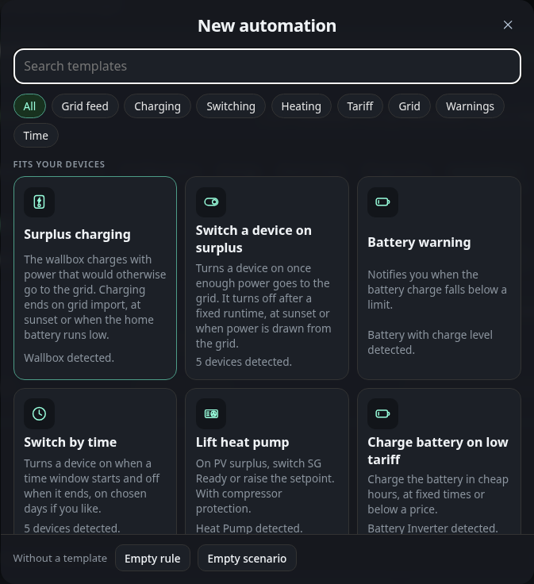

# Automations: Assistant

## Assistant

**Assistant** in the bar above the list opens the assistant. It is the only way to add an entry. It builds a scenario or a rule
from a few questions, so you do not need to know the fields.

Below 900 px wide the assistant opens as a bottom sheet that slides up from the
bottom of the screen. Drag its handle down to close it, or tap the dark area
above it, or press Escape. A drag that stops short springs back. When the
assistant closes, the focus returns to the **Assistant** button.

The first page is the gallery. A search field matches the title, the text and
the keywords of each template. Category buttons narrow the list to **Charging**,
**Grid feed**, **Grid**, **Heating**, **Switching**, **Tariff**, **Time** or
**Warnings**. Templates that fit your
devices show as tiles on a desktop and as rows on a phone. Templates whose device or battery is missing are listed
under **More templates** with the reason. Under the tiles, **Without a
template** creates an empty rule or an empty scenario.

A template then asks its steps one at a time. Each step has a device choice,
a set of cards or tiles, a number or a time window. Options that do not apply,
for example the sun option without a known location, are greyed out with the
reason. The dots at the top show your place. **Back** returns to the previous
step or to the gallery, and **Next** is enabled once the step has an answer.

The step **How tight should it regulate?** of the zero feed template shows the
target as a window on the grid axis. Drag the window to move the target, tap
the axis to jump there, or use the arrow keys (5 W, with Shift 20 W). The three
cards **Careful**, **Balanced** and **Tight** set +60, +30 and +10 W. The
switch **Adjust tolerance** adds a handle on each edge of the window, so the
tolerance can be dragged between 5 and 60 W. Switched off, the tolerance is
20 W. The bars show how yesterday's grid power was spread around the target,
and three figures show how much would have been fed in and drawn yesterday and
how often the regulator would have adjusted per hour. Without history from
yesterday the figures are left out and only the axis and the window remain.

The last page is the summary. It lists the answers as plain sentences grouped
by phase: **When**, **Running**, **Ends**, **On start**, **On end** and
**Then**. Each row has a **change** button that jumps back to the step that
sets it. **Create** adds the entry.

The new entry lands in its list, expanded and in edit mode, switched on and
marked as new. It is not saved yet. The page counts it as an unsaved change
until you save the document. A bar shows **Scenario added** or **Rule added**
with an **Undo** button for 10 seconds, as in [Undo](automations.md#undo). If the list is
full, the summary shows a note and **Create** is disabled.

The templates are these. The phases describe what the entry does in words.

| Template | Category | Creates | Phases |
|---|---|---|---|
| Zero feed-in | Grid feed | A scenario that limits an inverter so that no power is fed in. The regulator keeps a small grid import of 10, 30 or 60 W as a buffer. The period is the sun window, always, or a time window with weekdays. The regulator measures the inverter's own reading, the house grid balance or the last setpoint sent. | When the period starts. Running: the setpoint follows the measured value. Ends: with the period, the limit returns to its maximum if the reset option is on. A notification at the start is optional. |
| Surplus charging | Charging | A scenario that regulates a wallbox with the surplus. It starts when feed-in stays above 1400, 2000 or 3000 W for 3 minutes. The vehicle must be plugged in if that option is on. | When feed-in stays above the chosen power. Running: the charging power follows the surplus, at least the minimum of the wallbox. Ends: with one of three end conditions that you choose, sunset, a charge level below a limit between 10 and 90 %, or grid import above 200 W for 5 minutes. On start the switch of the wallbox turns on, on end it turns off or the power drops back to the minimum. |
| Switch a device on surplus | Switching | A scenario that switches a device on when feed-in is at least 1000, 1500 or 2500 W for 2 minutes. Optionally it stays on by repeating the switch command each minute, and it applies only on chosen weekdays. | When feed-in is high enough. Running: the device stays on while the condition holds, if repeat is on. Ends: after a fixed runtime of 10 to 600 minutes, at sunset, or when grid import stays above 100 W for 2 minutes. On end the device turns off. |
| Battery warning | Warnings | A rule that sends a notification when the charge level falls below 10, 20 or 30 %. You choose the severity info, warning or critical. It fires at most once an hour. | When the charge level falls below the limit. Then: a notification with the chosen severity appears. |
| Switch by time | Time | A scenario that switches a device on for a daily time window, by default 11:00 to 15:00, optionally on chosen weekdays. | When the window starts. Ends: when the window ends, the device turns off. |
| Lift heat pump | Heating | A scenario that lifts a heat pump when feed-in stays above 1500, 2500 or 3500 W. It switches the SG Ready contact or raises the setpoint by 1 to 10 K, and it restores the old setpoint at the end. The minimum run time and the pause protect the compressor. | When feed-in stays above the chosen power for 5 minutes, and the battery is above its charge level if that option is on. Running: the heat pump is lifted. Ends: when feed-in stays below 40 % of the start power for 10 minutes. Then the contact goes off or the setpoint goes back, and the pause starts. |
| Charge battery on low tariff | Tariff | A scenario that charges the battery at a chosen power up to a target charge level. It runs in a fixed night window or while the price is below a threshold of 10, 15 or 20 ct/kWh. Discharging can be blocked during the charge when the battery has a discharge limit. | When the window starts or the price falls below the threshold. Running: the battery charges at the chosen power until the target. Ends: when the window ends or the price rises above the threshold, and the power returns to automatic. |
| Cap grid import | Grid | A scenario that keeps the grid import just below a limit of 11, 16 or 25 kW by throttling a wallbox. | When the import stays above the limit minus 500 W for 10 seconds. Running: the wallbox follows the limit minus 500 W. Ends: when the import stays below the limit minus 1500 W for 10 minutes, and the wallbox returns to its maximum. |
| Control signal per §14a | Grid | A scenario that answers a control signal of the grid operator. Heat pumps and wallboxes go to a chosen power, 4.2 kW by default, and return afterwards. | When the input of the control box shows its on value. Running: each chosen device goes to the chosen power. Ends: every device goes back to its maximum. |
| Heating rod with surplus | Heating | A scenario that uses the surplus for a stepless heating rod. The rod takes the surplus and holds the grid export in a chosen band. | When the export stays above 100 W for one minute and the temperature is below the chosen maximum. Running: the rod follows the surplus. Ends: when the import stays above 100 W for 10 minutes, and the rod goes to its minimum power. |
| PV yield missing | Warnings | A rule that warns when an inverter reports too little power during the day. | When the reading stays below a limit of 5 to 200 W for 10 to 120 minutes, between one hour after sunrise and one hour before sunset. Then a notification appears, at most once in six hours. |
| Charge battery to full once a month | Charging | A scenario that charges the battery to 100 % on one day of the month, from 1 to 28. The day runs from midnight to midnight. You choose whether surplus is enough or the battery may also charge from the grid. | When the chosen day of the month starts, the charge level is below 100 %, and with the surplus option the feed-in stays above 200 W for one minute. Running: the charging power goes to the maximum of the battery. Ends: when the battery is full or the day is over. Then the charging power returns to the value it had before. |
| Inverter stops reporting | Warnings | A rule that warns when an inverter sends no new reading for 5 to 120 minutes. It also applies at night. | When no new reading of the inverter arrives within the chosen minutes. Then a notification appears, and again after 1 to 24 hours at the earliest. |
| Wallbox at low tariff | Tariff | A scenario that charges a wallbox at its maximum power in a fixed window or while the price is below a threshold of 10, 15 or 20 ct/kWh. The vehicle must be plugged in if that option is on. | When the window starts or the price falls below the threshold. Running: the wallbox charges at its maximum power. Ends: when the window ends or the price rises above the threshold, and the wallbox returns to its minimum. |

The energy templates need more than one kind of device. The assistant greys
out a template and names the missing part when a requirement is not met.

- **Lift heat pump** needs a device with the heat pump role on the energy page.
  Assign the role there if the device is not listed. The device needs an SG
  Ready switch, either its own switch or another switch you choose, or a
  writable setpoint. The control step decides which one is used. With the SG
  Ready contact, a contact step follows, and the device's own switch comes
  first and is preselected. The minimum run time and the pause of the heat
  pump are the **Run at least** and **Pause after the end** fields of its
  scenario. The start step shows yesterday's surplus with the start threshold.
- **Charge battery on low tariff** needs a battery with a writable charging
  power. The price comes either from fixed times or from a measured price in
  ct/kWh. A price in €/kWh is converted to ct/kWh. The block option needs a
  discharge limit on the battery. The charge step shows the energy and the
  duration from the capacity of the battery.
- **Cap grid import** needs a wallbox with a writable power. The speed step sets the
  largest change per step, 1000 W for calm and 3000 W for fast.
- **Control signal per §14a** needs an input of the control box with a payload
  that means on, and at least one heat pump with a setpoint or one wallbox with
  a writable power. Devices with another unit than W or A are locked with the
  reason. A current setpoint is calculated for three phases at 230 V, so amps
  are the power in kW times 1000 divided by 690, rounded.
- **Heating rod with surplus** needs a device with a writable power in W or % and a
  temperature sensor. The maximum temperature is checked only at the start of
  a run. During the run the thermostat of the heating rod limits the
  temperature, the dashboard does not. Battery priority needs a state of
  charge.
- **PV yield missing** needs an inverter with its own power reading. The sun
  window needs a location in the settings.
- **Charge battery to full once a month** needs a battery with a writable charging power and a
  charge level. The day is limited to 1 to 28, so every month has it.
- **Inverter stops reporting** needs an inverter with its own reading. The rule uses the
  age of the last message, not its value, so it also warns when the value
  stays the same.
- **Restart option** for **Inverter stops reporting** and **PV yield missing**: the option is always listed and greyed out when no switch exists. With it on, the assistant creates a scenario instead of a rule. On start it sends the notice and switches the chosen switch off, after a pause of 1 to 30 minutes it switches it on again. The inverter's own switch comes first.
- **Wallbox at low tariff** needs a wallbox with a writable power. The price and
  the fixed window work as in **Charge battery on low tariff**.
