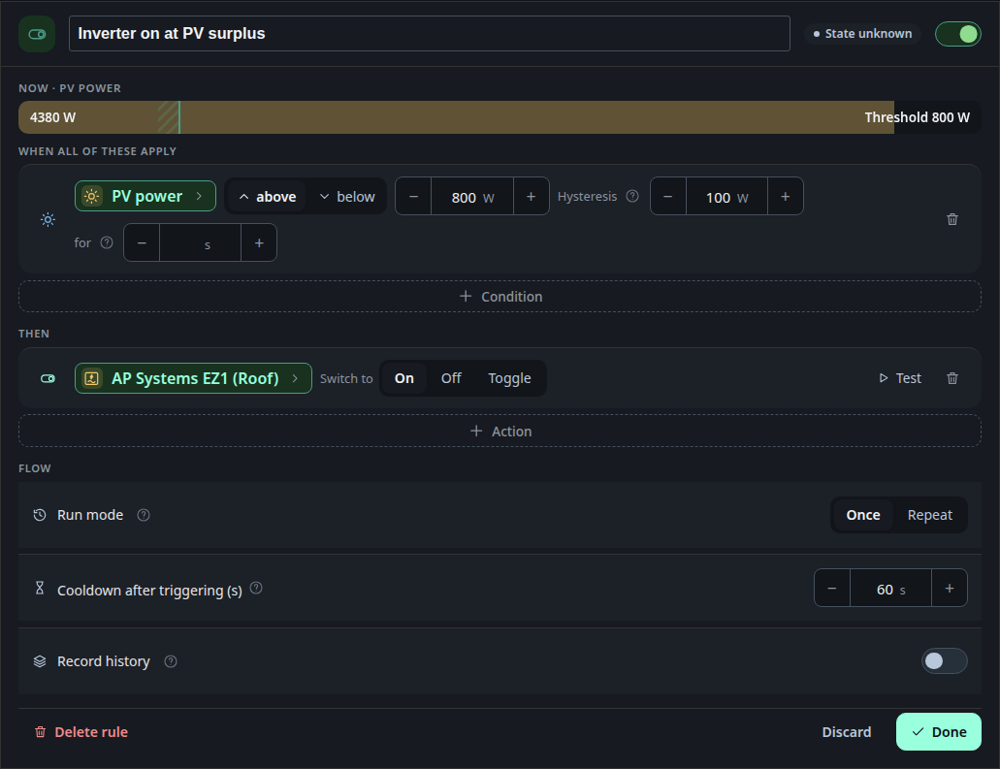

# Automations: Single rules

## Single rules

The **Single rules** tab lists the rules. A collapsed row shows the rule's icon
tile, its name, the device path (the condition icons, an arrow and the action
icons), a status pill, the on/off switch and a chevron. A click on the row
expands it, and the icon tile collapses it again. The switch does not expand
the row.

The expanded card shows the live bars, the three columns **When all of these
apply**, **Then** and **Flow**, and the trigger strip. In the card head,
**Test** runs every action of the rule once, in order. **Edit** opens the
editor. A rule that is being edited shows neither button.

### Rule editor

**Edit** opens the rule as sentence rows on desktop. Each condition and each
action is one row, with its field labels, and the **Flow** column holds the
cooldown, the run mode and **Record history**.

The footer has **Delete rule** on the left, and **Discard** and **Done** on the
right. **Discard** restores the rule as it was when you pressed **Edit**, so
nothing you changed in the editor stays. **Done** keeps the changes and leaves
the editor. Changes are not saved to the device until you save the document.

The rule editor has four parts.

- **When all of these apply** lists the conditions. All of them must hold
  for the rule to trigger. **Above** and **below** carry an up and a down arrow.
  A balance condition shows its **Hysteresis** directly in the card, a new one
  starts with 5 in the unit of its field (5 W for power).
  A time window and a sun window also take **days of the month**, 1 to 31, next to
  the weekdays. Without a chosen day the window applies every day. Like the
  weekdays, the day on which the window starts counts. A condition on an entity
  or a topic has the comparison **no new values**. It is met when the last
  message is older than the minutes you set. If no message has arrived since the
  service started, the time counts from the start of the service.
- **Then** lists the actions that run on a trigger.
- **Flow** sets the **Cooldown after triggering (s)**, the time a rule
  waits after a trigger before it may trigger again, the **Run mode** and
  **Record history**.
- **Repeat** is the **Repeat** segment of the run mode. It shows
  **Every (s) while met**, which makes the rule send its actions again while its
  conditions keep holding. **Once** sends them once per trigger. Repeat must be
  at least the minimum interval for commands (see [Settings](automations.md#settings)). The repeat is off
  for a rule with a toggle action, because every repeat would flip the state back.

### Action cards

Each action is a card with the icon of its kind. **Switch device** under
**+ Action** opens the device picker, a switch starts on On and a setpoint
with the device's current value. An action that sends to the command topic of
a known device shows as **Switch** or **Setpoint** with that device, **MQTT
command** is left for topics without a device. The **Advanced** tiles appear
once **+ Action** is open. **Switch** sets a device to
On, Off or Toggle. **Setpoint** sends a value to an output, and the value can
come from a measurement. **Notify** raises a notification with a level, a title
and a text. **MQTT command** publishes a payload to a topic. The head of a
setpoint card takes the colour of its device's role.

### Reading a rule

The state between conditions and actions shows the rule's current result, for
example **Waiting for hold time**, **Cooldown running** or **Energy balance
stale**. While a hold time or cooldown runs, the remaining time is shown below
it, together with the last trigger and how often the rule has fired.
[How it works](../services/automations-how-it-works.md#1-the-result-of-a-rule)
lists every result. When the service is offline, the state always reads
**Service offline**, because none of the values can be trusted.

Each condition shows one of three states, in a badge next to its line:

| State | Meaning |
|---|---|
| open | The condition is not met. The text beside the badge says why, for example that the threshold is not reached or that there is no value yet. |
| waiting | The condition is met and waits for its hold time. |
| met | The condition is met and its hold time is over. |

The expanded rule card also shows a trigger strip with the last four triggers.
Its time window fits those four triggers and is at least 30 minutes wide. The
strip needs **Record history** to be on for the rule. Otherwise the card says
that history is off for this rule. Above the blocks, each numeric condition has
a live bar with the caption **Now · field**. The value is on the left, the
threshold on the right, and a hatched part marks the hysteresis.

The live values come from the automation service, which evaluates every
`tick_interval_s` (default 10 s). They show what the rule last computed with,
not the newest value the dashboard has elsewhere. The header says how long ago
the service last reported. When it is offline, the page shows the last known
state.

With **Show history** on in the toolbar, each rule with a balance condition shows a
30 minute sparkline under its row. The line is the value of the balance field,
and the dashed line is the threshold. Grid export is shown as positive feed-in.
A rule without readings shows **No readings**. **Show full history** in the
expanded card opens the list of the last triggers of one rule, each marked as
Triggered, Blocked or Error. A trigger from a test carries a Test badge.

### On a phone

Below 900 px wide the toolbar has two rows. The first row switches between
**Scenarios** and **Single rules**. The second row has **Assistant**, **Save**
and a history icon button in place of the **Show history** switch. The button
is pressed while history is on.

A rule row shows its device path and a short status instead of the pill. The
short status is **met**, **not met**, **Cooldown**, **waiting**, **Error** or
**off**. The rule's switch stays at the right. When history is on, the sparkline
sits under the row.

The expanded card ends with a row of **Edit**, **Test** and a trash icon for
**Delete rule**. The editor head stays at the top while you scroll. It shows
the back tile, the name, the switch and one line with the status and the last
trigger. The footer with **Discard** and **Done** stays at the bottom. The
condition cards show their state badge, and the device and value fields take
the full width of the card.

## Testing an action

**Test now** on an action runs exactly that action at once, without checking
conditions, hold time or cooldown. For a publish action the dashboard first
shows the topic and payload that would be sent and asks for confirmation. The
result appears as a message: published, blocked with the reason, or failed.

- The test always uses the saved rule. With unsaved changes, save first.
- A test works on a disabled rule too.
- A test does not start the cooldown and does not count as a trigger.
- `publish_allowed_prefixes` applies to tests just as to real triggers.
- The button needs the `automations` role and a reachable service.

## Rules that refer to entities

When you pick an entity, the editor copies its topic (and for conditions its
value template) into the rule. The service works with that copy and never looks
at the device registry. If the entity changes later, for example because a
device was discovered again with a new topic, the editor shows a note with the
current topic. Conditions offer **Apply** to take it over. Nothing is updated
automatically, so a rule never points at a different device without you
noticing. If the entity is no longer in the registry at all, the rule keeps
running with the saved topic.

## Where a switch came from

The learning features record where each switching command comes from. The
dashboard tells a rule from a hand switch and from an outside change. A switch
that follows a rule is recognised by the automation state document, which
counts the firings of each rule in `fire_count` and records the time of the last
one in `fired_at`. A command sent through the dashboard is a hand switch, and
everything else counts as outside. The daily profiles hold these origins in
15 minute steps and are kept for 56 days by default, see
[Recording](settings.md#recording). Nothing changes a rule by itself. Learned
patterns only appear as suggestions.

## Suggestions

The band above the list shows suggestions that come from how your devices are
used. Each one is a pattern that the node found in the daily profiles: a device
you switch at about the same time each day, a run that often lasts far longer
than usual, or a device that another device follows. The band only suggests.
A rule changes only when you create or edit it yourself.

The band needs **Learn patterns** to be on in the
[learning settings](settings.md#learning-features). With it off, the band is
hidden. With **Habits** off, the band stays empty.

### Learning phase

While the node is still learning, the band reads **Learning for N days from M
devices** and shows no cards. A new installation needs at least 10 days before
the first card can appear. Each kind of pattern needs its own minimum:

| Pattern | Needs |
|---|---|
| Switching time | The device is switched by hand at about the same time on 10 days. |
| Run time | 10 runs, two of them far longer than usual. |
| Follows another device | 10 switchings of the first device, and the second device follows in most of them. |

### Cards

A card shows the kind of pattern, the device and a tag, **Sure** or **Estimate**.
**Sure** means the pattern is clear. **Estimate** means it is likely, but the
data is still thin. The card also shows the weeks it applies to, or **Applies
all year**. Below the title, a graphic shows what happened and what the
suggestion would change, together with the facts behind it.

The numbers on a card stay the same until they change clearly, so the card does
not jump around from one minute to the next. The band shows three suggestions.
**+N** shows the rest, up to 20 in total. A suggestion is not shown when it would
save very little, or when it would duplicate or contradict a rule you already
have.

### What you can do

- **Open in assistant** opens the assistant with the matching template filled
  in. Nothing is saved until you press **Create** on the summary page. The
  button only appears when a template fits, see [Templates](automations-templates.md).
- **Later** hides the suggestion for seven days.
- **Do not suggest again** hides the suggestion for good.

After **Later** or **Do not suggest again**, the band shows **Suggestion hidden**
with an **Undo** button for six seconds. After that the suggestion stays hidden.

### Rules stay yours

The system never changes a rule by itself, not even when you accept a
suggestion. Accepting only opens the assistant. The rule is added when you
create it there, and it is saved with the rest of the document.

## Rule check

The rule check reads all rules and reports findings where a rule cannot work as
you probably intend. It runs on the dashboard and never changes a rule by
itself. Only you change a rule, in the editor, and it takes effect when you
save the document as usual.

### What is checked

The check reports eleven kinds of findings. Each one names the rules involved.

| Finding | What it means | Based on |
|---|---|---|
| Competes with a regulator | The rule publishes to the topic of an enabled scenario regulator, so the device gets two commands in turn. | Rules and scenarios |
| Contradicts another rule | Two rules have the same conditions but send different commands to the same topic. | Rules |
| Duplicate | Two rules do exactly the same. One of the two is enough. | Rules |
| Can never be met | The conditions rule each other out, for example above 500 W and below 300 W on the same value. | Rules |
| Device missing | The rule uses an entity that is no longer in the device registry. | Rules and registry |
| Triggers very often | The rule fired at least 12 times within one hour of the last 24 hours. | Observed triggers |
| Never triggers | An enabled rule did not fire for 14 days, although it has been known for 14 days and its value has been seen on 7 days. | Observed triggers and values |
| Flapping | Two rules switch the same device back and forth faster than the device tolerates. | Rules and observed switching |
| No effect | A rule sends its command, but the device does not change in several cases. | Rules and observed switching |
| Often overridden | The device is switched back by hand or from outside soon after the rule switched it. | Rules and observed switching |
| Runs while offline | The start of the rule's time window falls into the usual offline time of the device. | Rules and observed switching |

A threshold that was reached in earlier months of the last year does not count
as a fault. Such a rule gets the note **Resting for the season** instead, which
is only information and has no fix.

The observed checks need data. A new installation has no history yet, so
**Triggers very often**, **Never triggers** and the reliability checks stay
silent until enough is recorded. The reliability checks need:

- **Flapping**: three changes between the two rules, over at least one day.
- **No effect**: three commands without effect.
- **Often overridden**: five switches set back within the time limit.
- **Runs while offline**: 14 days of data.

The check lists at most 20 findings, the most severe first.

### Fixes of the reliability findings

The four reliability findings follow the **Reliability** switch in the
[learning settings](settings.md#learning-features). With the switch off they do
not appear.

- **Flapping** offers **Set a minimum runtime**. It sets the hold time of the
  first condition of the rule that switches the device off. The hold time is the
  longer of the device's minimum runtime and three times the switching period.
  The minimum runtime is 10 minutes for a heat pump, 3 minutes for a wallbox,
  2 minutes for other switchable devices and none for lights.
- **No effect** reads the cause from the failed commands. When the device could
  not be reached at those times, or the failures bunch up at one time of day,
  only **Open rule** is offered. When the failures are spread over the day,
  **Merge as a repeat** sets a repeat every 60 seconds, so the command is sent
  again while the rule's conditions hold.
- **Often overridden** offers **Add a condition** when a time of day, a day
  type, the house load or the surplus separates the switches that were set back
  from the accepted ones. Otherwise it offers **Shift the time window**, which
  moves the start of the window to the usual time of the switch back.
- **Runs while offline** offers **Move before the outage**. It moves the start
  of the time window 5 minutes before the usual offline time of the device.

Each fix changes only the draft in the browser, as described above.

### The mark and the popover

A rule with open findings shows a mark at its head, labelled **Show the finding
for this rule**. A click opens a popover with:

- the cause, as a title and a sentence, with the facts behind it,
- a before and after graphic that shows the recorded triggers or values next to
  the threshold, where the finding has such evidence,
- one or two prepared fixes as buttons, for example **Hysteresis 100 W**,
  **Cooldown 10 minutes**, **Threshold to 350** or **Turn this rule off**. A
  finding without a prepared fix offers **Open rule** only.

A fix changes only the draft in the browser. It opens the rule in the editor, and
the change reaches the device when you save the document, as with any other
edit. The system never saves a fix on its own.

### Ignoring a finding

**Ignore** hides a finding. The page then shows **Finding hidden** with an undo
button, which shows the finding again. Hidden findings stay hidden after a
reload. A finding of a rule that no longer exists is removed from the list of
hidden findings automatically. Ignoring needs the automations role.

### The dot on the Automations tab

While findings are open, the **Automations** tab shows a dot. The dot goes away
when no open finding is left, either because you fixed the rules or because you
ignored the findings.

### Where the data is stored

The check keeps its observations in `<dataDir>/autolearn/checks.json` and the
hidden findings in `<dataDir>/autolearn/ignored.json`. Both files belong to the
history part of a backup. The endpoints are described in the
[dashboard API](../developing/api-data.md).
