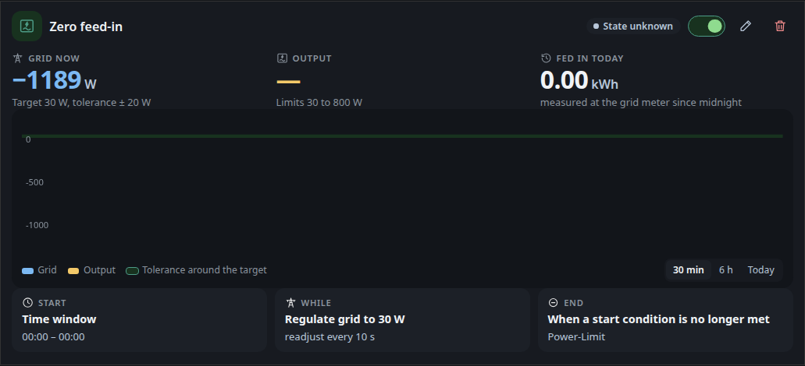

# Automations: Scenarios

## Scenarios

A scenario has three phases. **Start** holds the conditions that begin it,
**While** is what happens during the scenario, and **End** holds the actions
that run when it stops. The usual use is a regulator that keeps the grid
balance near a target by adjusting one output, for example an inverter.

### The scenario card

A collapsed card shows the scenario icon, its name, a short status line, a
status pill and an on/off switch. While the start conditions are not yet met,
a thin bar under the name shows how close the first balance threshold is to
its limit, with the current value and the limit in W.

A click on the card expands it. The icon tile collapses it again, outside the
editor a click on the name does the same. Expanding the card shows the figures,
the chart and the phase bar. The status
pill shows the current state of the scenario:

| Pill | Meaning |
|---|---|
| Off | The scenario is switched off. |
| Waiting | At least one start condition is not met yet. |
| Ready | All start conditions are met and the hold time runs. The line below tells how long until the start. |
| Running since (time) | The start conditions hold and the scenario is active. |
| Regulating since (time) | The scenario regulates the grid to its target. |
| Fallback value | The regulator cannot calculate and sends its fallback value. The line below names the reason, either a stale balance or a missing measurement. |
| Service offline | The automation service does not answer. |
| State unknown | The service has not reported this scenario yet. |

For a regulating scenario the card shows three figures. **Grid now** is the
current grid balance against the target, with the tolerance band around it.
**Output** is the value the regulator sends, with its minimum and maximum.
**Fed in today** is the energy measured at the grid meter since midnight.

The chart plots the grid balance and the output over the selected period. The
periods are **30 min**, **6 h** and **Today**, which starts at midnight. The
shaded band marks the tolerance around the target. The grid and output
series come from the history kept in this browser, which the history recorder
fills, and the chart adds the newest values while the page is open. The
dashboard also samples these two series on the server once a minute for the
history exchange with other devices. The chart on this page does not read
that buffer.

The phase bar shows Start, While and End side by side, each with its condition
or action in short text. The phase that is running is highlighted. The While
phase is highlighted while the scenario runs or falls back, and the End phase
for one minute after it has stopped.

### Editing a scenario

The pencil button on an expanded card opens the editor. It has three phases.

- **Start** lists the start conditions and the actions that run at the start.
  Each phase takes the same condition and action rows as a single rule.
- **While** selects what happens during the scenario: **Regulate**, **Hold**
  or **Nothing**. Changing the mode discards the content of the previous mode.
- **End** runs the end actions. With **Own end condition** switched off, the
  scenario ends as soon as its start conditions are no longer met. With the
  switch on, its own conditions decide when it ends.

Two more fields sit in the End phase. **Run at least** keeps the scenario
running for this many minutes, even if its end condition is met sooner.
Switching the scenario off and the maximum run time still end it at once. Empty
means no minimum. **Pause after the end** blocks a new start for this many
minutes after the scenario has ended, even if its start conditions hold again.
Empty means no pause.

For **Regulate** the form asks for the following values. Each field has a help
text next to it.

- **Target in W**, the grid balance to hold, positive for import and negative
  for export.
- **Deadband in W**, the range around the target where the output stays
  unchanged.
- **Output**, the device output the regulator writes to.
- **Direction**, either **Throttle inverter** or **Follow consumer**.
- **Measured value**, which can be a **Device** meter, the **Balance** or the
  **Last value**.

A band preview under the target shows the tolerance band and the current grid
balance. It states whether the grid is inside or outside the band, or that the
grid value is not known yet.

Under **Fine tuning** you find **Gain**, **Minimum in W**, **Maximum in W**,
**Step size in W**, **Max. change per step in W**, **Interval in s** and
**Fallback value**. An empty interval uses the regulator interval from the
settings (see [Settings](automations.md#settings)).

Each fine tuning field shows its default as a grey placeholder. A default is
not saved, so the field stays empty and keeps following the default. A stepper
on an empty field starts from the default.

For **Hold** the phase sends its actions again every **Repeat every (s)**
seconds, 60 by default, while the scenario is active.

**Record history** at the bottom of the editor stores the scenario's own
history, as for single rules.

The start phase needs at least one condition, and each phase takes at most 8
conditions or actions. The dashboard checks the scenario before saving and names the problem in a message. Examples are a
regulator without an output, an output that another scenario already uses, a
minimum above the maximum, a gain outside 0.1 to 1, an inverter without a
fallback value, or a repeat that is shorter than the minimum interval for
commands.
