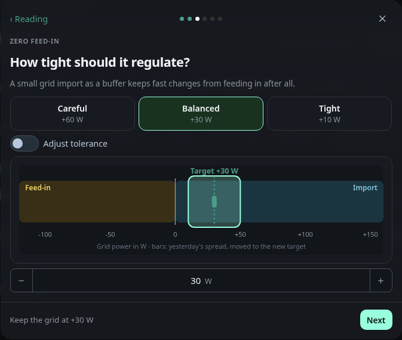
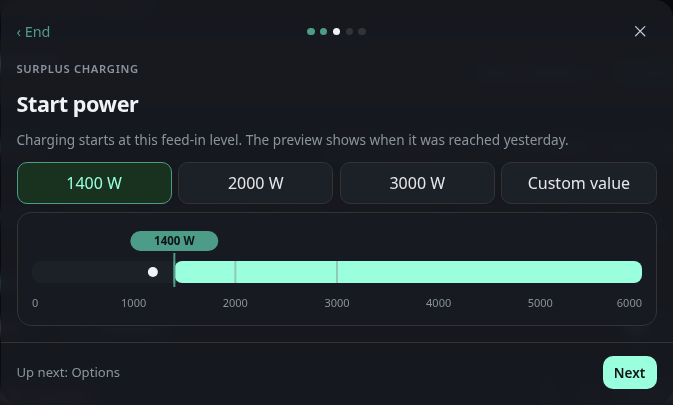
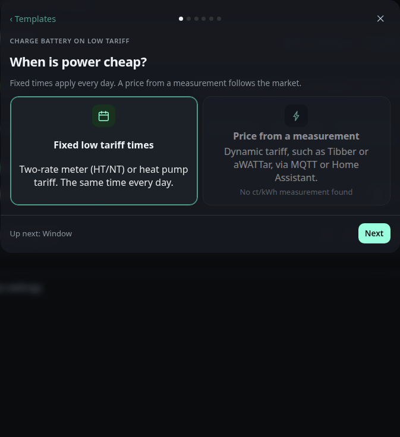

# Automations: Templates

The assistant offers these templates. Each one asks a few questions and creates a scenario or a rule.
How the assistant works is described on [Assistant](automations-assistant.md).

## Zero feed-in

Limits an inverter so that no power is fed in. The regulator keeps a small grid import as a buffer.

### Category

Grid feed

### Creates

Scenario

### Phases

When the period starts. Running: the setpoint follows the measured value. Ends: with the period, the limit returns to its maximum if the reset option is on. A notification at the start is optional.

### Options

- Buffer: 10, 30 or 60 W
- Period: the sun window, always, or a time window with weekdays
- Measured value: the inverter's own reading, the house grid balance or the last setpoint sent

The step **How tight should it regulate?** of the zero feed template shows the
target as a window on the grid axis. Drag the window to move the target, tap
the axis to jump there, or use the arrow keys (5 W, with Shift 20 W). The three
cards **Careful**, **Balanced** and **Tight** set +60, +30 and +10 W. The
switch **Adjust tolerance** adds a handle on each edge of the window, so the
tolerance can be dragged between 5 and 60 W. Switched off, the tolerance is
20 W. The bars show how yesterday's grid power was spread around the target,
and three figures show how much would have been fed in and drawn yesterday and
how often the regulator would have adjusted per hour. Without history from
yesterday the figures are left out and only the axis and the window remain.

## Surplus charging

Regulates a wallbox with the surplus. Charging starts when feed-in stays above the chosen power.

### Category

Charging

### Creates

Scenario

### Phases

When feed-in stays above the chosen power. Running: the charging power follows the surplus, at least the minimum of the wallbox. Ends: with one of three end conditions that you choose, sunset, a charge level below a limit between 10 and 90 %, or grid import above 200 W for 5 minutes. On start the switch of the wallbox turns on, on end it turns off or the power drops back to the minimum.

### Options

- Start power: 1400, 2000 or 3000 W for 3 minutes
- Plugged-in vehicle: required, if the option is on

## Switch a device on surplus

Switches a device on when feed-in is high enough. It can stay on by repeating the switch command, and it can apply only on chosen weekdays.

### Category

Switching

### Creates

Scenario

### Phases

When feed-in is high enough. Running: the device stays on while the condition holds, if repeat is on. Ends: after a fixed runtime of 10 to 600 minutes, at sunset, or when grid import stays above 100 W for 2 minutes. On end the device turns off.

### Options

- Feed-in: 1000, 1500 or 2500 W for 2 minutes
- Repeat: the switch command each minute, optional
- Weekdays: chosen weekdays, optional

## Battery warning

Sends a notification when the charge level of the battery falls below the limit. It fires at most once an hour.

### Category

Warnings

### Creates

Rule

### Phases

When the charge level falls below the limit. Then: a notification with the chosen severity appears.

### Options

- Charge level: below 10, 20 or 30 %
- Severity: info, warning or critical

## Switch by time

Switches a device on for a daily time window. The window can be limited to chosen weekdays.

### Category

Time

### Creates

Scenario

### Phases

When the window starts. Ends: when the window ends, the device turns off.

### Options

- Time window: daily, by default 11:00 to 15:00
- Weekdays: chosen weekdays, optional

## Lift heat pump

Lifts a heat pump when feed-in stays high. It switches the SG Ready contact or raises the setpoint, and it restores the old setpoint at the end. The minimum run time and the pause protect the compressor.

### Category

Heating

### Creates

Scenario

### Phases

When feed-in stays above the chosen power for 5 minutes, and the battery is above its charge level if that option is on. Running: the heat pump is lifted. Ends: when feed-in stays below 40 % of the start power for 10 minutes. Then the contact goes off or the setpoint goes back, and the pause starts.

### Requirements

Needs a device with the heat pump role on the energy page. Assign the role there if the device is not listed. The device needs an SG Ready switch, either its own switch or another switch you choose, or a writable setpoint. The control step decides which one is used. With the SG Ready contact, a contact step follows, and the device's own switch comes first and is preselected. The minimum run time and the pause of the heat pump are the **Run at least** and **Pause after the end** fields of its scenario. The start step shows yesterday's surplus with the start threshold.

### Options

- Feed-in: 1500, 2500 or 3500 W
- Method: the SG Ready contact, or the setpoint raised by 1 to 10 K

## Charge battery on low tariff

Charges the battery at a chosen power up to a target charge level. It runs in a fixed night window or while the price is low. Discharging can be blocked during the charge.

### Category

Tariff

### Creates

Scenario

### Phases

When the window starts or the price falls below the threshold. Running: the battery charges at the chosen power until the target. Ends: when the window ends or the price rises above the threshold, and the power returns to automatic.

### Requirements

Needs a battery with a writable charging power. The price comes either from fixed times or from a measured price in ct/kWh. A price in €/kWh is converted to ct/kWh. The block option needs a discharge limit on the battery. The charge step shows the energy and the duration from the capacity of the battery.

### Options

- Run: a fixed night window, or the price is below a threshold of 10, 15 or 20 ct/kWh
- Power: chosen, up to a target charge level
- Block discharging: only when the battery has a discharge limit

## Cap grid import

Keeps the grid import just below a limit by throttling a wallbox.

### Category

Grid

### Creates

Scenario

### Phases

When the import stays above the limit minus 500 W for 10 seconds. Running: the wallbox follows the limit minus 500 W. Ends: when the import stays below the limit minus 1500 W for 10 minutes, and the wallbox returns to its maximum.

### Requirements

Needs a wallbox with a writable power. The speed step sets the largest change per step, 1000 W for calm and 3000 W for fast.

### Options

- Limit: 11, 16 or 25 kW

## Control signal per §14a

Answers a control signal of the grid operator. Heat pumps and wallboxes go to a chosen power and return afterwards.

### Category

Grid

### Creates

Scenario

### Phases

When the input of the control box shows its on value. Running: each chosen device goes to the chosen power. Ends: every device goes back to its maximum.

### Requirements

Needs an input of the control box with a payload that means on, and at least one heat pump with a setpoint or one wallbox with a writable power. Devices with another unit than W or A are locked with the reason. A current setpoint is calculated for three phases at 230 V, so amps are the power in kW times 1000 divided by 690, rounded.

### Options

- Chosen power: 4.2 kW by default

## Heating rod with surplus

Uses the surplus for a stepless heating rod. The rod takes the surplus and holds the grid export in a chosen band.

### Category

Heating

### Creates

Scenario

### Phases

When the export stays above 100 W for one minute and the temperature is below the chosen maximum. Running: the rod follows the surplus. Ends: when the import stays above 100 W for 10 minutes, and the rod goes to its minimum power.

### Requirements

Needs a device with a writable power in W or % and a temperature sensor. The maximum temperature is checked only at the start of a run. During the run the thermostat of the heating rod limits the temperature, the dashboard does not. Battery priority needs a state of charge.

### Options

- Grid export band: chosen

## PV yield missing

Warns when an inverter reports too little power during the day.

### Category

Warnings

### Creates

Rule, or a scenario with the restart option

### Phases

When the reading stays below a limit of 5 to 200 W for 10 to 120 minutes, between one hour after sunrise and one hour before sunset. Then a notification appears, at most once in six hours.

### Requirements

Needs an inverter with its own power reading. The sun window needs a location in the settings.

### Options

- Restart option: the switch goes off, then on again after a pause of 1 to 30 minutes, greyed out when no switch exists. The inverter's own switch comes first.

## Charge battery to full once a month

Charges the battery to 100 % on one day of the month. The day runs from midnight to midnight.

### Category

Charging

### Creates

Scenario

### Phases

When the chosen day of the month starts, the charge level is below 100 %, and with the surplus option the feed-in stays above 200 W for one minute. Running: the charging power goes to the maximum of the battery. Ends: when the battery is full or the day is over. Then the charging power returns to the value it had before.

### Requirements

Needs a battery with a writable charging power and a charge level. The day is limited to 1 to 28, so every month has it.

### Options

- Day of the month: 1 to 28
- Source: surplus is enough, or the battery may also charge from the grid

## Inverter stops reporting

Warns when an inverter sends no new reading for a while. It also applies at night.

### Category

Warnings

### Creates

Rule, or a scenario with the restart option

### Phases

When no new reading of the inverter arrives within the chosen minutes. Then a notification appears, and again after 1 to 24 hours at the earliest.

### Requirements

Needs an inverter with its own reading. The rule uses the age of the last message, not its value, so it also warns when the value stays the same.

### Options

- Time without a new reading: 5 to 120 minutes
- Restart option: the switch goes off, then on again after a pause of 1 to 30 minutes, greyed out when no switch exists. The inverter's own switch comes first.

## Wallbox at low tariff

Charges a wallbox at its maximum power in a fixed window or while the price is low.

### Category

Tariff

### Creates

Scenario

### Phases

When the window starts or the price falls below the threshold. Running: the wallbox charges at its maximum power. Ends: when the window ends or the price rises above the threshold, and the wallbox returns to its minimum.

### Requirements

Needs a wallbox with a writable power. The price and the fixed window work as in **Charge battery on low tariff**.

### Options

- Run: a fixed window, or the price is below a threshold of 10, 15 or 20 ct/kWh
- Plugged-in vehicle: required, if the option is on
