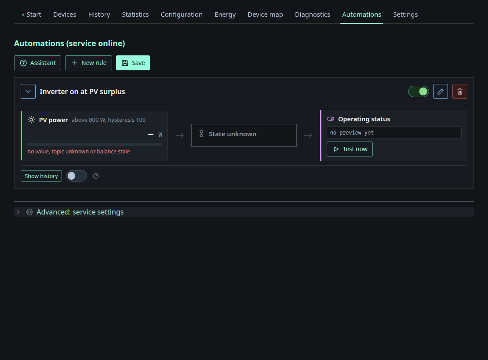

# Automations

This page edits the rules of the separate `automation_mqtt.py` service. A rule
reads from left to right: conditions, then state, then actions. A condition can
be a threshold on a balance field (with hysteresis and hold time), a raw MQTT
topic value, a Home Assistant style entity template or a time window. An action
publishes to a topic or raises a notification.

Besides the built-in balance fields, a threshold can watch any custom category
from the energy page. They are listed under **Custom categories** in the field
selection. A rule whose category was removed shows it as an unknown category
and its condition stays unmet until you pick another field.

The header shows whether the automation service is reachable. In the
screenshot it is offline because the smoke test harness does not start it, so
the rules are drawn from their saved state without live values. The dashboard
never runs rules itself. It only edits the JSON, and the Python service
evaluates the rules and publishes. See
[Device services → Automations](../services/automations.md).

The **Assistant** button walks you through building a rule. **Show history**
lists the last triggers of one rule.

## Reading a rule

The state between conditions and actions shows the rule's current result, for
example **Waiting for hold time**, **Cooldown running** or **Energy balance
stale**. While a hold time or cooldown runs, the remaining time is shown below
it, together with the last trigger and how often the rule has fired.
[How it works](../services/automations-how-it-works.md#1-the-result-of-a-rule)
lists every result. When the service is offline, the state always reads
**Service offline**, because none of the values can be trusted.

Each condition card shows one of four states:

| State | Meaning |
|---|---|
| no value | The topic has never carried a message, or the balance is stale. |
| threshold not reached | There is a value, but the condition is not met. |
| met, hold time left | The condition is met and waits for its hold time. |
| met | The condition is met and its hold time is over. |

The live values come from the automation service, which evaluates every
`tick_interval_s` (default 10 s). They show what the rule last computed with,
not the newest value the dashboard has elsewhere. The header says how long ago
the service last reported. When it is offline, the page shows the last known
state.

## Settings

Two settings on this page set the smallest intervals for commands and
regulators:

- **Minimum interval for commands (s)** (`publish_min_interval_s`, default 30)
  is the shortest cooldown, hold time and repeat interval that a rule with a
  command may have. The default suits a Raspberry Pi 1. Faster hardware can go
  lower.
- **Regulator interval (s)** (`regulator_interval_s`, default 10) is how often a
  regulator adjusts its output, when its scenario sets no interval of its own.
  A regulator never runs faster than the tick interval.

## Saving

**Save** writes all rules and then waits up to 15 seconds for the service to
confirm. **applied** means the new rules are running. **rejected** names the
reason, and the service keeps running the previous rules. **Service not
responding** means no answer came in time, usually because the service is
offline. The rules are saved and take effect once it is back.

The rule file is also listed under [Configuration](configuration.md), with its
revisions and **Restore**. Use the raw JSON there if this page cannot express
something.

## Repeating a rule

**Repeat every (s)** in the rule editor, next to **Cooldown after triggering
(s)**, makes the rule send its actions again while its conditions keep holding.
The value is the interval between the repeats. 0, the default, means once per
trigger. A repeat must be at least the minimum interval for commands (see
Settings). The field is disabled for a rule with a toggle action, because every
repeat would flip the state back.

## Testing an action

**Test now** on an action runs exactly that action at once, without checking
conditions, hold time or cooldown. For a publish action the dashboard first
shows the topic and payload that would be sent and asks for confirmation. The
result appears as a message: published, blocked with the reason, or failed.

- The test always uses the saved rule. With unsaved changes, save first.
- A test works on a disabled rule too.
- A test does not start the cooldown and does not count as a trigger.
- `publish_allowed_prefixes` applies to tests just as to real triggers.
- The button needs the `automations` role and a reachable service.

## Rules that refer to entities

When you pick an entity, the editor copies its topic (and for conditions its
value template) into the rule. The service works with that copy and never looks
at the device registry. If the entity changes later, for example because a
device was discovered again with a new topic, the editor shows a note with the
current topic. Conditions offer **Apply** to take it over. Nothing is updated
automatically, so a rule never points at a different device without you
noticing. If the entity is no longer in the registry at all, the rule keeps
running with the saved topic.
