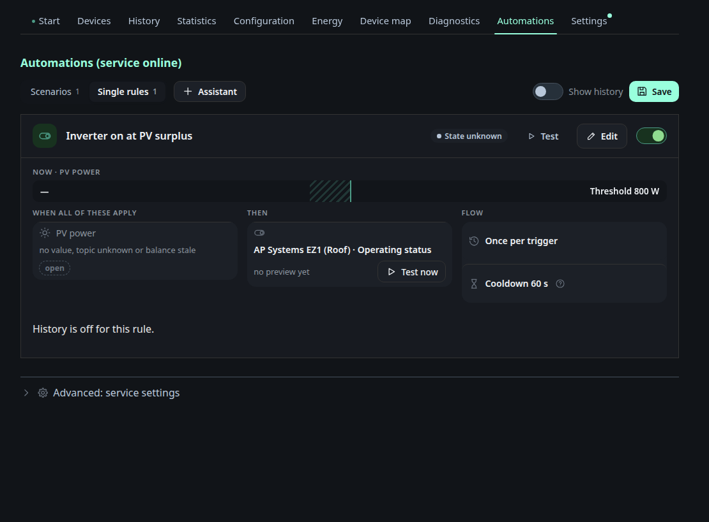

# Automations

This page edits the scenarios and single rules of the separate
`automation_mqtt.py` service. The two tabs, **Scenarios** and **Single rules**,
show the same saved document. A single rule reads from left to right:
conditions, then state, then actions. A condition can be a threshold on a
balance field (with hysteresis and hold time), a raw MQTT topic value, a Home
Assistant style entity template or a time window. An action publishes to a
topic or raises a notification.

Besides the built-in balance fields, a threshold can watch any custom category
from the energy page. They are listed under **Custom categories** in the field
selection. A rule whose category was removed shows it as an unknown category
and its condition stays unmet until you pick another field.

The header shows whether the automation service is reachable. In the
screenshot it is offline because the smoke test harness does not start it, so
the rules are drawn from their saved state without live values. The dashboard
never runs rules itself. It only edits the JSON, and the Python service
evaluates the rules and publishes. See
[Device services → Automations](../services/automations.md).

The page has more detail on three subpages:

- [Assistant](automations-assistant.md): create scenarios and rules from a
  template with a few questions.
- [Scenarios](automations-scenarios.md): the scenario card and the scenario
  editor.
- [Single rules](automations-rules.md): the rule editor, its action cards, how
  to read a rule, the view on a phone, testing an action and rules that refer
  to entities.

## Choosing devices

The editors offer devices in role groups: inverter, wallbox, heat pump, grid and
other. A field shows as many device chips as fit in one row, with the selected
device first. Each chip shows the icon of its role in the colour of that role
and the current value of the entity. **Show all (n)** opens the device picker
with every matching device and its current value. The picker has a search field
and role filter chips. A click on a device selects it, and a double click or
Enter takes it at once. Picking a wallbox or heat pump as the output switches
the regulator to **Follow consumer**, picking an inverter switches it back.

The balance field and the entity of a condition use the same picker. The
selected field or entity shows as a chip with its role icon, **Change** opens
the picker.

## Undo

A new scenario or rule starts switched on and records its history. Adding one
shows a bar above the list for 10 seconds, for
example **Scenario added**, with an **Undo** button. Undo removes the new item
again. The bar disappears on its own after the time runs out, and it does not
touch items that were already there.

## Limits

The dashboard holds at most 16 single rules and 8 scenarios. The add buttons
are disabled once the limit is reached.

## Settings

The settings under **Settings** on this page set the smallest intervals for
commands and regulators:

- **Minimum interval for commands (s)** (`publish_min_interval_s`, default 30)
  is the shortest cooldown, hold time and repeat interval that a rule with a
  command may have. The default suits a Raspberry Pi 1. Faster hardware can go
  lower.
- **Regulator interval (s)** (`regulator_interval_s`, default 10) is how often a
  regulator adjusts its output, when its scenario sets no interval of its own.
  A regulator never runs faster than the tick interval.

## Saving

**Save** writes all rules and scenarios and then waits up to 15 seconds for the
service to confirm. **applied** means the new rules are running. **rejected**
names the reason, and the service keeps running the previous rules. **Service
not responding** means no answer came in time, usually because the service is
offline. The rules are saved and take effect once it is back.

The rule file is also listed under [Configuration](configuration.md), with its
revisions and **Restore**. Use the raw JSON there if this page cannot express
something.
