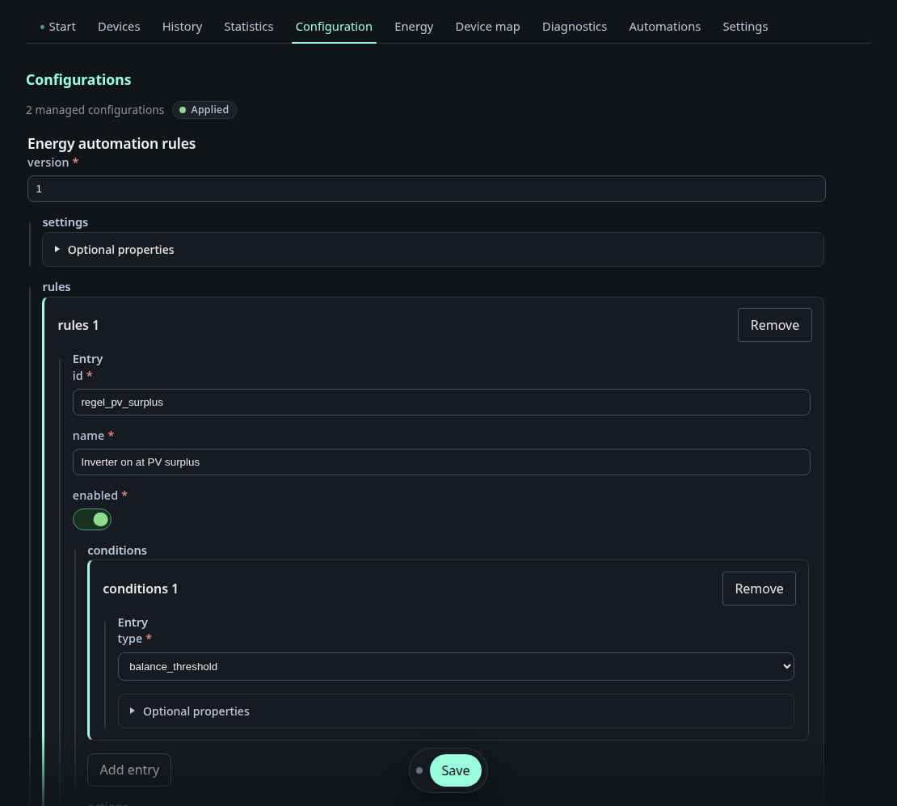

# Configuration editor

This page edits the device JSON files of the Python services, the same
`*_devices.json` files described in [Device services](../services/index.md).
The form is generated from the JSON schema next to each config file, so field
names, help texts, required markers and value ranges all come from one place.

The dropdowns suggest MQTT topics and JSON keys from retained payloads the
broker has actually carried. A topic that has never carried a message says so
instead of offering an empty list. The topics are grouped by the device they
belong to, topics without a known device are listed under *Other*.

Values are validated before anything is written. A value outside the schema's
range is rejected with HTTP 400, so it cannot end up in the file and stop a
service from starting later.

Saving writes the file and asks the owning service to reload it. The dashboard
reports whether the request could be sent. If the service refuses the new file,
it keeps the old one and shows `rejected` in its status, so check the service
after saving. Developers find the details in
[Configuration schemas](../developing/config-schema.md). Editing automation rules also requires the
`automations` role and a CSRF token.
