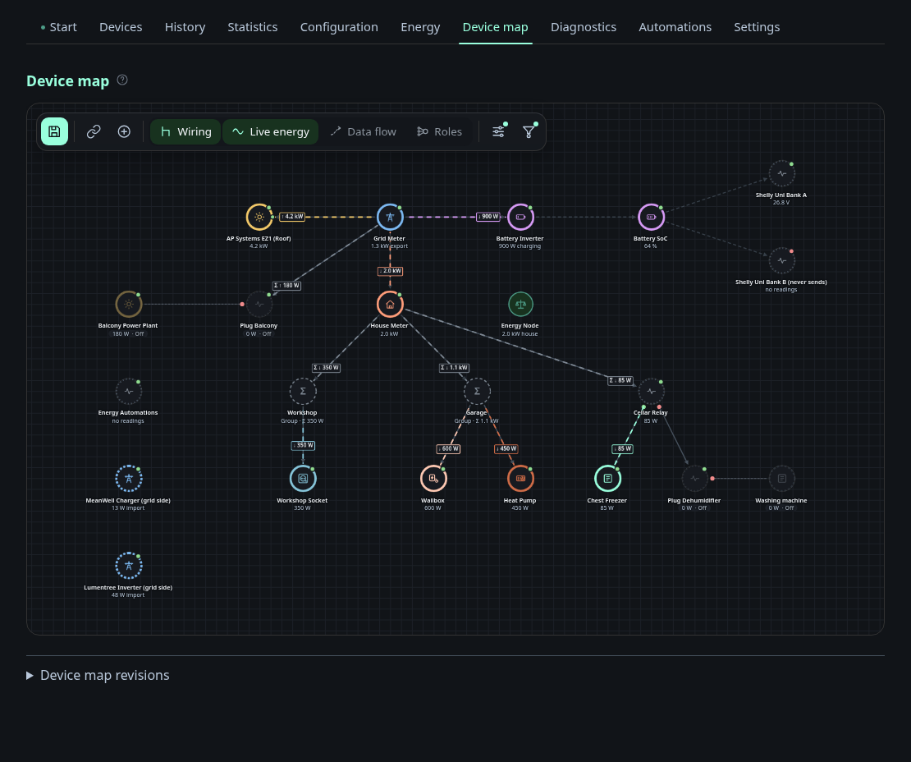
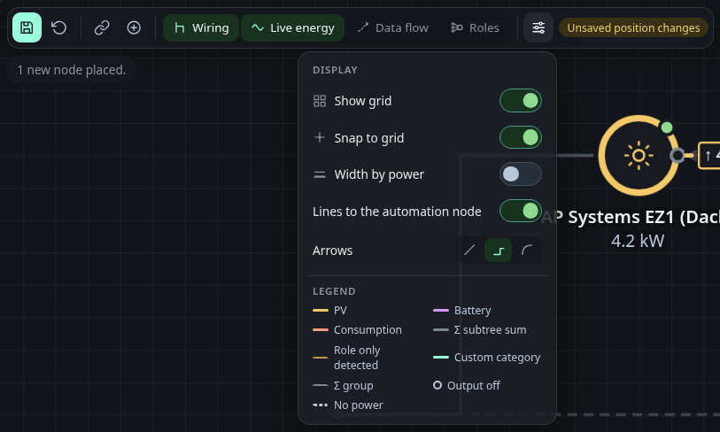
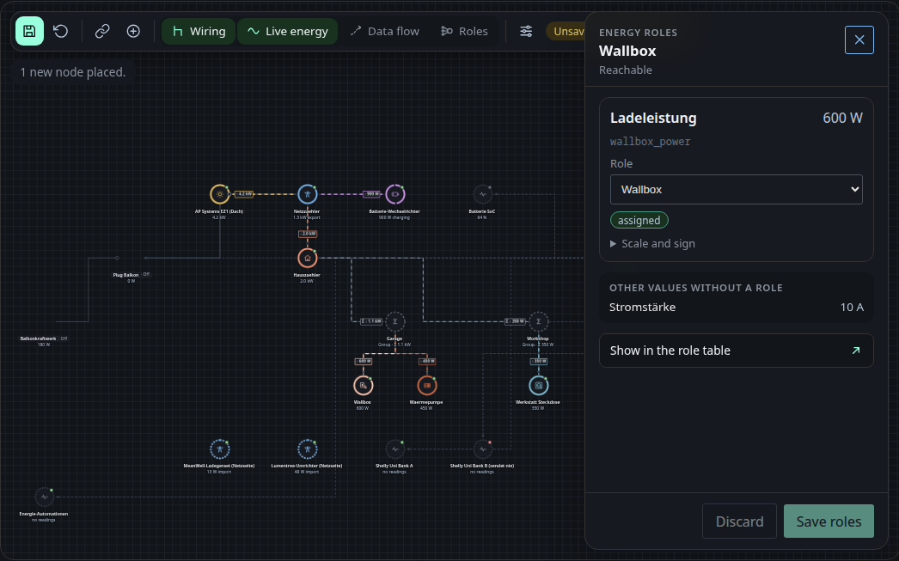
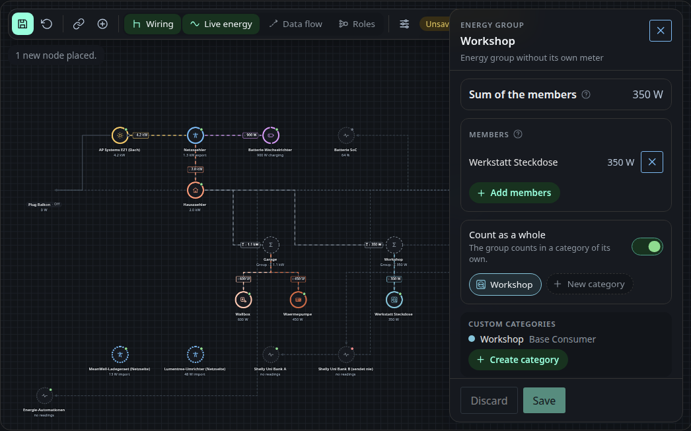
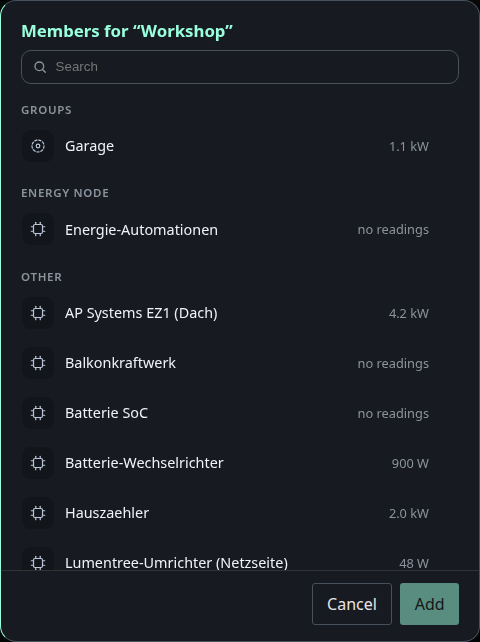
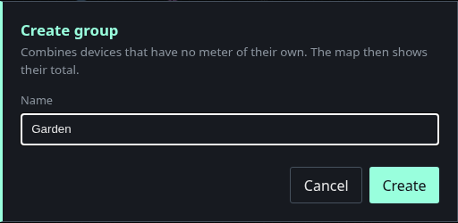
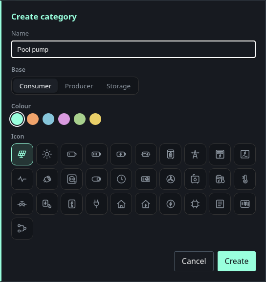
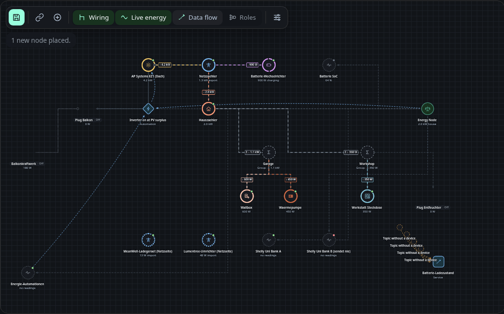
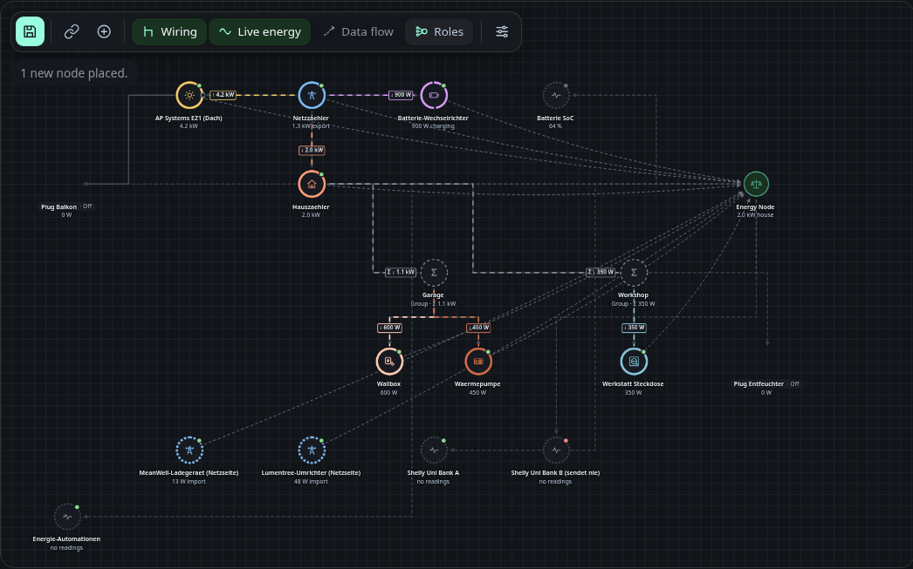
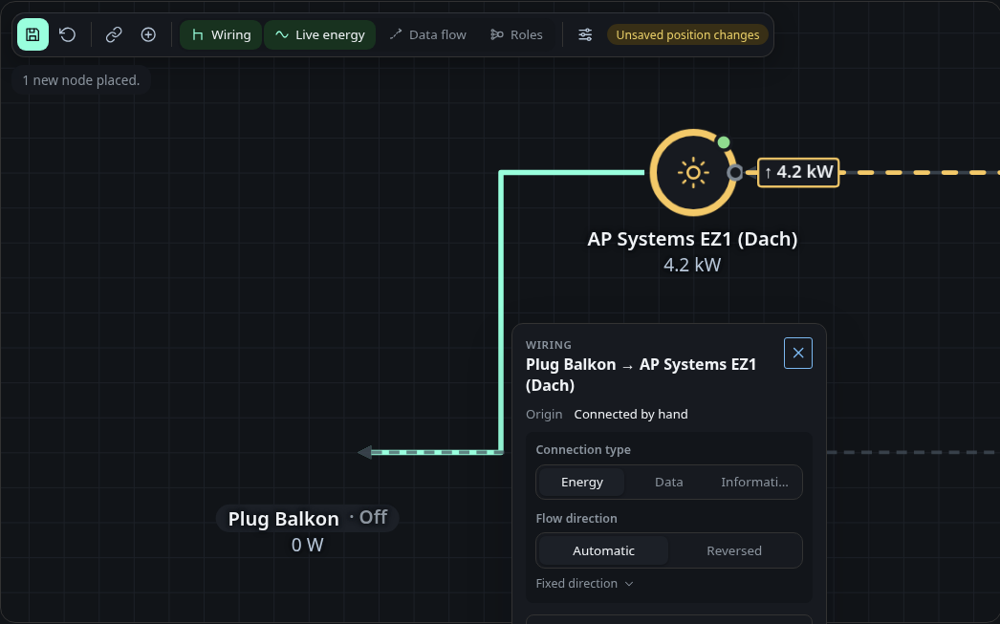

# Device map

The device map shows how the devices are wired, where the energy flows and
which data flows between them. Its layers switch between the wiring, the live
energy, the data flow and the roles. The map uses the same roles, groups and
categories as the Energy tab, so a change on one tab shows up on the other
right away. How to set roles, groups and categories is described on the
[Energy page](energy.md).

A free canvas with all devices. Place the nodes by hand and connect them to
record how the site is wired, such as which meter feeds which sub-distribution.
Positions, connections and layers are versioned, so an accidental drag can be
rolled back.

How to read a node:

- **Ring colour**: the energy roles of the device, one segment per role.
- **Solid ring**: role assigned by you. **Dashed**: only detected. **Grey
  dotted**: no role.
- **Dot top right**: availability, green, amber, red or grey without data.
- **Σ in a dashed circle**: a group, its value is the sum of its members.
- **Moving dashes**: the live flow, faster for more power, with the value at
  the child end.

## Layers and view

| Layer | Shows |
|---|---|
| Wiring | the connections between devices and groups |
| Live energy | roles, values and the moving flow |
| Data flow | topics between devices, services, automation rules and the balance conditions of automations |
| Roles | every device with an energy role, connected to the Energy Node |

The view menu holds the grid, snap to grid, width by power, the line style and
the legend. With reduced motion enabled in the system the lines stand still and
carry an arrow.

## Connection types

Click a connection to set what it stands for:

| Type | Meaning | Flow |
|---|---|---|
| Energy | an electrical line, such as inverter to battery | yes |
| Data | communication through a hub, gateway or service | no |
| Informational | a plain assignment, such as an accessory | no |

Until you choose, the map decides by itself: a connection between two devices
that both measure power counts as energy, every other one as data. Such a
detected type is marked in the card.

For an energy connection the flow direction is automatic by default, taken
from the sign of the measurement. Reversed turns it round. Under Fixed
direction the flow always runs toward one of the two ends, whatever the sign.

A connection you drew yourself can be reversed in the same card, which swaps
parent and child. Connections that come from discovery and feeds into a group
cannot be reversed, but their flow direction can still be set.

## Device panel

Click a device to see the roles of its measurements. A chip tells where each
role comes from: detected, assigned or no role. Changes are drafts until you
save, and the map already follows them. Show in the role table jumps to the
Energy tab.
Entities you hid in the role table on the Energy tab are not listed.

## Group panel

Click a group for its sum, its members and the count as a whole switch. Members
are added with the picker or by hanging a device under the group in connect
mode.

The plus in the toolbar creates a group. New category in a group creates a
category and selects it for that group.

## Data flow layer

Topics as dashed edges from the producer to the receiver. Automation rules are
diamonds, services are squares, and a topic nobody publishes is a stub labelled
Topic without a device. Click an edge or a rule for its details and a link into
the configuration or the Automations tab. How a service declares its topics is
described in [Data flows](../developing/data-flow.md#12-data-flow-on-the-device-map).
The automations device sits under the Energy Node and connects to every rule it runs.
A rule with an energy value condition gets an edge from the balance, so the
value a rule compares against is visible here without the Roles layer.

## Roles layer

The Roles layer connects every device with an energy role to the Energy Node, in
the colour of its role. The Energy Node is the balance itself, the device the
dashboard publishes for Home Assistant, and it shows the net grid power. Without
the Energy Node device, a separate balance node stands in for it.

## Switchable devices

A smart plug or relay can switch its output off. The map shows this when the
Wiring or the Live energy layer is on. Every connection that leaves a switched
device carries a small filled circle where it starts: green when the switch is
on, red when it is off and grey when the state is unknown. When the switch is
off, everything that only gets its power through that connection is dimmed, its
flow stops and its outgoing connections turn dotted. A device whose switches are
all off also gets a grey pill with "Off". A switch without an outgoing
connection keeps its circle on the device itself.

The connection card leads with the state. For a cut connection it shows
"Switched off", the number of devices without power and the switch. Below a cut
connection it shows "No power" and the cause, for example "Plug Balkon is off",
which links to the device.

A switch is an energy role called **Switches**. Set it in the device panel or in
the energy configuration, like any other role. A device with several switches,
such as a two channel relay, gets a channel for each of them. Open the card of
an energy connection and choose the channel it hangs on. Without a choice the
connection uses channel 1. The channel field only appears for devices with more
than one switch.

The map suggests the role for a device that has exactly one switch entity, where
the switch can be commanded, is not a configuration or diagnostic entity and the
device has a power entity in W or kW. The suggestion is marked "detected" until
you save a role. A device that is off is never itself shown as without power,
even if another switched-off device feeds it.

The map only shows the state. To switch a device, use the Devices tab. The link
in the device panel opens it.

## Sub-devices

A sub-device gives a consumer its own name and icon when the consumer has no
connection of its own, such as a washing machine behind a plug. It hangs on one
power measurement of a real device. On the map it gets a node of its own, and
the measuring device becomes the plain link in front of it. The sub-device
changes only the name and the icon. Values, roles, groups and the balance stay
on the measurement, and the sub-device is not sent to Home Assistant.

Each power measurement carries at most one sub-device. A device with several
power measurements, such as a two channel plug, can carry one sub-device per
channel. The measurement must report its power in W or kW.

Manage sub-devices in the device panel of the measuring device or of the
sub-device itself, or in the device dialog on the [Devices](devices.md) tab. A
sub-device can be renamed, given another icon, moved to another power
measurement and deleted. Moving keeps its name, icon and position on the map.
Deleting a sub-device only removes the name, and the measurement reappears under
its own name.

The energy connection from the measuring device to the sub-device is fixed. It
cannot be deleted or reversed, but its channel can be chosen like the channel
of any other energy connection. A sub-device has no further connections.

## Permissions

Changing the map, meaning the positions, the connections, the connection types
and the groups, needs the permission `edit_energy`, the same permission as
changing roles. Until there is a user management every account has it, guests
included.
