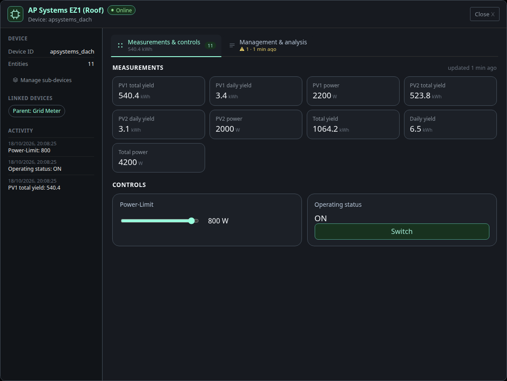
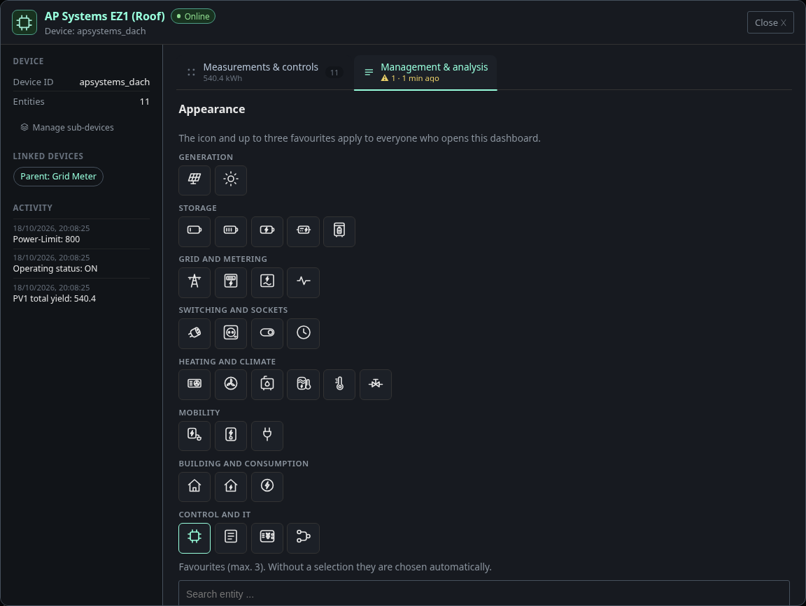
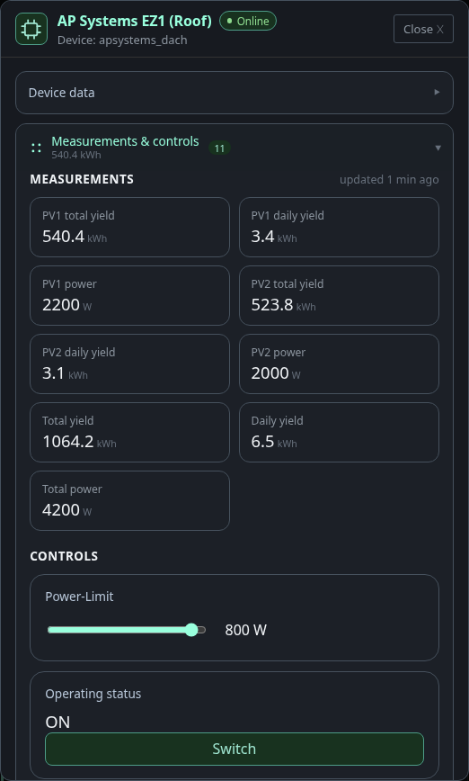

# Device dialog

Every device opens the same dialog, whether you come from the
[device list](devices.md), the overview, the diagnostics page or the
[device map](device-map.md). It shows one device: what it measures, what you
can switch, and where it comes from.

## Header and side column

The header shows the device icon, its name, an online pill and manufacturer and
model. The side column on the left holds the device ID, the number of entities,
the devices it is linked to and the latest activity. A linked device is a chip:
click it to jump to that device. **Manage sub-devices** appears for devices that
measure power, see [sub-devices](device-map.md#sub-devices).

Favourite values, if any are set, are pinned above the tabs so the numbers you
care about are visible without opening anything.

## Measurements and controls

Measurements are shown as tiles with value and unit. Values change live and
count smoothly to the new number. A tile with a warning frame belongs to an
entity that is stale or reports itself unavailable. **updated … ago** tells how
fresh the data is.

Controls sit below, next to each other when there is room: a slider for
numbers, a button for switches, a choice list for selections. Changing a
control sends the command at once. Under the control you see whether the device
confirmed it.

When the dialog is tall enough, measurements and controls share one tab.
Otherwise they get a tab each. Tabs without any entity are not shown. Devices
that expose configuration or diagnostic entities get a **Configuration &
diagnostics** tab: configuration entities can be changed, diagnostic values are
read-only.

Each tab carries a small counter with the number of entities inside.

## Management and analysis

The last tab is for housekeeping:

- **Appearance** sets the device icon and up to three favourites, and whether
  they are pinned to the top of the dialog. Without a choice, favourites are
  picked automatically. The settings apply to everyone who opens the dashboard,
  so they need the permission to edit the layout.
- **Warnings** explain what is wrong with the device, for example an entity
  that stopped reporting, with the affected entities and a hint.
- **Latest MQTT messages**, **Discovery** and **Latest write actions** show
  what the device sent, how it announced itself and which commands the
  dashboard sent to it. The discovery payload of each entity is one click away.
  This is the quickest way to find out why Home Assistant sees a device
  differently from the dashboard.
- **Device management** ignores the device, or removes its discovery. Ignoring
  is reversible, the device is listed under the ignored devices and can be
  reactivated there. Removing the discovery deletes the retained discovery
  topics from the broker. A confirmation first lists exactly what will be
  deleted and which configuration still refers to the device. Only
  administrators can do that.

## On narrow screens

On a phone or in a narrow window the side column and the tab bar turn into one
list of sections. One section is open at a time, the others stay collapsed
with their entity count. The device data from the side column becomes the first
section.

