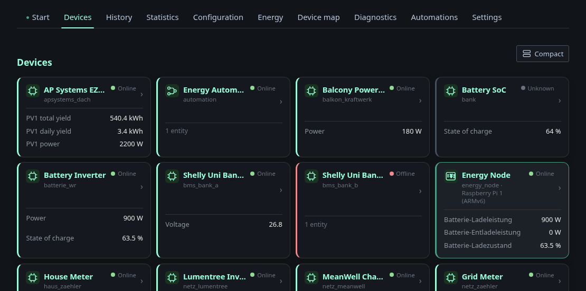
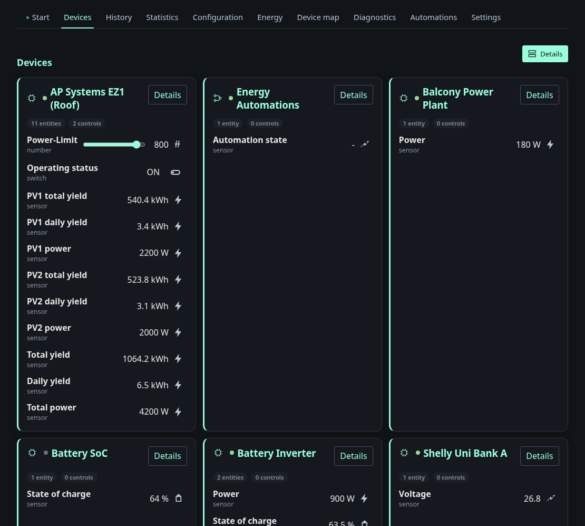

# Devices

Everything the node has seen through MQTT Discovery, grouped by device. The
button in the top right switches between two views.

The compact view shows the name, the availability and a few headline values.

The detailed view shows every entity with its controls: sliders for `number`
entities, toggles for `switch` and live values for `sensor`.

Availability comes from each device's `availability_topic`. `Details` on a
device opens the raw discovery payload, the topics involved and whether the
discovery message was retained. That is usually the quickest way to find out
why Home Assistant does not see a device.

The default view is a setting, so a tablet on the wall can open straight into
the compact view.

The device dialog of a device that measures power lists its
[sub-devices](device-map.md#sub-devices). There you can create, edit and delete
a sub-device, which gives the measurement a name such as "Washing machine".

How the devices are wired and what they contribute to the energy balance is on
the [device map](device-map.md).
