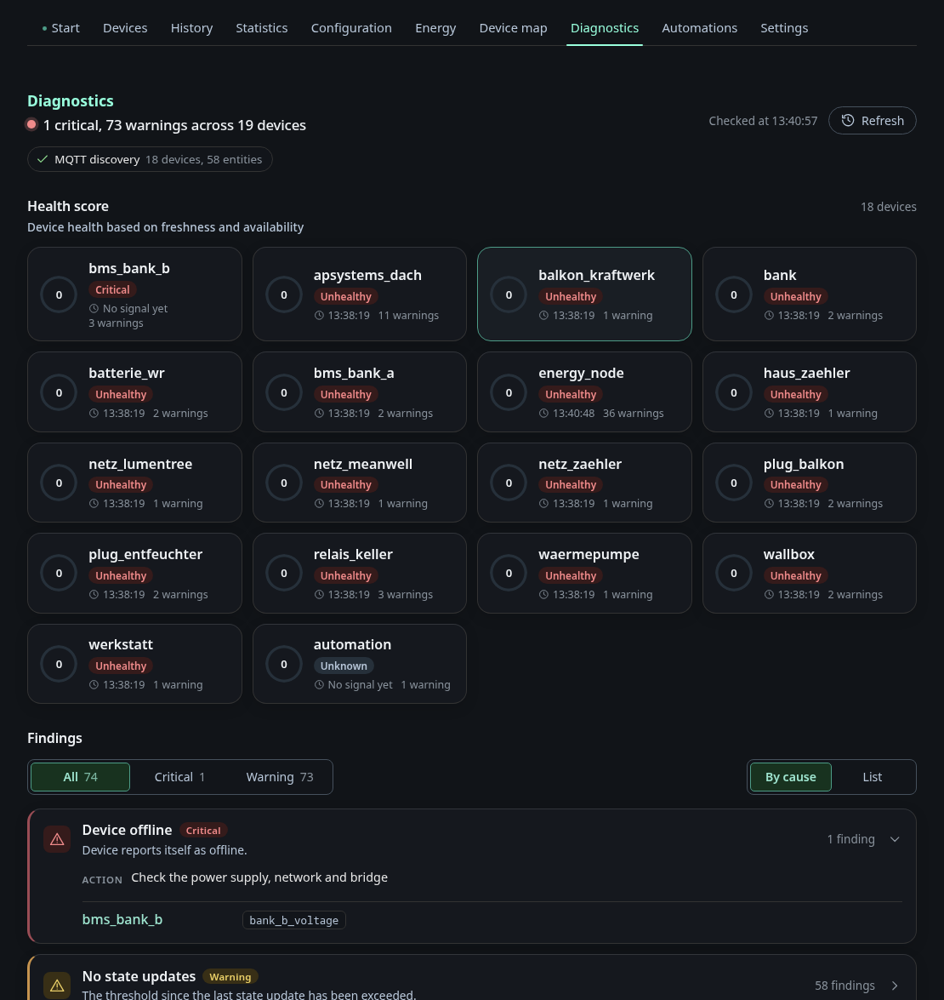
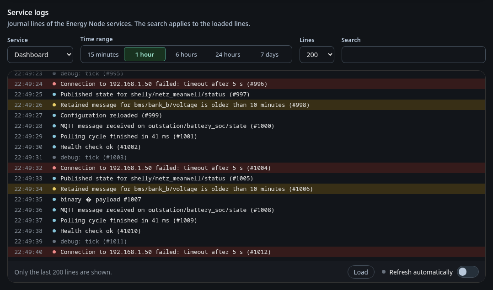

# Diagnostics

The line under the title sums up the current state, for example "1 critical,
26 warnings across 11 devices". Its dot turns green, yellow or red with the
most severe finding. Next to it you see when the page last checked, and
Refresh checks again.

The MQTT discovery chip counts devices and entities. It turns red when there
are parse errors or duplicate `unique_id`s, and a card below lists the
problems behind them. Duplicate unique IDs are the usual reason Home Assistant
merges two devices into one.

## Health score

Every device has a card with its score ring, its status, the time of its last
signal and its number of warnings. The worst device comes first. A device that
has never sent anything shows as critical with "No signal yet". A device is healthy while it
keeps sending values. Its score falls to zero once the newest value is as old as
the health threshold from the settings, which is 180 seconds by default (10 to
3600). The fixture broker in the screenshot replays the retained messages once
and then goes quiet, so its devices age out.

Click a card to show only the findings of that device. Click it again, or the
device chip in the findings toolbar, to show all devices again.

## Findings

By cause groups the findings by their reason, most severe first. Each group
names the cause, explains it once, tells you what to check and lists the
affected entities per device. Critical groups start open. Click a device name
inside a group to filter by that device.

List shows every finding as a table row that you can sort by severity, device,
entity or rule.

The severity switch (All, Critical, Warning) works in both views and shows how
many findings each choice leaves.

## Service logs

The service logs panel shows the journal lines of the Energy Node services. Only
users with the `system_actions` role see it. Other users do not get the panel
and the API answers with a permission error.

Pick one of the 11 services in the Service dropdown, for example Dashboard,
Automations, Mosquitto or Updater. Then choose the time range (15 minutes,
1 hour, 6 hours, 24 hours or 7 days) and the number of lines (100, 200, 500 or
1000). The default is the last 200 lines. Load fetches the lines again.

The search field filters the lines that are already loaded. It does not query
the journal again. When the query returns as many lines as you asked for, the
panel adds the note that only the last lines are shown. Then choose a shorter
time range or raise the number of lines.

Turn on Refresh automatically to check for new lines every 5 seconds. The
refresh adds only the lines written since the last check. It pauses while the
browser tab is in the background or the panel is not visible. An error turns
the automatic refresh off.

If a service log query reports `journal_not_permitted`, the dashboard is not
allowed to read the journal. This happens after an update that did not refresh
the sudoers file. The next update sets up the permission, so the message goes
away after that update.
