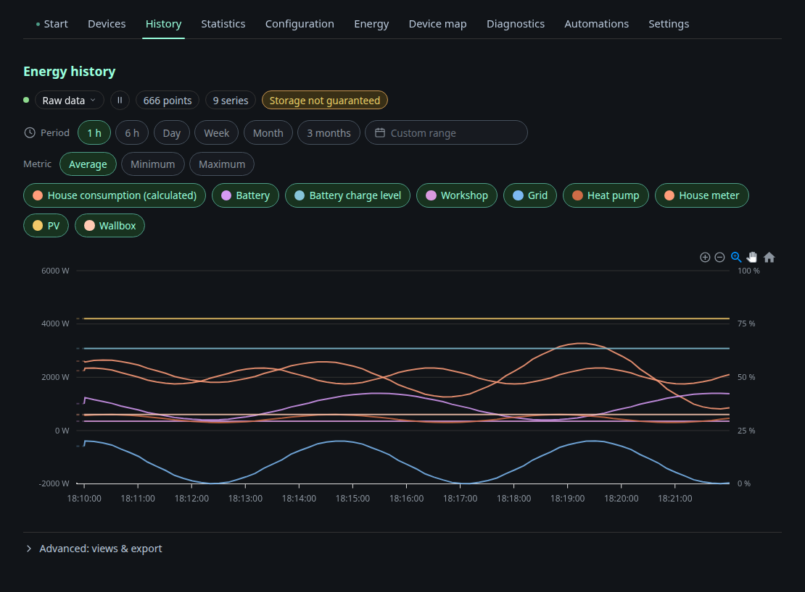

# History

The node stores no history. The browser records it: a recorder samples
`/api/v1/energy` at an interval and writes to IndexedDB, so the Pi's SD card
and RAM are not involved at all.

You can choose the time range (1 h, 6 h, day, week, month, 3 months or a custom
range) and the metric per bucket (average, minimum or maximum). The series are
every energy role plus computed ones such as *House consumption (calculated)*.
Click a chip to show or hide a series. Under **Advanced: views & export** you can
save a set of series as a named view and export the visible data as CSV or JSON.

## Resolutions

The line above the chart offers the resolutions that fit the chosen span, and
the coarsest one is preselected. Pick a finer one to see more detail, and pick
the coarsest one again to return to the automatic choice. The choice belongs to
the page session. A reload starts again with the coarsest resolution.

| Resolution | Offered for a span of | Where the values come from |
|---|---|---|
| Raw data | up to `rawWindowHours` (default 24 h) | Samples recorded in this browser |
| 1-minute average | from 1 h up to `minuteWindowDays` (default 7 days) | Minute averages recorded in this browser |
| 5-minute average | from 24 h | Five-minute averages in this browser, with minute values filling the gaps |
| Hourly average | from 7 days | Hourly means from the energy statistics on the node |

The history tile on the overview always shows the coarsest resolution the span
allows. Saved views store their series, range and metric but no resolution, so
applying a view keeps the resolution the page has at that moment.

Raw samples are compacted into one minute and five minute tiers as they age.
The hourly resolution is not kept in the browser. The page reads it from the node.

### Hourly values

Hourly values come from `GET /api/v1/energy/stats/hours` on the node, see
[api.md](api.md). An hour that the node recorded itself counts only when it
holds at least 50 minutes of recording. Hours from Home Assistant always count.
A series appears only if at least one of its hours is not zero.

House consumption at the hourly resolution is the node's own `load_total` value.
It is not calculated from the other series, because a calculation from mixed
resolutions would not match the full hour.

If a series has no hourly values, it falls back to five-minute averages. The
line above the chart then says how many series use the fallback. This also
happens when the node cannot answer, for example because it runs without a data
directory.

## Exchange between browsers

When two browsers have the dashboard open at the same time, each fetches the
tiers it is missing from the other through the node. The server runs an SSE
hub for this and stores no data. A browser's own measurements are never
overwritten. Minute values are only exchanged up to 30 minutes before now. When
the page shows a range that reaches into that last half hour, it asks the other
browsers for it as well.

The line above the chart names the resolution, the number of points and series,
and whether the browser has granted persistent storage.
