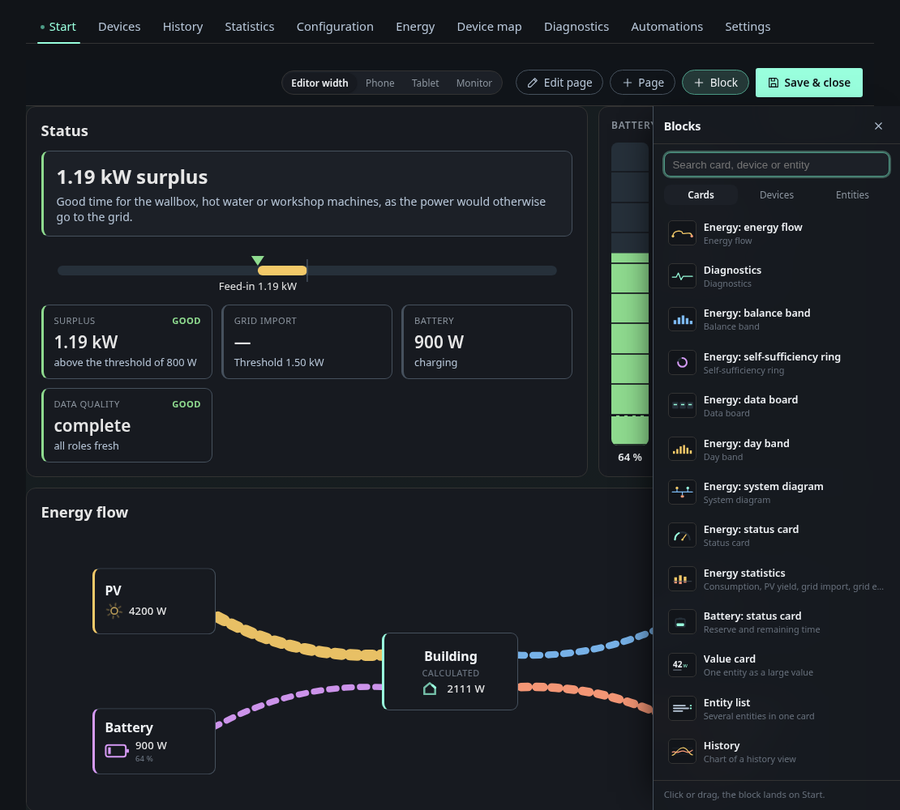
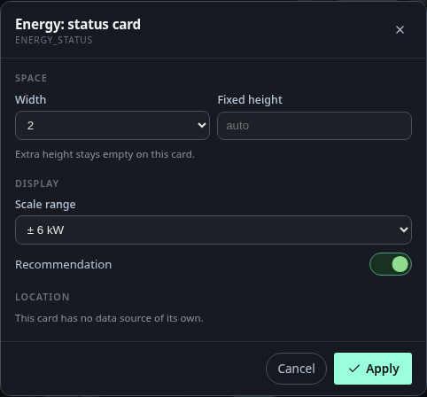
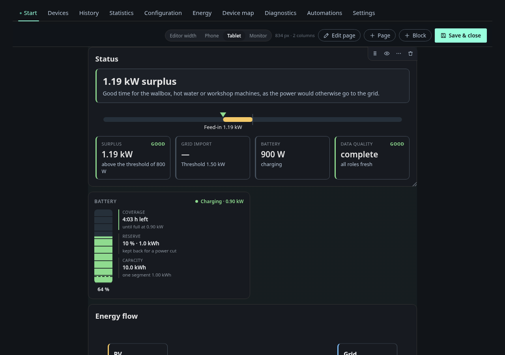

# Layout editor

**Edit** on the overview turns the page into the editor. You arrange the cards
on the real grid, the same one the overview uses afterwards, so a card has the
size in the editor that it has when you close it again. **Save & close** keeps
the layout, **Discard changes** drops it and closes the editor.

## Moving, resizing and removing cards

Hover over a card in the editor and four buttons appear in its top corner:

| Button | What it does |
|---|---|
| Grip | drag it to move the card. A marker shows where it lands |
| Eye | hide the card without deleting it. A hidden card stays in the layout |
| ⋯ | open the options of the card |
| Bin | remove the card, without a confirmation. **Discard changes** or an earlier revision brings it back |

The handle in the lower right corner resizes the card. Its width is a size
class from 1 to 6 or **full**, its height is optional (see below). A card never
gets narrower than its minimum, which differs by type. The minimum widths are
in [Overview cards](overview-cards.md).

The number of columns follows the width of the window. A card that would not fit
next to its neighbours takes a full row. On a phone everything is one column. In
the editor, gaps in a row stay visible so you can see what you set. On the
overview itself, the largest card in an incomplete row grows into the gap.

## Adding blocks

**Block** opens the panel on the right. It has three tabs and a search field:

- **Cards** are the computed cards, such as the energy cards, the value card,
  the entity list, diagnostics and the history chart.
- **Devices** has one entry per device.
- **Entities** has one entry per entity, which becomes a large value card.

Click a block to append it to the page, or drag it to the place you want. A new
card shows a placeholder until you save, because the editor does not render the
real card.

## Card options

The ⋯ button opens the options of one card.

- **Space** sets the width and, for cards that can use more room, a fixed height.
  A fixed height acts as a minimum. A card that cannot use the extra height says so.
- **Display** holds the options of the card, such as the scale range of the
  status card. The full list is in [Overview cards](overview-cards.md).
- **Location** picks the data source: the device of a device card, the entity of
  a value card, the entities of an entity list. A card without a source of its
  own says so.

A **device card** is shown in detail with all its entities, or compact with up
to three values and a status dot, the same two views as on the
[Devices](devices.md) page. In compact mode you can choose which values the card
shows, otherwise it picks them itself. The categories (Controls, Measurements
and so on) only apply to the detail view.

## Pages

Every layout page is a tab in the navigation. **Page** adds one, **Edit page**
renames the active page, moves it forward or back, or deletes it. The last page
cannot be deleted, because without it there would be no way back into the editor.
Cards are added to the page that is active when you click.

## Previewing other screens

The **Target width** buttons show the layout at the width of a phone (390 px),
a tablet (834 px) or a monitor (1280 px), and tell you how many columns that
width has. **Editor width** goes back to the real width. The preview scales the
page down and never up.

## Saving and leaving

Changes stay in the editor until **Save & close**. The toolbar shows
**Unsaved** while there are any. Switching to another tab or leaving the editor
asks whether to keep editing or discard. Layouts are versioned, every save is a
revision, and the revision list below the editor restores an earlier state.

## Limits

- The column width is fixed at about 18 rem and cannot be changed.
- Above size 6 there is only **full**.
- Some cards, the energy flow and the energy graphics, exist only once per
  layout.
- Groups of cards are not visible on the overview. Only the order counts.
- The editor is made for a desktop. Dragging on a phone is not a goal.
- The editor needs the permission to edit the layout.
