# Overview cards

This page lists every block you can put on an overview page and the options it
has in the layout editor. How the editor itself works is described in
[Overview and layout editor](overview.md).

## All blocks

| Block | Layout type | What it shows | Min. columns | Default width |
|---|---|---|---|---|
| Energy: status card | `energy_status` | Situation, thresholds, data quality | 1 | 1 |
| Energy: energy flow | `energy_flow` | Animated flow graph | 2 | 2 |
| Energy: self-sufficiency ring | `energy_ring` | Coverage/use ring | 2 | 2 |
| Energy: system diagram | `energy_schema` | Plant diagram | 2 | 2 |
| Energy: balance band | `energy_band` | Sources and consumers as proportional bands | 2 | 2 |
| Energy: day band | `energy_day` | The recorded curve of supply and use | 2 | 2 |
| Energy: data board | `energy_board` | The balance as a plain number board | 2 | 3 |
| Energy statistics | `energy_stats` | Totals for today, this week, month or year | 1 | 1 |
| Battery: status card | `battery_status` | Charge column or trajectory | 1 (trajectory 2) | 1 (trajectory 2) |
| History | `history_view` | Chart of a saved history view | 1 | 2 |
| Diagnostics | `diagnostics` | Health summary of all devices | 1 | 1 |
| Value card | `entity_value` | One entity as a large value | 1 | 1 |
| Entity list | `entity_group` | Several entities in one card | 1 | 1 |
| (Devices tab) | `device` | A full device tile with its controls | 1 | 1 |

The editor does not let a card get narrower than its minimum, because the
drawing would no longer fit. The pictures on this page show each card at its
minimum width, so text is cut off in places where a wider card has room. Cards that do not grow with extra height offer
**Fixed height** instead. The extra space then stays empty.

All energy cards work from the same balance as the Energy tab. None of them is
tied to a particular device. Two settings that change what the cards show are
not layout options but belong to the energy configuration, see
[Energy](energy.md): the surplus and grid import thresholds of the status card,
and the battery reserve.

## Energy: status card

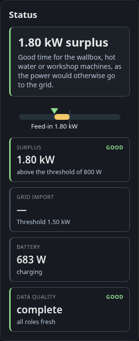

Sums up the situation in one sentence, with a scale between grid import and
feed-in and tiles for surplus, grid draw, battery and data quality.

| Option | Values | Default |
|---|---|---|
| Scale range | ± 3 kW, ± 6 kW, ± 11 kW | ± 6 kW |
| Recommendation | on, off | on |

The thresholds for surplus (default 800 W) and grid import (default 1500 W) are
set on the Energy tab.

## Energy: energy flow

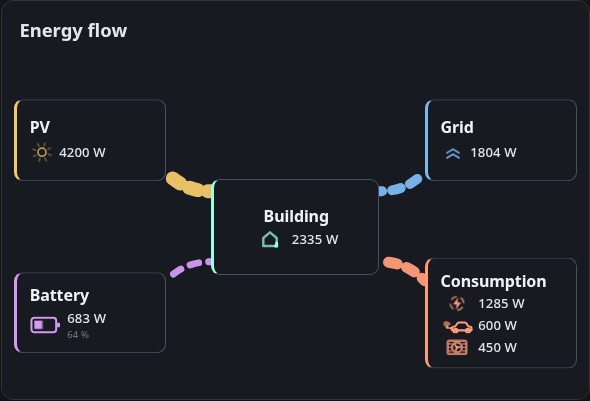

Draws PV, grid, building, battery and loads as five nodes with animated flows
between them. The battery node adds the state of charge when one is known.
When the direction of a flow is unknown, for example a grid meter without a
sign, the line is drawn but not animated.

| Option | Values | Default |
|---|---|---|
| Power display | Line width, Animation speed | Line width |
| Hide inactive consumers | on, off | off |
| Reference for the animation speed | relative (largest active flow), fixed | relative |
| Reference power (W) | any value | 1000 |

The two reference options only appear with **Animation speed**. With
**relative** the fastest flow is the largest one currently active, but never
less than the reference power. With **fixed** the reference power alone sets
the scale.

If the browser asks for reduced motion, the card always uses line width,
because the animation stands still.

## Energy: self-sufficiency ring

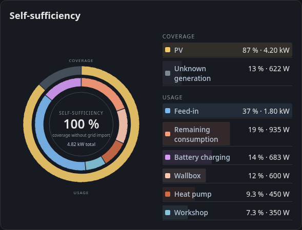

Shows how much of the use is covered by own production, split by source and by
consumer.

| Option | Values | Default |
|---|---|---|
| Figure in the centre | Self-sufficiency, Self-consumption rate, Grid balance, Household consumption | Self-sufficiency |
| Labels | Percent, Absolute values, both | both |
| Animate direction | on, off | on |
| Measured consumers | combined, one per entity | combined |

## Energy: system diagram

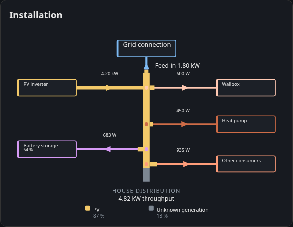

A wiring style diagram of the site (titled *Installation* on the card) with the
live power on each branch. The battery box shows the state of charge on a
second line.

| Option | Values | Default |
|---|---|---|
| Line width | by power, constant | by power |
| Labels | power only, Power + entity | power only |
| Hide inactive branches | on, off | off |
| Display size | XS, S, M, L, XL | M |
| Animate arrow | on, off | off |

With **Power + entity** each branch also names the entity it is measured from.
Other consumers have no entity of their own and are marked as derived from the
household consumption.

## Energy: balance band

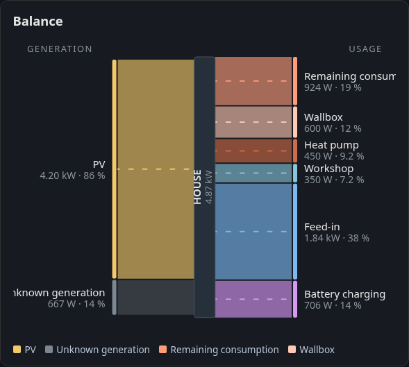

A cut through the current moment: sources stack on the left, consumers on the
right and the building sits in the middle. The height of each band follows its
power, so you see at a glance which source covers which consumer.

| Option | Values | Default |
|---|---|---|
| Height reference | proportional (fills the height), absolute (10 kW reference) | proportional |
| Scaling | linear (true shares), square root (small ones visible) | linear |
| Unit | automatic, always W, always kW | automatic |
| Small flows | all separate, bundle below 3 %, bundle below 8 % | all separate |
| Animate flow | on, off | on |
| Measured consumers | combined, one per entity | combined |

## Energy: day band

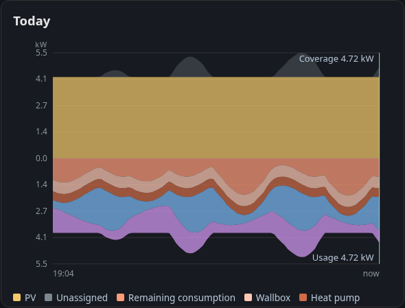

Draws supply and use over the period this browser has recorded. Right after a
restart, or on a device that has not recorded yet, the band is narrow until
enough history has built up. The time axis names the first and last recorded
point.

| Option | Values | Default |
|---|---|---|
| Display | mirrored (supply / use), supply only, use only | mirrored |
| Label the now edge | on, off | on |

## Energy: data board

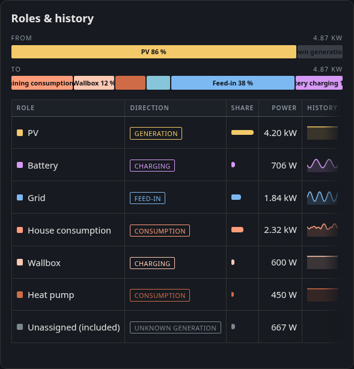

The balance as a table of numbers, one row per role, each with a small history
line.

| Option | Values | Default |
|---|---|---|
| Sorting | fixed order, by power | fixed order |
| History | 15 minutes, 60 minutes, off | 15 minutes |
| Compact | on, off | off |
| Show inactive roles | on, off | on |
| Measured consumers | combined, one per entity | combined |

The history lines come from the browser's recording, like the day band.

## Measured consumers

When the Energy tab adds up several metered loads into one position,
**Measured consumers** decides how three cards show that sum:

- **Balance band** and **self-sufficiency ring** draw one segment per entity
  with **one per entity**.
- **Data board** shows one row per entity, but without a history line, because
  the history only records role totals.

The other cards always show the sum. The day band draws it as its own area,
the system diagram as its own branch and the energy flow names the measured
part on the load node.

## Energy statistics

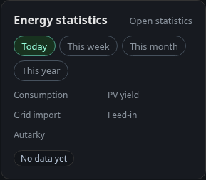

Consumption, PV yield, grid import, grid export and self-sufficiency for today,
this week, this month or this year. **Open statistics** opens the
[Statistics](statistics.md) tab for the same period. The card has no options.

## Battery: status card

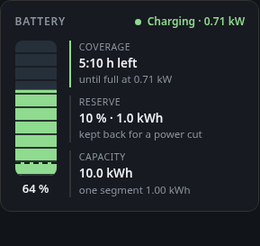
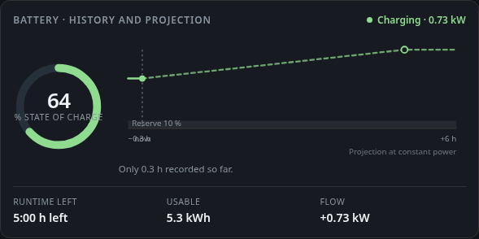

Has two displays:

- **Column (reserve and remaining time)** shows the stored energy as a
  segmented column with the time to full or empty.
- **Trajectory (history and projection)** shows a ring with the recorded state
  of charge and a projection. It needs at least two columns.

| Option | Values | Default |
|---|---|---|
| Time window (trajectory only) | 3 h, 6 h, 12 h, 24 h | 6 h |
| Projection (trajectory only) | same as time window, 3 h, 6 h, 12 h, 24 h | same as time window |

The reserve held back for a grid outage is set on the Energy tab (default
10 %, 0 switches it off). Without a reserve the card counts down to empty.
If the browser has no recorded history yet, or less than 15 minutes of it, the
projection takes the whole width and the card says why. Gaps in the recording
break the line instead of bridging it. The same card is available in Home
Assistant, see [Lovelace card](../ha/battery-soc-card.md).

## History

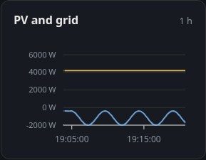

Puts a chart from the history page on an overview page.
[Overview and layout editor](overview.md#history-tile) explains the options
**Source**, **Own settings**, **Period**, **Statistic** and **Series**.

## Diagnostics

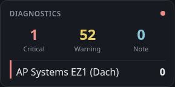

A health summary of all devices. Tapping it opens the
[Diagnostics](diagnostics.md) tab. No options.

## Value card and entity list

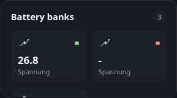

The **value card** shows one entity as a large value. The **entity list**
shows several entities with a title of its own. Both are picked under
**Entities** in the block picker.

## Device tile

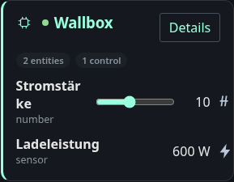
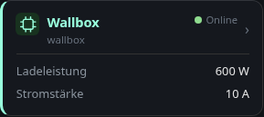

A device from the **Devices** tab of the picker, with its controls.

| Option | Values | Default |
|---|---|---|
| Display | Detail (all entities), Compact (up to three values) | Detail |

**Compact** shows up to three values. You can pin which ones, otherwise the
tile picks them itself. In the detail view the categories (measurements,
controls, configuration, diagnostics) decide which entities appear.
