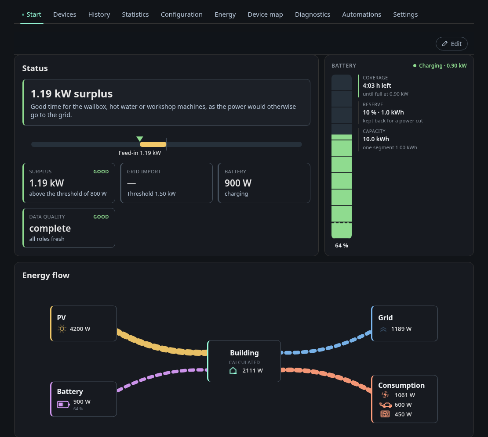

# Overview and layout editor

The start tab is a grid of cards that you arrange yourself. The screenshot
shows the fixture's cards.

The status card sums up the current situation in one sentence ("1.25 kW
surplus. Good time for the wallbox …"). Below it a bar shows where the balance
sits between grid import and feed-in, followed by tiles for surplus, grid draw,
battery and data quality with their thresholds.

The battery status card has a segmented charge column, the time to full or
empty, the reserve held back for a grid outage and the usable capacity.

The energy flow card draws PV, storage, building, grid and the individual loads
as animated flows. The animation speed follows the actual watts.

The self-sufficiency ring shows coverage against use, split by source and by
consumer.

The system diagram (titled *Installation* on the card) is a wiring style
diagram of the site with the live power on each leg.

All cards work only from MQTT Discovery data and the role assignment on the
Energy tab. None of them is hard-coded to a particular device.
[Overview cards](overview-cards.md) describes every card and its options.

## The layout editor

**Edit** turns the overview into an editor. You can drag and resize cards, add
pages and pick new blocks from the panel on the right, so one layout page can mix
computed energy cards with a raw device tile or a single measured value. The
[layout editor](layout-editor.md) page describes how it works.
[Overview cards](overview-cards.md) lists every block with its options,
defaults and minimum width.

### History tile

The block **History** puts a chart from the history page on an overview page.
In its options, **Source** picks a saved history view. The tile then follows
that view: change the view on the history page and the tile changes with it.
**Own settings** lets the tile keep its own title, period, statistic and
series. Switching from a view to own settings starts from the view's values.

The tile only shows what this browser has recorded or received through the
history exchange, like the history page. On a device that has not recorded
yet it stays empty. If its view is deleted, the tile says so until you pick
another source.

In the default exchange mode the tile asks other devices and Home Assistant
only for its own period.
