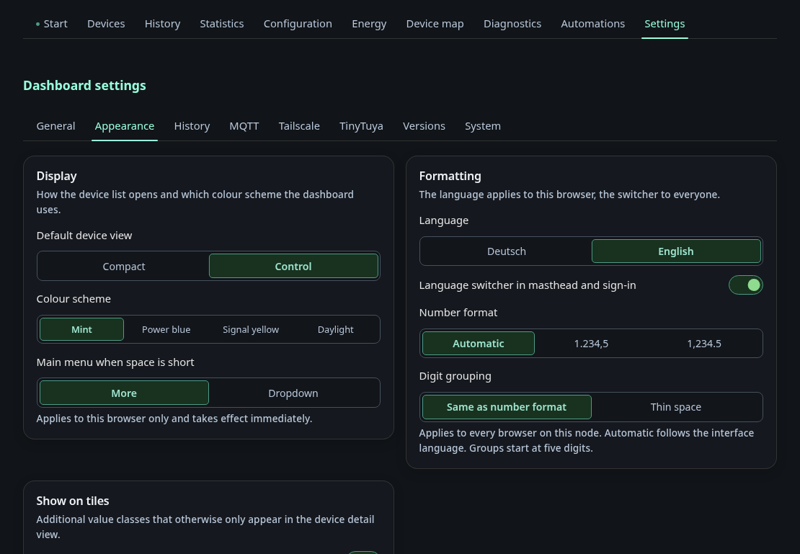

# Settings: Appearance

The tab **Appearance** under *Settings*. The other tabs are listed on
[Settings](settings.md).

## Appearance

Here you set the default device view, the colour scheme and which extra
information the UI shows: discovery JSON tooltips, the global status bar, and
configuration and diagnostic values on tiles. **Tabs without a width limit**
lets selected tabs use the full window width instead of the centred column.
By default these are Overview, Devices, History, Layout and Settings.
The switch **All tabs at full width** in the same card sets every tab to full width at once.
**Items in the system status** picks the fields in the status bar.

**Main menu when space is short** decides what the tab bar does when not all tabs fit. *More* keeps one row and moves the rest into a **More** list. *Dropdown* collapses the bar into a menu on screens narrower than 700 px. The choice applies to this browser only and takes effect immediately, without saving. The pages under Settings have their own sidebar and are not affected.

The **Formatting** card holds the language of this browser, the switch that
shows or hides the `DE | EN` pill for everyone, and the number format.

The **Masthead** card sets the title and subtitle at the top of every page.
Leave a field empty to keep the default text. The title also names the
browser tab and the sign-in page. **Show title** and **Show subtitle** hide
them in the masthead only. With both hidden and the language pill off, the
masthead disappears entirely.
