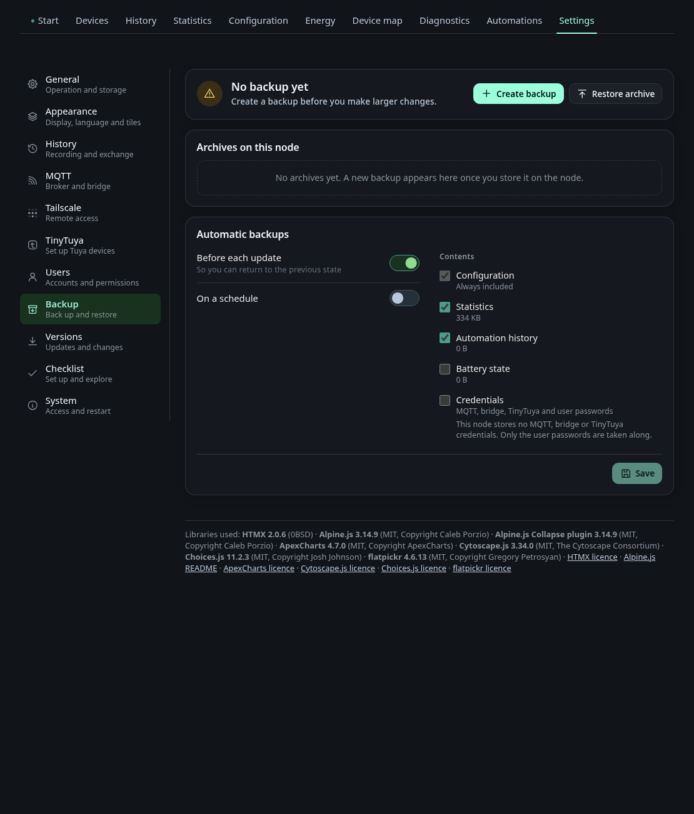

# Settings: Backup

The tab **Backup** under *Settings*. It creates backup archives of the node's
configuration and data, and restores them. The tab is only shown when your
account has the permission *Create backup* (`backup_export`) or *Restore
backup* (`backup_import`). Creating and restoring work only over HTTPS. The
permissions are set under [Settings, Users](settings-users.md#permissions).



| Permission | Key | Allows |
|---|---|---|
| Create backup | `backup_export` | Change the backup settings, create, download and delete archives |
| Restore backup | `backup_import` | Check archives and restore them |
| Back up credentials | `backup_secrets` | Include credentials in backups, replace them when restoring |

Without *Back up credentials* you cannot switch credentials on, create an
archive with credentials, or download an archive with credentials that has no
password. A restore that replaces credentials or user accounts with their
passwords needs it too.

## What a backup contains

An archive always holds the central configuration file
`/etc/energy-node/config.json`. The other content follows the areas you
choose. Each area can be switched on or off.

| Area | Contents | Default |
|---|---|---|
| Settings | Dashboard settings, layout, device map, device preferences, energy setup, onboarding, ignored devices, MQTT and bridge settings, backup settings | On |
| Devices | Device configurations, automation rules and Shelly presets | On |
| Users | Accounts and roles from `users.json`. Password hashes are only included with credentials | On |
| Credentials | Credential files for MQTT, the bridge and TinyTuya, and the password hashes of the users | Off |
| Statistics | Monthly energy statistics | On |
| Automation history | The history of the automation engine | On |
| Battery state | The state files of the battery state of charge devices | Off |

Credentials are only written when the Credentials area is chosen and the
archive includes credentials. Runtime files such as sessions, the journal,
earlier revisions and older archives are never part of a backup.

## Where archives are stored

Archives are kept on the system drive, in the `backups` folder of the data
directory. Every archive has a small sidecar file next to it. The sidecar
records the trigger, the creation time in UTC, the areas, and whether the
archive has credentials or a password. The archive ID combines the UTC time and
the trigger, for example `20261108-030000-auto`. An unprotected archive is
stored as `<id>.tar.gz`, an encrypted one as `<id>.tar.gz.enc`.

The system drive can be switched off in the backup settings. Then the node has
no location for archives, manual backups stop with the error
`backup_no_location`, and scheduled runs are skipped.

## Password

A manual archive can be protected with a password of at least 8 characters.
The whole archive is encrypted with AES-256-GCM. The key is derived from the
password with PBKDF2 (HMAC-SHA256, 200,000 iterations).

The node does not store the password. Without it an encrypted archive cannot
be restored, and the node cannot recover it.

Automatic and update archives never have a password.

## Automatic backups

The backup settings have three kinds of automatic archive. Each one keeps its
own count of archives, so the newest archives of one kind never replace the
others.

- **Before each update** (on by default). The updater creates an archive before
  it installs a new version. A failed backup does not stop the update. The
  archive has the trigger `update`.
- **On a schedule** (off by default). The node creates an archive between
  03:00 and 03:04 local time, once a day, or on Sundays only when the frequency
  is weekly. Missed runs are not made up. The node keeps the reason of the last
  skipped run, for example `no_location`.
- **Manual.** Created with **Store** (kept on the node) or **Download** (the
  file is handed to your browser and removed from the node once it is
  downloaded, or after one hour).
  Manual archives are never deleted by the keep count.

The keep count (default 5, at least 1) is applied to each kind of automatic
archive. When a new archive is saved, the older archives of the same kind
beyond the count are deleted.

Automatic and update archives run without a password. **Automatic backups run
without a password. The credentials are then readable in the archive.** Only
switch on credentials for automatic backups if the place where the archives
are stored is safe.

## Restoring

Restoring happens in four steps.

1. **Choose the archive.** Upload a file, or pick an archive from the list. An
   encrypted archive asks for its password. A wrong password is refused, and
   nothing is changed. An uploaded archive is kept in the node's staging folder
   for up to one hour.
2. **Check the preview.** Each area shows how many files it holds, their size,
   and what would change: modified, new or removed entries. An area that the
   archive does not contain cannot be chosen.
3. **Choose the environment.** This step only appears when the archive comes
   from another device. It compares the MQTT broker address and the dashboard
   port. For each of them you choose the value from the archive or the value of
   this device. The bridge and Tailscale values of this device are always kept.
4. **Restore.** Before anything is changed, the node saves a safety archive of
   the current state with all areas. It has the trigger `pre_import`, and the
   node keeps the three newest of them. Then it stops the enabled device
   services, writes the configuration file if you chose values from the archive,
   and restarts the dashboard. After the restart it copies the files into place,
   starts the services again and shows the result on the tab.

If the restore fails before the restart, the services start again and nothing
else changes. The safety archive stays in the list.

What a restore does to the existing data:

- Each file of a chosen area is replaced with the copy from the archive. Files
  that only exist on this node are kept.
- Statistics are merged, not replaced. Hours recorded by Home Assistant in the
  archive replace the hours here. Other hours that are already here stay, and
  empty hours are filled from the archive.
- Battery state files are only restored for batteries that exist on this node.
- Users: when the archive has no credentials, the restore keeps the password of
  each user that exists here with the same name. Users that do not exist here
  are locked, and the result lists them. When the archive has credentials, its
  users and passwords replace the current ones. A restore is refused when no
  active local user with user management would remain.

The result shows one of these outcomes:

- **Archive restored.** Everything was written.
- The restore finished, but some monthly statistics files in the archive could
  not be read. All other data was restored.
- **Restore failed.** Part of the archive could not be written, or the restore
  was interrupted. The previous state was restored.

### Rolling back an update

To roll back, install the older version first, then restore the archive from
before the update, the one with the trigger `update`. Two facts matter for this
order. An older dashboard refuses a `users.json` of version 6, which this
version writes, and an archive from a newer version is refused with the message
that it comes from a newer version.

## For operators

The updater calls the backup from the command line. You can call it yourself
with:

```bash
energy-node-dashboard backup create --config /etc/energy-node/config.json --trigger update
```

The only trigger the command accepts is `update`. It uses the keep count and the
areas from the backup settings. It never sets a password. The exit codes are:

| Code | Meaning |
|---|---|
| 0 | Archive written. The archive ID is printed |
| 3 | Skipped, because the backup before updates is off or the node has no location |
| 1 | Error |
| 2 | Usage error |
