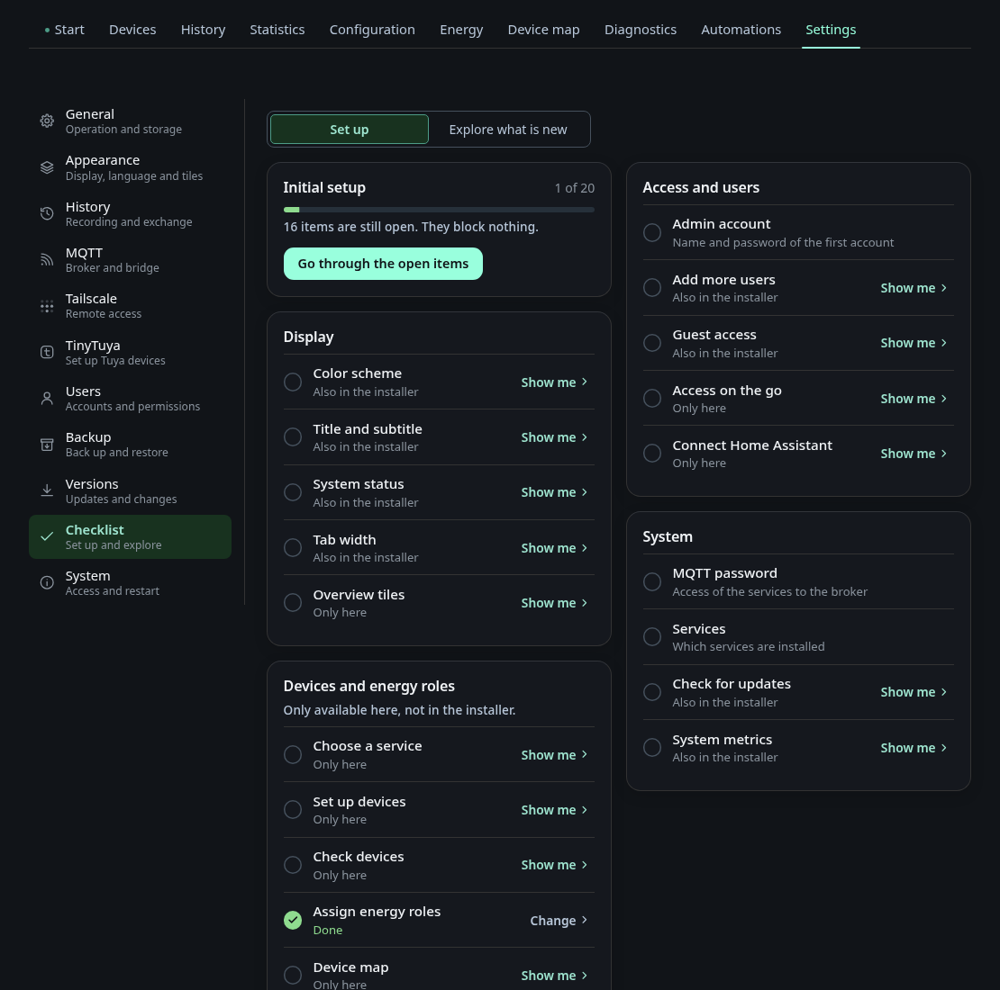

# Settings: Checklist

The tab **Checklist** under *Settings* lists the steps of the [Onboarding](onboarding.md) and the new features of each version. A step on an existing install is checked off when its setting differs from the default. Steps that are not set up yet stay open. Choose a service, Set up devices, Check devices, Device map and Overview tiles are never checked off automatically, so you decide when they are done.

Press **Later** in the setup to leave a step for later. It stays open in the checklist, where you can come back to it at any time. Open steps block nothing, and the dashboard works without them.

Use **Go through it again** to repeat the setup. Under **Explore what's new** the checklist lists the highlights of the last three versions. **Start tour** shows the tours you have not seen yet, and every tour can be replayed. **Explore further back** opens the earlier versions since v0.8.0.
