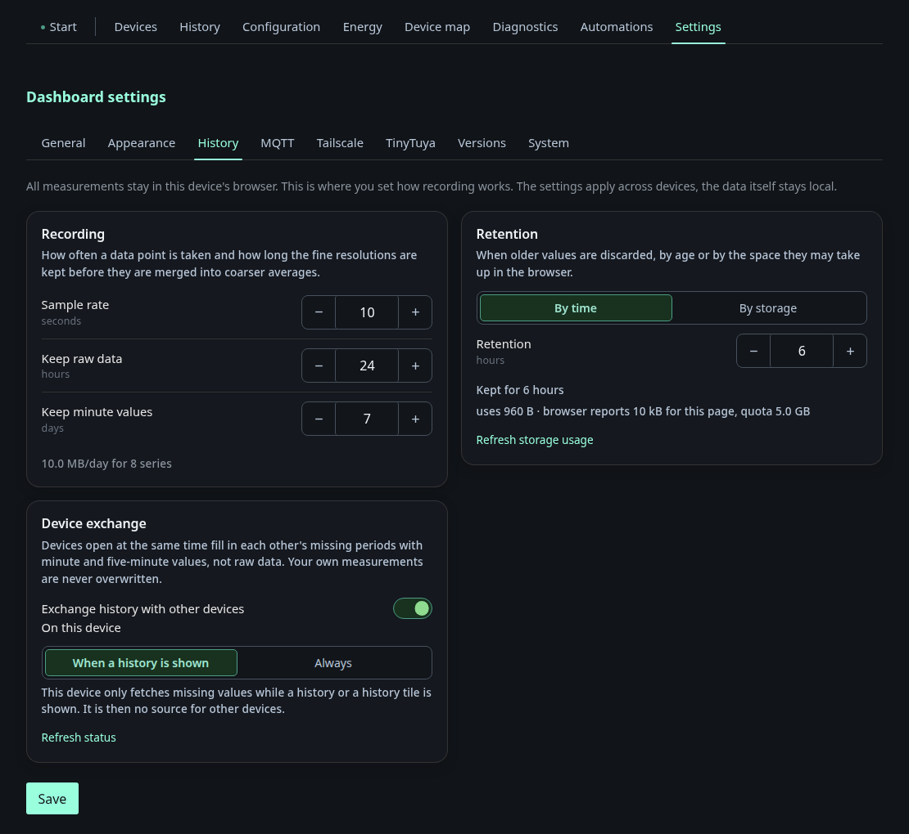

# Settings: History

The tab **History** under *Settings*. The history charts themselves are
described on [History](history.md), the statistics on
[Statistics](statistics.md).

## History

This tab controls recording and retention of the browser side history: the
sample rate, how long raw data is kept before compaction and how long minute
values are kept. Retention is limited either by time or by a storage budget in
MB. The page shows the projected daily volume, the actual usage and the
browser's quota. The last block switches off the exchange between devices. Below the switch,
**On this device** chooses whether this browser exchanges **Always** or only
**When a history is shown**. The second choice is the default and spares
phones. The browser then only fetches what the history page or a history tile
shows. In the first mode, **Provide data to other devices** decides whether other
devices may ask this browser for missing periods. It is off by default. In
**Always** the browser provides data anyway, so the switch is hidden. Both
choices are stored in the browser and apply at once, without saving. Below the
choices a status tile shows whether the exchange is connected, with how many
other devices, how many values it has added and who filled in the last ones. It
updates itself when values arrive.

The setting applies to every browser, but the recorded data does not. The
measurements only exist in the browser that recorded them, and the page says so.

**Energy statistics** chooses how the node records its own hourly energy values:
**Always** (the default), **Pause while the companion delivers** or **Off**. The
modes and the gaps they can leave are explained on the
[statistics page](statistics.md). Below the choice you see whether the own
recording is active, whether the Energy Node Companion is connected and how far
the backfill from Home Assistant has come.
