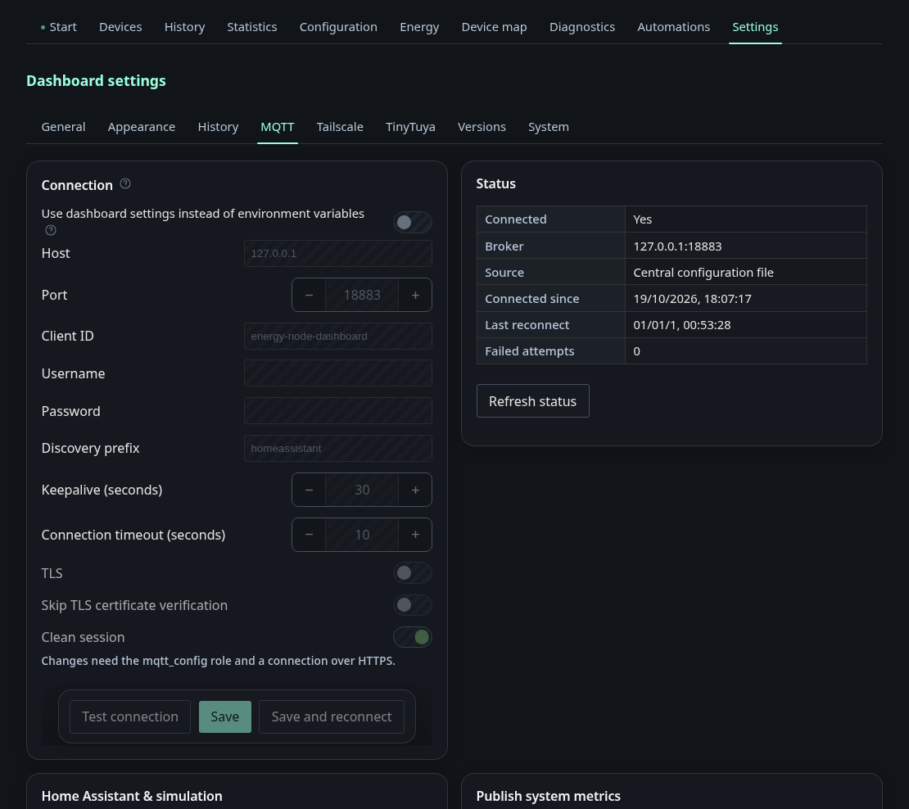
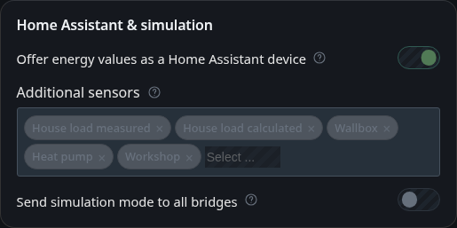
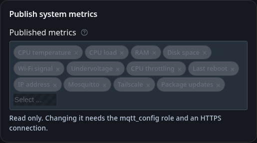
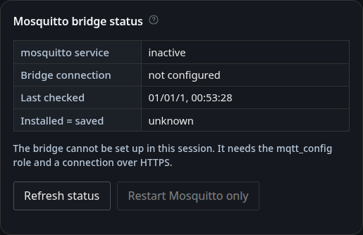

# Settings: MQTT

The tab **MQTT** under *Settings*. Which topics the dashboard reads and writes
is described in [Data flows](../developing/data-flow.md).

## MQTT

The broker connection comes with a live status table: connected or not,
address, where the configuration came from, connected since, last reconnect
and failed attempts.

**Publish energy values as a Home Assistant device** makes the dashboard
announce itself over MQTT Discovery as the device "Energy Node" with PV, grid,
battery and house load sensors. The computed balance then reaches Home
Assistant without an extra service.

**Additional sensors** under *Home Assistant & simulation* offers one sensor per
wallbox, heat pump and custom category. A sensor appears in Home Assistant only
once something is assigned to its role or category, so the list stays empty
until then. House load measured and House load calculated, offered once a house meter is assigned. Energy Node Companion uses the measured one for the house meter history. All of them are on by default. Deselect a sensor to have the
dashboard remove it from Home Assistant again, and select it to bring it back.

A sensor is removed as well when its category is deleted or unassigned. This
also works after a restart of the dashboard, because the announced sensors are
remembered in `energydiscovery/announced.json`. In Home Assistant each category
sensor is named after the category's label and has the unique ID
`energy_node_custom_<id>`. Storage categories get a sensor too, but Energy Node
does not count them in its energy statistics.

**Use dashboard settings instead of the central configuration** decides which
values win. When it is off, the values from `/etc/energy-node/config.json` are
used unchanged. When it is on, the settings stored here replace them
completely. Fields are not merged.

Further down, the same tab configures the **Mosquitto bridge to the main site**
and can apply it and restart it.

**Published metrics** selects which system metrics this device publishes to MQTT
as diagnostic entities, for example Wi-Fi signal or undervoltage. Remove a metric
from the selection to stop publishing it and add it again to resume. Changes are
saved immediately. Guests see the selection but cannot change it. Changing it
needs a login with configuration rights over HTTPS.

## Bridge to the main site

Users who can configure the bridge see the same steps at the top of the bridge section.

1. Run an MQTT broker on the main system, for example the Mosquitto add-on in
   Home Assistant.
2. Create a dedicated user for this bridge on the main system.
3. Put both systems into the same tailnet on the Tailscale page and use the main
   system's Tailscale IPv4 address as the bridge address.
4. Under bridge configuration, enter a name, the address and port of the main
   system, a unique client ID, and the user and password from step 2.
5. In the topic table, set for each topic whether it goes to the main system
   (out), comes from it (in) or runs both ways.
6. Save and check the preview, then apply. Applying writes the configuration to
   `/etc/mosquitto/conf.d/bridge.conf` and restarts Mosquitto, which briefly
   interrupts all MQTT connections of this device, including the dashboard's.
7. In the Mosquitto bridge status, check that the bridge connection shows as
   connected and that "Installed = saved" shows yes.

### If applying fails

The root helper checks the generated file again before it installs anything. It
has to be small, owned by the dashboard user and made only of the known bridge
directives, so a file with anything else is rejected (`bridge_helper_failed`)
and nothing changes. If Mosquitto does not start with the new file, for example
because of a wrong address, the helper puts the previous configuration back and
restarts Mosquitto again (`bridge_restart_failed`). A typo in the bridge
address therefore does not leave the local broker down.

The bridge password is part of `/etc/mosquitto/conf.d/bridge.conf` in plain
text, because Mosquitto reads it from there. The file is readable only for root
and the dashboard user. The preview in the dialog masks the password, and it
never appears in revisions, logs or API responses.

Guests see the bridge status with a note that the bridge cannot be set up in their
session. The steps and the configuration form stay hidden for them.
