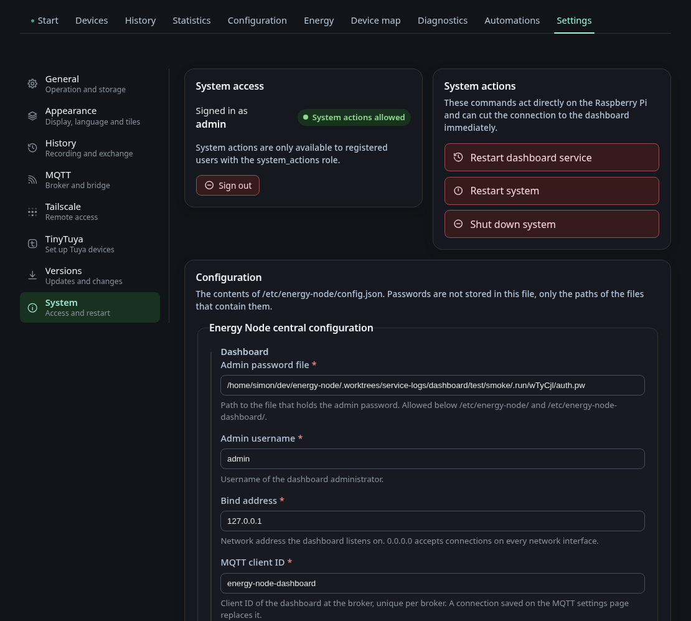

# Settings: System

The tab **System** under *Settings*.

## System

This tab shows who you are logged in as and with which role, and holds the
system actions: restart the dashboard service, restart the system and shut it
down. The screenshot shows an admin session, so the actions are enabled. In a
guest session they are greyed out, because system actions need a registered
user with the `system_actions` role and HTTPS.

Below that is the content of `/etc/energy-node/config.json` as a generated
form, built the same way as the configuration tab. Passwords are never in that
file, only the paths of the files that hold them.
