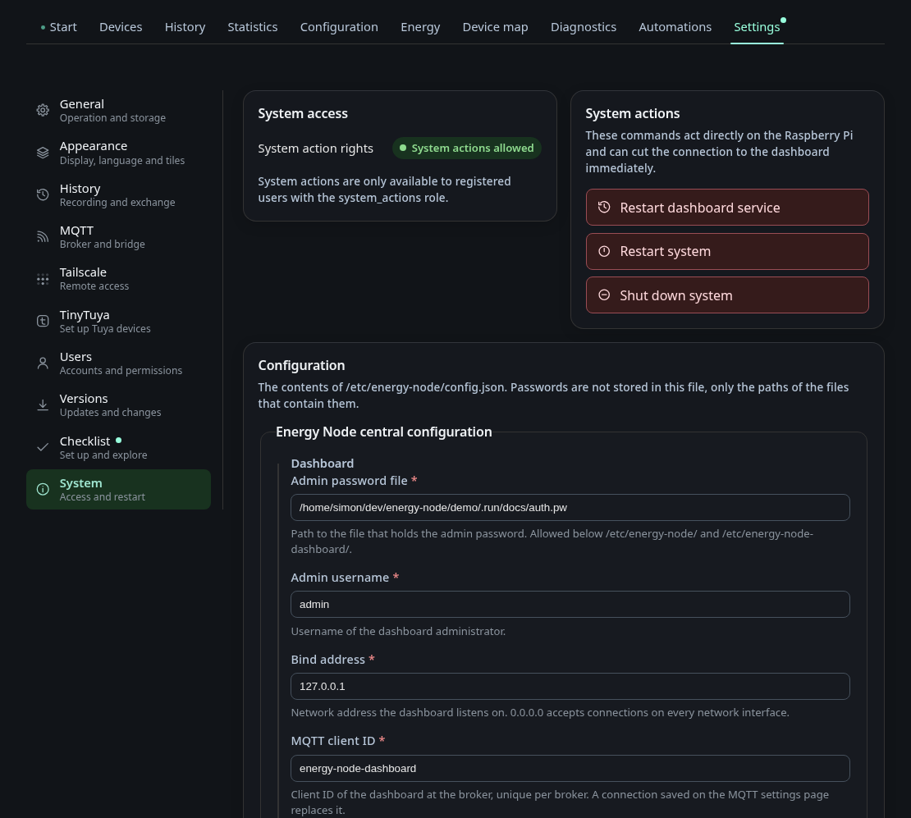

# Settings: System

The tab **System** under *Settings*.

## System

This tab shows whether your session may run system actions, and holds them:
restart the dashboard service, restart the system and shut it down. The
screenshot shows an admin session, so the actions are enabled. In a guest
session they are greyed out, because system actions need a registered user
with the permission *Services and bridge* (`system_actions`) and HTTPS. Who you
are signed in as and **Sign out** are under
[Settings, Users, Me](settings-users.md#me).

Below that is the content of `/etc/energy-node/config.json` as a generated
form, built the same way as the configuration tab. Passwords are never in that
file, only the paths of the files that hold them.
