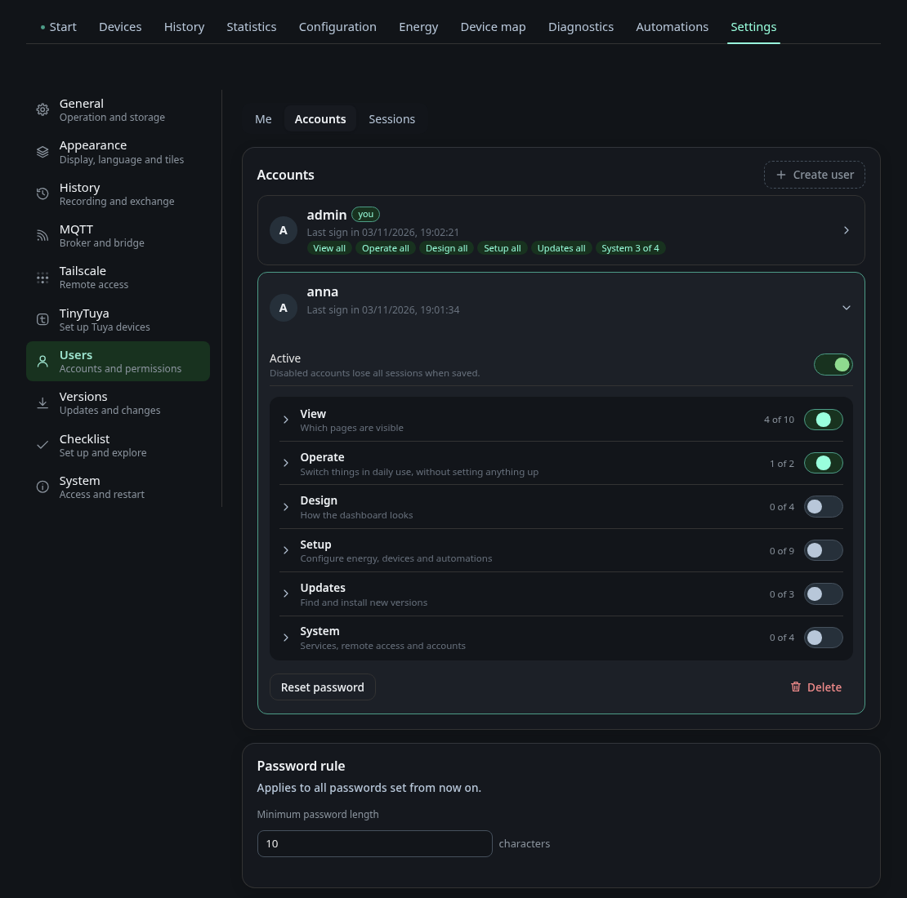
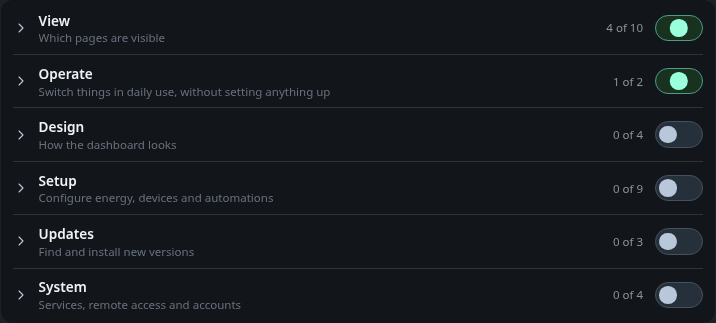

# Settings: Users

The page **Users** under *Settings* manages who may sign in and what each
account may do. It has three tabs: **Me**, **Accounts** and **Sessions**.
Everyone sees **Me**. The other two tabs need the permission
`user_management` and an HTTPS connection.

## Me

**Me** shows who you are signed in as and holds **Sign out**. A local account
changes its password here with the current password and the new one twice.
Over HTTP the tab says that some permissions only apply over HTTPS, see
[Signing in over HTTP](#signing-in-over-http). An account that signed in
through Home Assistant changes its password in Home Assistant.

## Accounts

**Create user** adds a local account with a user name and an initial
password. A user name has 3 to 32 characters: a to z, digits, dot, underscore
and hyphen. Each account is a card. Open it to change its permissions, reset
its password, switch it off with **Active** or delete it. Changes are only kept after **Save**,
and an open card with changes is marked *unsaved*.

- Switching **Active** off disables the account and keeps its permissions.
  All its sessions end when you save.
- **Delete** removes the account and its permissions for good, and its
  sessions end at once.
- **Reset password** sets a new password and ends all sessions of the
  account.

Your own account cannot be disabled. The last active local account with
`user_management` keeps that permission and cannot be disabled either, so
there is always someone who can manage accounts.

### Password rule

**Minimum password length** applies to every password set from now on, for
accounts and for HTTP passwords. It is between 8 and 64 characters, the
default is 10. Existing passwords stay valid.

## Permissions

Permissions are grouped in six categories. A switch next to a category turns
the whole group on or off.

| Category | What it allows |
|---|---|
| View | which pages are visible: Overview, Devices, Device analysis, History, Statistics, Energy, Device map, Configuration, Automations, Diagnostics |
| Operate | switch devices and set values, turn rules and scenarios on and off |
| Design | arrange the overview, style devices (icon and favourites), default view of the device map, change the appearance |
| Setup | edit automations, energy assignment, edit device map, edit device configuration, ignore and remove devices from discovery, MQTT connection, set up the dashboard, set up TinyTuya, set up Tailscale |
| Updates | check for updates, install the offered update, change update settings |
| System | read service logs, services and bridge, user management, sign in over HTTP |

Many permissions need a view permission first. *Switch devices* needs the
page Devices, *Edit automations* needs the page Automations. Without the
view permission the switch is locked and names the page it needs.

**Change the appearance** covers the theme, view, number format, tiles and the
title. **Set up the dashboard** covers live updates, diagnostics, history
recording, energy statistics and the update check. Accounts from before the
split kept what they were allowed to do.

An account without any view permission sees only a notice and its own
account.

### Elevated rights

Some permissions are tagged *Elevated*: MQTT connection, set up TinyTuya, set
up Tailscale, change update settings, services and bridge, and user
management. They allow restarting or updating the system, managing users and
changing the MQTT connection or Tailscale. Saving an account that gets one of
them asks for confirmation first.

The elevated rights and *Read service logs* are tagged *HTTPS only*. They
apply only in a session that signed in over HTTPS.

## Presets

Presets are the permissions for accounts that have no list of their own. There
are three:

| Preset | Applies to | Default |
|---|---|---|
| Guest access | everyone who chooses *Continue as guest* | view only: Overview, Devices, History, Statistics, Energy, Device map |
| HA administrators | Home Assistant administrators who sign in through the companion | every permission that is not elevated |
| HA users | all other Home Assistant users | view every page, operate, design and check for updates, no setup |

A guest can never get an elevated permission, *Read service logs*, *Install
the offered update* or *Sign in over HTTP*. After an update from an older version the page says that
guests can now only view by default. Check the guest preset once to dismiss
the note.

## Guest access

The guest card holds the switch **Allow guest access**. With guest access on,
the sign-in page offers *Continue as guest*, and the guest gets the guest
preset. A guest session lasts seven days, and a guest that has not come back
for seven days is removed.

Switch guest access off and the sign-in page no longer offers it. Running
guest sessions end at once.

## Home Assistant users

Home Assistant users sign in through the
[Energy Node Companion](../ha/companion.md). The panel in Home Assistant then
shows the dashboard as the Home Assistant user who opened it. The section
**Home Assistant** on the Accounts tab pairs the companion with the
dashboard:

1. **Create pairing code** shows a code with 12 characters. It is valid for
   10 minutes and works once.
2. In Home Assistant open the Energy Node Companion integration, choose
   **Configure** and enter the code. The details, including the companion port
   8081, are in
   [Setup and options](../ha/companion-setup.md#pair-with-the-dashboard).
3. The section shows *paired* with the date and the last connection.

Every Home Assistant user who signs in gets a card tagged *Home Assistant*.
It follows the preset HA administrators or HA users. **Set permissions
individually** gives the account its own list. Its password is changed in Home
Assistant, the dashboard rejects a password change for it. If a local account
has the same name, the card is tagged *Name taken* and the account works only
through the panel in Home Assistant.

Deleting a Home Assistant account removes only the entry. When the user
signs in again, the account is created anew with the preset. Disable it to
keep someone out. **Unpair** ends all sessions of Home Assistant accounts.
Local accounts stay signed in, and pairing again needs a new code.

## Sessions

The tab **Sessions** lists every signed-in session with its account, whether
it came over HTTP and when it expires. *This session* marks your own. **End**
signs a session out right away.

## Signing in over HTTP

Over HTTPS every account signs in with its password and gets all its
permissions. Over plain HTTP only accounts with the permission *Sign in over
HTTP* (`http_login`) can sign in, and they get a restricted session: the
permissions tagged *HTTPS only* are left out of it. The card of such an
account is tagged *restricted over HTTP* and lists what is left out.

Over HTTP the password travels unencrypted. Anyone who reads it can sign in
over HTTPS with all permissions. **Set HTTP password** gives the account a
second password for HTTP. Signing in with it always gives the restricted
session, even over HTTPS, and the main password never travels over HTTP.

Every restricted sign-in is written to the dashboard log as
`auth: <name> login restricted`, which
[Service logs](diagnostics.md#service-logs) shows.

## See also

- [The window frame](index.md#the-window-frame): what the sign-in page offers
- [Secrets](../operating/secrets.md): where the password files live
- [Dashboard in the Home Assistant sidebar](../ha/companion-sidebar.md)
