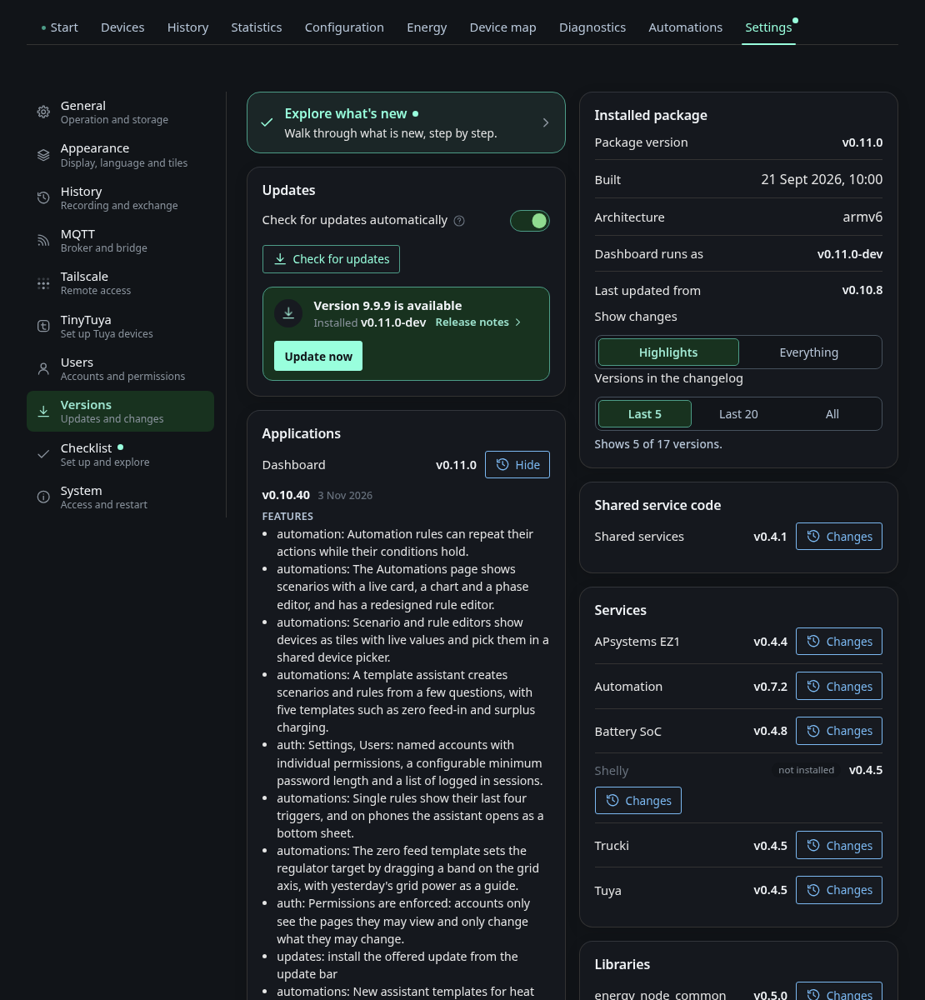
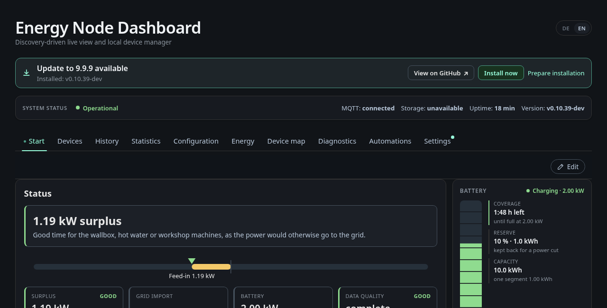
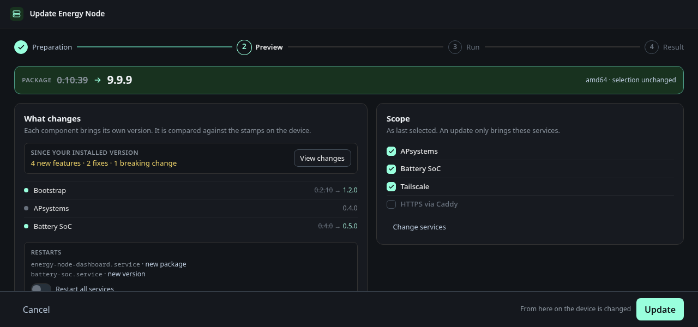

# Settings: Versions & updates

The tab **Versions** under *Settings* and the update of the node from the
dashboard.

## Versions

This tab shows what is installed on the node. The top card shows the installed
package with its version, build date and architecture, and the version the
dashboard itself runs as. When the dashboard was updated on its own after the
installation, the two differ and the page points that out. Below that every
application, service and library is listed with its version. **Changes** opens
its changelog. A service that is not installed is marked as such. The switch
in the package card chooses between the **Highlights** of each release and
**Everything**, which includes every commit. In the What's new dialog, a
highlight with details has a **More** link that opens its explanation, its image
and a link to the guide.

The setting **Versions in the changelog** chooses how many bundle versions the
changelog shows. **Last 5** is the default and shows the five newest versions.
**Last 20** shows the twenty newest, which is the most a bundle carries. **All**
shows every version the node has received, including the older ones it kept
from earlier updates.

The **Updates** card checks GitHub for a newer release when you click
**Check for updates**.

## Updating from the dashboard

When a newer release is out on GitHub, a bar under the header offers it
(**Update to … available**) with the installed version and a link to the
release on GitHub. The same notice appears under *Settings, Versions*, next to
**Check for updates** and the link **Release notes on GitHub**.

- **Install now** needs the permission *Install the offered update*
  (`install_updates`). It asks once more, then installs exactly the offered
  signed version. The dashboard restarts during the update, and the page
  reconnects on its own. The bar follows the steps and ends with **See what's
  new**, or names the failed step.
- **Prepare installation** needs *Change update settings* (`update_settings`)
  and opens the update page (`/redeploy/`) described below.
- Without these permissions the bar asks you to sign in as admin to start
  the installation. **Dismiss** hides the bar.

The permissions are set under [Settings, Users](settings-users.md#permissions).

The update page first downloads the newest signed release package for the
node's architecture. **View changes** lists what the new package changes. The
page shows the same preview as the
[desktop installer](../installer-update.md): which components change,
which services restart and which services the node runs. **Update** runs the
pending steps on the node itself, without the installer and without SSH.
