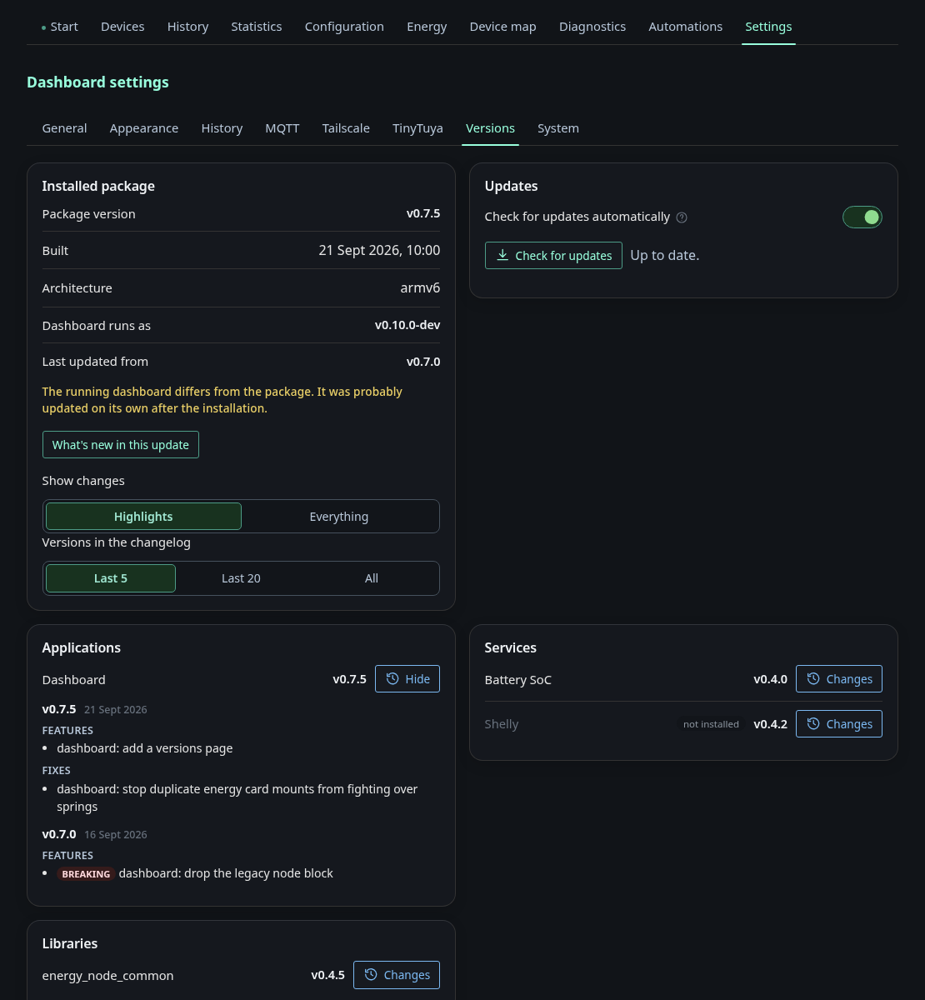
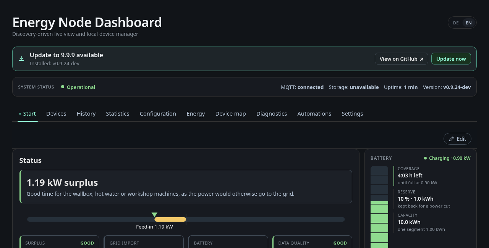
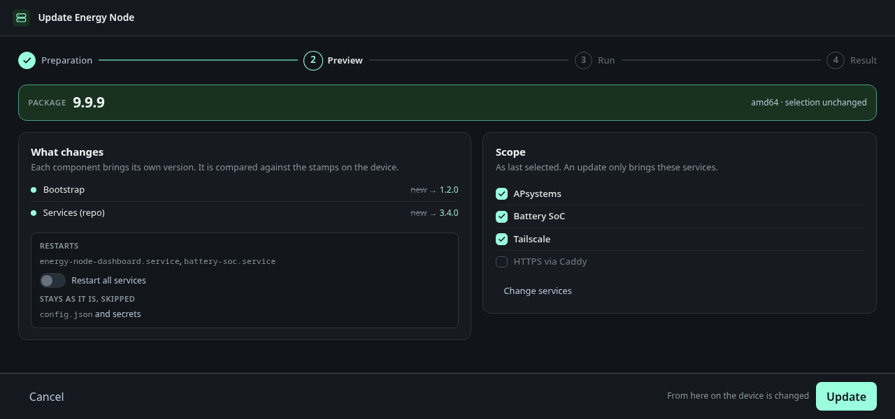

# Settings: Versions & updates

The tab **Versions** under *Settings* and the update of the node from the
dashboard.

## Versions

This tab shows what is installed on the node. The top card shows the installed
package with its version, build date and architecture, and the version the
dashboard itself runs as. When the dashboard was updated on its own after the
installation, the two differ and the page points that out. Below that every
application, service and library is listed with its version. **Changes** opens
its changelog. A service that is not installed is marked as such. The switch
in the package card chooses between the **Highlights** of each release and
**Everything**, which includes every commit.

The **Updates** card checks GitHub for a newer release when you click
**Check for updates**.

## Updating from the dashboard

When a newer release is out on GitHub, the header shows a notice next to the
title (**Update … available**). The same notice appears under
*Settings → Versions*, next to **Check for updates** and the link
**Release notes on GitHub**. For a registered user with the `system_actions`
role the notice opens the update page (`/redeploy/`). Everyone else gets the
release notes on GitHub in a new tab.

The update page first downloads the newest signed release package for the
node's architecture. **View changes** lists what the new package changes. The
page shows the same preview as the
[desktop installer](../installer.md#updating-a-node): which components change,
which services restart and which services the node runs. **Update** runs the
pending steps on the node itself, without the installer and without SSH.
