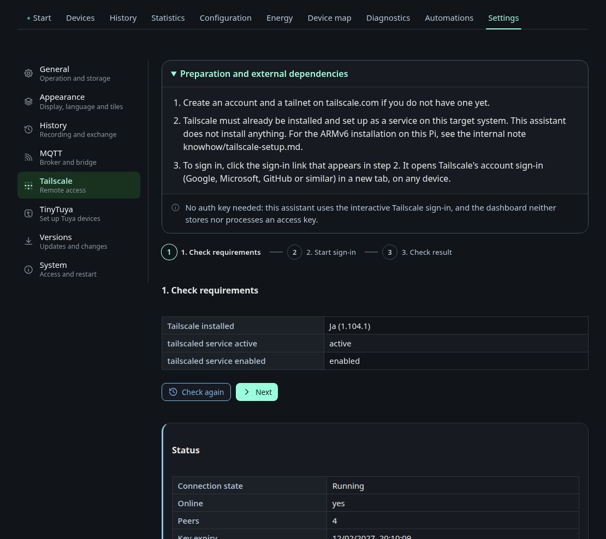
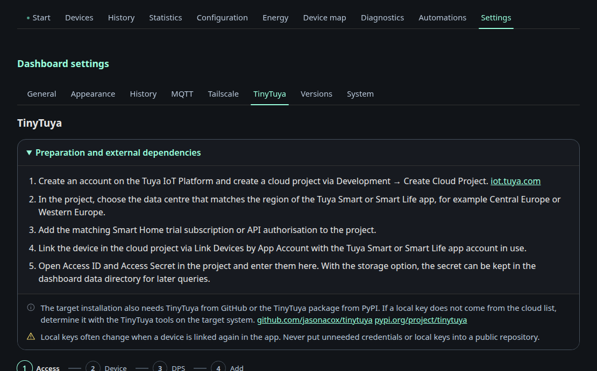

# Settings: Tailscale & TinyTuya

The tabs **Tailscale** and **TinyTuya** under *Settings*. Each only appears
when the matching service is installed on the node.

## Tailscale

The wizard has three steps: check the prerequisites, start the login, check the
result. It reports whether Tailscale is installed and whether `tailscaled` is
active and enabled. Once connected, it shows the connection state, the number
of peers and the key expiry, with buttons to check again, log out or restart
the service. Without it, putting a headless Pi on a tailnet means an SSH
session and copying a login URL by hand.

## TinyTuya

This four step wizard (credentials, device, data points, apply) wraps the
`tinytuya` cloud lookup. You enter the Tuya region and API credentials, list
the devices on the account, probe the device's data points locally and write
the result into `tuya_devices.json`. The probe step is there because a switch
is not always data point `1`. Credentials are only stored when you ask for it.
