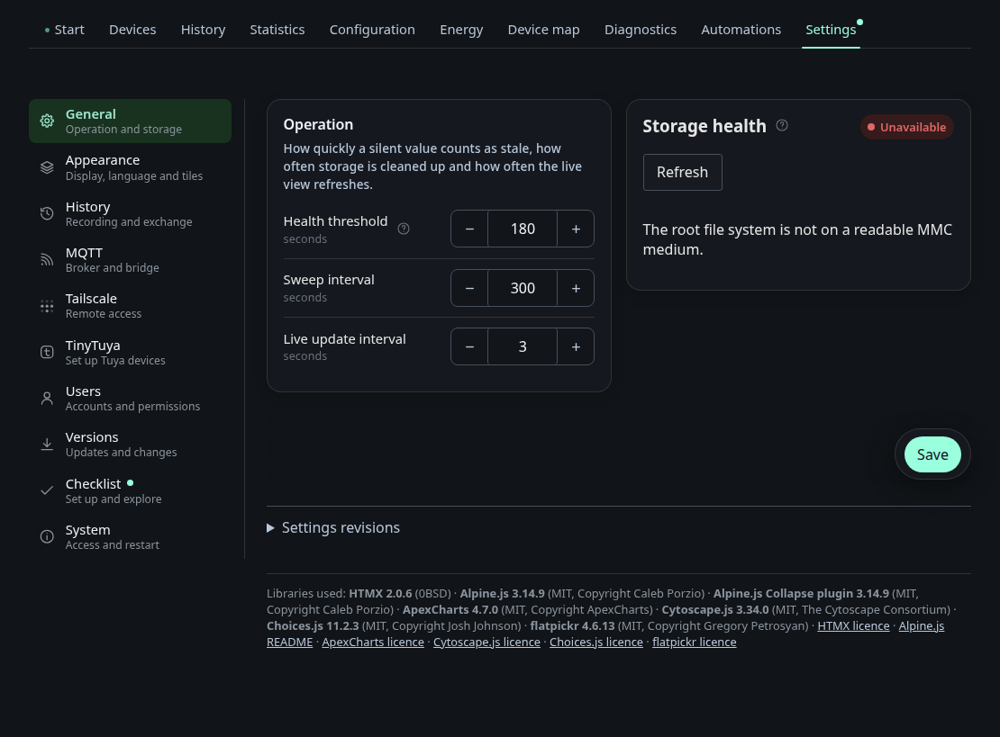

# Settings

Settings has eleven pages: General, Appearance, History, MQTT, Tailscale,
TinyTuya, Users, Backup, Versions, Checklist and System. Tailscale and TinyTuya only
appear when the matching service is installed.

On wide screens the pages are listed in a sidebar next to the content, each
with an icon and a short description. On narrow screens a button above the
content shows the current page. Tapping it opens the full list as a sheet from
the bottom. Swiping sideways on the button moves to the previous or next page.

## General

This tab holds the health threshold in seconds (10 to 3600, default 180).
It is the age at which a value counts as not updated and the health score of a
device falls to zero. The tab also holds the sweep interval, the live update
interval and the storage health check. On a Pi the check reads the SD card's
wear counters. When the root filesystem is not a readable MMC medium, the page
says so. Settings are versioned, and **Settings revisions** restores an earlier
state. The footer lists every bundled JavaScript library with its version,
license and license link.

## Other pages

| Page | Tabs | What you set there |
|---|---|---|
| [Appearance](settings-appearance.md) | Appearance | default view, colour scheme, language and number format |
| [History](settings-history.md) | History | recording and retention in the browser, exchange between devices, recording of the energy statistics |
| [MQTT](settings-mqtt.md) | MQTT | broker connection, the "Energy Node" device in Home Assistant, the bridge to the main site |
| [Tailscale & TinyTuya](settings-wizards.md) | Tailscale, TinyTuya | the setup wizards for the tailnet and for Tuya devices |
| [Users](settings-users.md) | Me, Accounts, Sessions | sign-in and password, accounts and permissions, presets, guest access, Home Assistant users, signed-in sessions |
| [Backup](settings-backup.md) | Backup | backup archives of the settings, devices, users, statistics and history, automatic backups before updates and on a schedule, restore |
| [Versions & updates](settings-versions.md) | Versions | installed versions, changelogs, update check and the update from the dashboard |
| [Checklist](settings-checklist.md) | Checklist | the steps of the first-time setup and the tours of new features |
| [System](settings-system.md) | System | system actions (restart and shutdown), the central configuration file |
