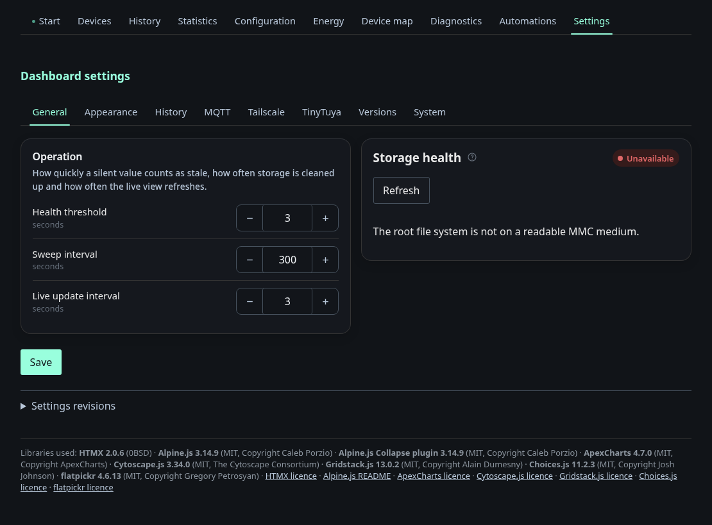

# Settings

Settings has eight sub-tabs: General, Appearance, History, MQTT, Tailscale,
TinyTuya, Versions and System. Tailscale and TinyTuya only appear when the
matching service is installed.

| Page | Tabs | What you set there |
|---|---|---|
| [General](#general) | General | health threshold, sweep and live update interval, storage check, settings revisions |
| [Appearance](settings-appearance.md) | Appearance | default view, colour scheme, language and number format |
| [History](settings-history.md) | History | recording and retention in the browser, exchange between devices, recording of the energy statistics |
| [MQTT](settings-mqtt.md) | MQTT | broker connection, the "Energy Node" device in Home Assistant, the bridge to the main site |
| [Tailscale & TinyTuya](settings-wizards.md) | Tailscale, TinyTuya | the setup wizards for the tailnet and for Tuya devices |
| [Versions & updates](settings-versions.md) | Versions | installed versions, changelogs, update check and the update from the dashboard |
| [System](settings-system.md) | System | current user, restart and shutdown, the central configuration file |

## General

This tab holds the health threshold in seconds (10 to 3600, default 180).
It is the age at which a value counts as not updated and the health score of a
device falls to zero. The tab also holds the sweep interval, the live update
interval and the storage health check. On a Pi the check reads the SD card's
wear counters. When the root filesystem is not a readable MMC medium, the page
says so. Settings are versioned, and **Settings revisions** restores an earlier
state. The footer lists every bundled JavaScript library with its version,
license and license link.
