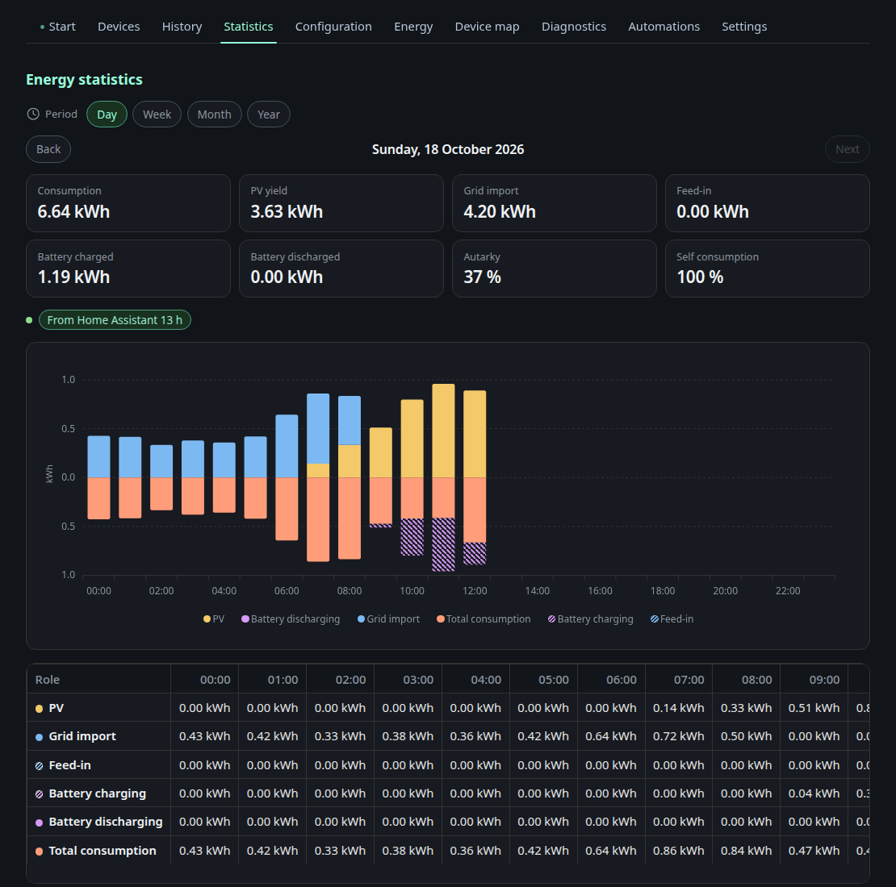

# Energy statistics

The **Statistics** tab shows how much energy flowed per role for a day, a week, a month or a year. Use **Back** and **Next** to move between periods.

- **Chart:** stacked bars per hour (day), per day (week and month) or per month (year). Generation sits above the zero line (PV, battery discharge, grid import), consumption is mirrored below it (total consumption, battery charge, grid export).
- **Key figures:** consumption, PV yield, grid import, grid export, battery charged and discharged, autarky and self consumption for the whole period.
- **Table:** kWh per role and interval, including your own consumer and producer categories.
- **Coverage:** for example "From Home Assistant 20 h, own recording 3 h, no data 1 h". Gaps stay gaps, nothing is extrapolated.

## Where the numbers come from

The dashboard records energy per hour on the node itself, whether or not a browser is open. When the Energy Node Companion is installed in Home Assistant, it delivers hourly values from the Home Assistant long term statistics. Those replace the own recording for the same hour and reach back as far as Home Assistant has data.

Days and months follow the time zone of the node.

## Tile

The **Energy statistics** tile shows consumption, PV yield, grid import, grid export and autarky for today, this week, this month or this year. **Open statistics** opens the tab with the same period. Add it in the layout editor.

## Own recording

Settings, History, Energy statistics:

- **Always** (default): the node records every hour.
- **Pause while the companion delivers:** the node stops writing while the companion delivers current hours. It keeps the last three hours in memory and writes them if the companion stops, so no gap appears.
- **Off:** the node does not record. Only hours from Home Assistant appear.

Below the choice you see whether the own recording is active, whether the companion is connected and how far the backfill from Home Assistant has come.
