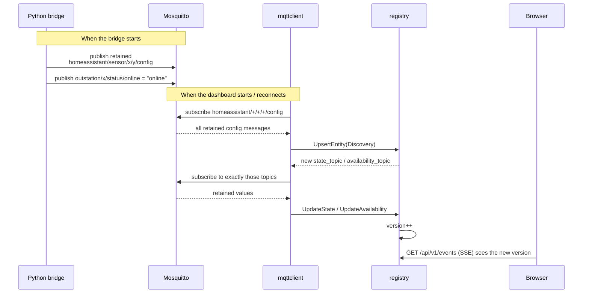
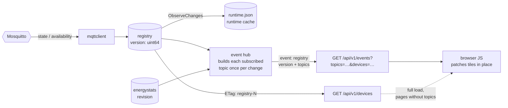
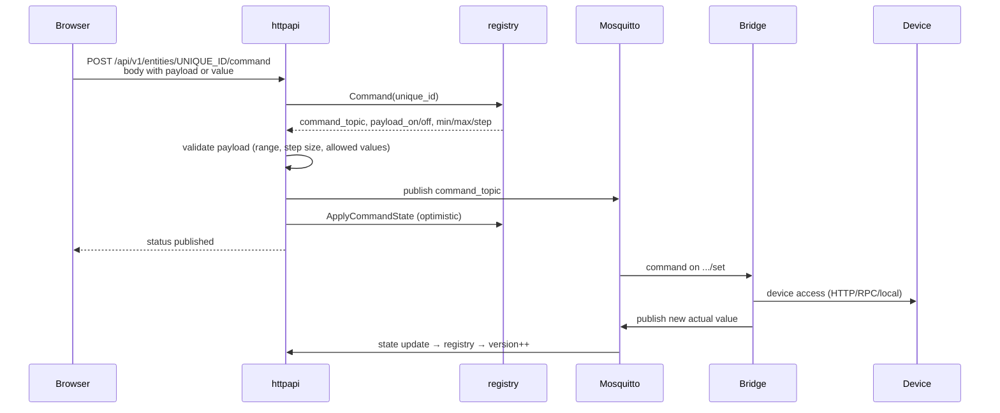

# Data flows: Devices

Part of [Data flows in the Energy Node system](data-flow.md). The chapter
numbers follow the overview.

## 3. Discovery: how the dashboard learns what exists

The dashboard has no device list in a configuration file. It learns everything
at runtime from retained Discovery messages. After a restart of the dashboard
the broker delivers the retained messages again.





The dashboard only subscribes to topics it has discovered, never to
`outstation/#`. If a Discovery field is empty, the dashboard does not see that
value.

An empty payload on a `config` topic deletes the entity, and topics nobody
needs any more are unsubscribed.

Parse errors are collected in `reg.DiscoveryErrors()` and shown by
`GET /api/v1/discovery`, so they do not get lost.

The `discovery_prefix` is configurable (default `homeassistant`).

### The dashboard as a Discovery publisher

The dashboard also announces itself. On every connect and reconnect it
publishes retained Discovery for the Home Assistant device "Energy Node". Two
parts share that device through `device.identifiers = ["energy_node"]`:

| Part | Entities | Values from |
|---|---|---|
| `internal/energydiscovery` | seven read only sensors: `pv_power`, `grid_import`, `grid_export`, `battery_charge`, `battery_discharge`, `house_load` (the `load_total` field), `battery_soc` | the balance topic `outstation/energy_node/energy/balance`, one field each through `value_template` |
| `internal/nodeagent` | Pi diagnostics, poll rate, simulation switch | `outstation/energy_node/…` |

The unique IDs are `energy_node_<object_id>`, for example
`energy_node_pv_power`. The Energy Node Companion finds these sensors in Home
Assistant by exactly these IDs (§14), so they must not change.

Three more sensors are optional: `energy_node_wallbox`, `energy_node_heat_pump`
and `energy_node_custom_<id>` for each custom category. They are announced only
once something is assigned to the wallbox, the heat pump or the category. The
setting `energy_sensors` decides which of them are announced, and a missing
setting counts as on. A category that is deleted or unassigned is retracted
with an empty retained config. The announced sensors are remembered in
`energydiscovery/announced.json`, so the retraction also works after a restart.

All energy sensors point to `outstation/energy_node/status/online` as their
availability. When Tailscale reports a MagicDNS name, the device block carries
it as `configuration_url`, and the configs are published again when the name
changes.

The switch `publish_energy_device` in `mqtt.json` (default on) turns the
energy sensors off. The dashboard then publishes empty retained payloads on the
same topics, which removes the entities in Home Assistant. Without these
sensors the companion has no source for the energy roles.

The dashboard subscribes to its own Discovery like to any other, so the
"Energy Node" device also shows up in its own registry.

## 4. Live values all the way to the browser

The browser never talks MQTT. The registry counts every change in a version
number, and one SSE stream carries the version together with the topics the
page subscribed to.





Each event carries `version` and one branch per subscribed topic:

| Topic | Content | Version source |
|---|---|---|
| `energy` | energy snapshot with balance | registry |
| `entities` | entity values, complete on connect, then only changes (`entities_delta`) | registry |
| `diagnostics` | summary of the diagnostics | registry |
| `devices` | structure, availability, status and with `:auto` the compact rows of the devices chosen with `?devices=`, as a delta after the first event | registry and device preferences |
| `energy_stats` | only `{"rev": N}` of the energy statistics | statistics store, so a backfilled hour from Home Assistant triggers an event while the registry is idle |

Without `?topics=` a client gets all topics except `devices`. With an empty
`?topics=` it gets only the version and fetches `GET /api/v1/devices` itself
when the version changes. The exact contract is in [api.md](api.md).

The hub builds a topic only while someone subscribes to it, and only once per
change for all connections. A connection that falls four events behind is
dropped and starts again with a complete event after the browser reconnects.

The send interval of the hub comes from `settings.json`
(`live_update_interval_seconds`, default 3 s) and takes effect without a
reconnect.

`GET /api/v1/devices` returns `ETag: "registry-N"`. With a matching
`If-None-Match` the server answers `304`.

The runtime cache (`runtime.json`) survives restarts. It remembers the last
values and restores them when an entity comes back, so tiles are not empty
after a restart.

## 5. Commands: from the click to the device





The dashboard only publishes to `command_topic`s from Discovery. No API path
writes to an arbitrary topic, except the fixed automation test on
`outstation/automation/test/set`.

Each command is recorded per device in an in-memory history (at most 12
entries) and appears in `GET /api/v1/devices/{id}` as `command_actions`.

## 12. Data flow on the device map

The [data flow layer](../dashboard/device-map.md#data-flow-layer) of the device map
is drawn from what the services declare in their JSON schemas. Every field with
`"format": "mqtt-topic"` needs an `x-dataflow` annotation:

| Annotation | Meaning |
|---|---|
| `direction` | `input` or `output` |
| `label` | text on the edge |
| `json_key_field` | field that holds the JSON key, when the payload is JSON |
| `unit_field` | field that holds the unit |
| `x-dataflow-label-key` | translation key for the label, on the field |
| `x-dataflow: false` | leave the field out of the data flow (`true` is not allowed) |

A service that lists entries, such as several banks, puts `x-dataflow-node` on
the schema of one item with `id_field`, `label_field` and `device_id_template`.
Each entry becomes its own node. It is linked to a device when the template
gives the ID of a known device, otherwise it stays a service node.

The contract test `TestEveryServiceTopicFieldDeclaresDataflow` in
`dashboard/internal/dataflow/contract_test.go` walks the schema of every
service and fails for a topic field without an annotation, so a new service has
to decide for each topic whether it appears in the data flow.
