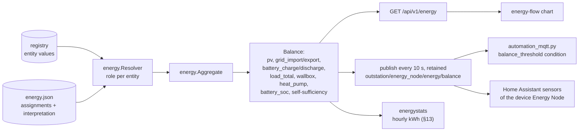
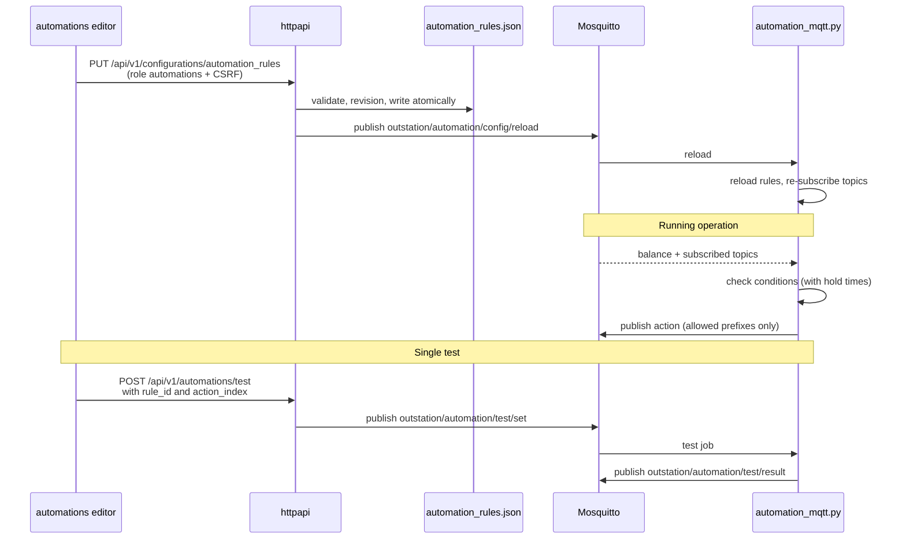
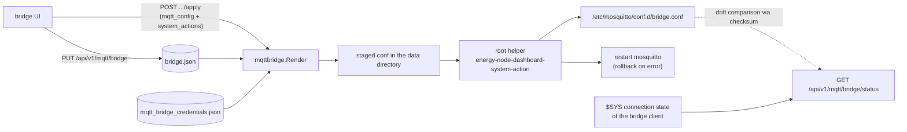

# Data flows: Energy and automations

Part of [Data flows in the Energy Node system](data-flow.md). The chapter
numbers follow the overview.

## 7. Energy balance

The balance is derived data. Entities get roles, and the roles produce a
balance object that is available over HTTP and over MQTT.





Measurement chains run first. `Aggregate` calls `evaluateChains` as a pre-pass
before it walks the entities. Reference points of a chain are skipped, because
their power is already in the counting point. When the counting point has no
fresh value, the pre-pass hands the value of the nearest fresh point of its
chain to the entity loop as a substitute. Before that, `correctedSubstitute` moves the
value by the learned loss of the segments on the way, or keeps the raw value while
one of them is not learned. The entity gets the quality
`substitute`, and `substituteValue` clamps a negative value to zero except for
battery, grid and storage roles. The same pre-pass delivers the chain states
for the energy page.

The payload is `{"at": <unix s>, "balance": {…}, "interpretation": {…}}`.
`balance.categories` holds one value in watts per custom category, keyed by the
category ID. Consumers are never negative, while producers and storage keep
their raw sign. The seven energy sensors from §3 each pick one
field of `balance`, and Home Assistant records them. These recorded values are what the companion later
supplies back (§14).

The automation service takes the balance as finished numbers and computes
nothing itself. If the balance is older than `balance_max_age_s` (default
30 s), rules based on it stop firing.

## 8. Automations





The condition types are `balance_threshold`, `battery_soc`, `topic_value`,
`time_window`, `sun_window` and `entity_value`. The action types are `publish`
and `notification`.

## 9. Path to the main site

The Mosquitto bridge mirrors both namespaces in both directions to the main
site (`topic outstation/# both 0`, `topic homeassistant/# both 0`), so the main
site sees the same Discovery and measurement topics as the dashboard. These are
the defaults, the topic list is editable per connection in `bridge.json`.

Home Assistant on the main site creates its MQTT entities from the mirrored
Discovery, the bridges' devices as well as the dashboard's own "Energy Node"
device. The companion depends on this path (§14): it finds the dashboard's
series in Home Assistant only through these MQTT entities.

The dashboard manages the bridge but is not part of its data path:





The dashboard never writes to `/etc` itself. It puts a file into its own data
directory and lets a root helper do the rest. The trust boundary is the helper,
not the dashboard process: it reads exactly one compiled-in staging path, requires
a regular file owned by the dashboard user of at most 8 KB and 200 lines, and
accepts only lines that match a fixed directive allowlist (`connection`,
`address`, `topic` and the like). A compromised dashboard process therefore
cannot slip in `log_dest`, a new listener or any other directive. The helper keeps
the previous file as a backup and restores it if Mosquitto does not restart. The status combines three
sources: the systemd service state, the `$SYS` connection state and a checksum
comparison between the stored and the installed configuration.

## 15. Measurement chain losses

The recorder keeps the losses of the measurement chains next to the energy
hours. The code is in `dashboard/internal/energystats/chain_*.go`. A probe
turns the chain states into samples, the integrator turns the samples into
hours, and the store keeps the hours on disk.

### Probe

The dashboard's main loop calls `Recorder.Observe` every 10 seconds with a
snapshot of the energy balance. The snapshot carries the state of every chain.
`ChainSampleOf` turns the chains into one sample:

- A chain in standby yields only a standby entry for its first point. It is in
  standby when the first point is fresh and reads at least 1 W, and every other
  point is fresh and reads below 10 W.
- A chain with the flow `idle` yields nothing.
- Any other chain yields, for each available segment that has an efficiency,
  the absolute power at its source and at its target in W. A segment without
  efficiency, because its source reads below 10 W, yields nothing.

### Integrator

`ChainIntegrator` weights the samples in time, like the energy integrator. A
sample counts until the next one, for at most `MaxHold`, which is 5 minutes.
Hours split at the UTC hour boundary. Each closed hour holds, per directed pair
of neighbouring points, the source and target energy in kWh and the covered
seconds, and, per standby entity, the energy in kWh and the covered seconds.
A sample that is not after the previous one is dropped.

The recorder resets the integrator when the clock is not ready, and when wall
clock and monotonic clock differ by more than 30 seconds (`ClockJumpTolerance`).
A reset drops the unfinished hour. When recording is switched off or the
dashboard shuts down, the unfinished hour is flushed and written. In the pause
mode while the companion delivers, the chains keep running and are written
without a backlog.

### ChainStore

`ChainStore` keeps the hours in `<data dir>/energystats/chains/<jjjj-mm>.json`,
one file per UTC month. `Add` sums an hour into the stored cell. Energy is
added, and the covered seconds are added and capped at 3600 per hour. The
changed file is written atomically at once, and `onChange` tells the energy
statistics to reload. A month file is read on first access and cached only
while it has a file or a pending write. A damaged file is renamed to
`.corrupt`, and that month starts empty.

### File format

Each `<jjjj-mm>.json` is version 1 and holds only the hours that have data:

```json
{
  "version": 1,
  "start": "2026-11-01T00:00:00Z",
  "pairs": [
    {"source": "inverter", "target": "meter", "hours": {"10": [0.512, 0.481, 1800]}}
  ],
  "standby": [
    {"entity": "plug", "hours": {"10": [0.004, 1800]}}
  ]
}
```

- `start` is the first instant of the month in UTC.
- The keys of `hours` are the hour indexes within the month, counted from 0.
  Index 10 in the example is 10:00 UTC on 1 November.
- A pair holds `[source kWh, target kWh, seconds]`, a standby entry holds
  `[kWh, seconds]`. Energy is rounded to 1 mWh.

On reading, the file is rejected when the version is not 1, when `start` is not
the first of a month, when an hour key lies outside the month, when a value list
has the wrong length, or when the seconds are not an integer from 0 to 3600.
A rejected file is moved aside as described above.

### Learned loss and diagnosis

The learned loss lives in `<data dir>/energystats/chains/learned.json`, next to
the hours. It is separate from the hours and is not a month file. The path is
the main loop of `cmd/dashboard` drives it:

1. Every 10 seconds `energy.Aggregate` builds the snapshot of the balance.
2. If the clock is ready, `Monitor.Observe` takes the same snapshot. It runs the
   detectors (unit, frozen, contradiction, sign, drift) and learns the samples
   of the segments.
3. The next `Aggregate` reads the model back through the `energy.ChainInsight`
   interface: `Segment` for the substitute correction and the normal range,
   `PairLearned` for the learning state, `Findings` for the notices and `Curve`
   for the efficiency curve. The model is therefore one pass behind the readings.

`ChainInsight` is the only way from the model to the energy package. The energy
package does not know the table.

The detector thresholds and the learning rules are described for users in
[Efficiency](../dashboard/efficiency.md). The hold times are `chainwatch.DefaultHolds`.
For a look at the demo, `ENERGY_NODE_CHAIN_HOLD_SECONDS` sets all five to one
number of seconds.

`learned.json` is version 1 and holds one entry per directed pair of neighbouring
points:

```json
{
  "version": 1,
  "pairs": [
    {
      "source": "inverter",
      "target": "meter",
      "first_seen": "2026-10-30T08:00:00Z",
      "scale_source": 1,
      "scale_target": 1,
      "invert_source": false,
      "invert_target": false,
      "agree": 12,
      "opposite": 0,
      "classes": {"10": [1080, 512, 481, 4]}
    }
  ]
}
```

- `classes` is keyed by the load class of the counting power. Class 10 covers
  500 to 550 W. Each value is `[N, source W, target W, deviation W]`, where N
  counts the samples up to 4320.
- `scale_*` and `invert_*` are the values the points had when the pair was
  learned. `agree` and `opposite` are the sign counts of the sign detector.
- Pairs are sorted by source and target, and values are rounded to three
  decimals, so an unchanged table gives the same bytes.

A changed scale of one of the points drops the pair in both directions. A changed
invert resets only the sign counts. Pairs are dropped only when the chain
configuration changes: at startup, after `energy.json` has loaded, and when a
chain is saved. Pairs that are no longer adjacent in any chain go then. A
snapshot that lacks a chain for a moment only drops the active findings of that
chain, not the learned data.

The table is saved atomically once an hour while it has changed, and on shutdown.
A failed save is logged and retried after 5 minutes. A damaged file or an unknown
version is moved to `learned.json.corrupt`, and the table starts empty.

### Queries

`Service.ChainStats` serves `GET /api/v1/energy/stats/chains` (permission
`view_stats`). It sums the hours of each chain per bucket of the requested
period and for the whole period. Hours from the current one on are not counted.

`Service.Efficiency` serves `GET /api/v1/energy/efficiency` (permission
`view_efficiency`). Per chain it reports:

- `round_trip_30d`: the discharged energy divided by the charged energy at the
  counting point over the 30 days up to the current hour. It needs a counting
  point with the storage role and at least 0.1 kWh of charge.
- `standby_w_30d`: the standby energy divided by the standby seconds, in W.
- `loss_month_kwh`: the loss of the local calendar month.
- `days`: seven local days, oldest first, each with the loss and the efficiency.

The loss of a period is the standby energy plus, for each segment and both of
its directions, the source energy minus the target energy. The efficiency of a
period is the product of the target divided by the source energy of each
segment. A segment whose source energy is below 0.01 kWh leaves the efficiency
empty.

## 16. Chain signals for automations

The chains have a second retained topic next to the balance. It is meant for
the automation conditions `chain_finding` and `chain_value`, which read it once
the automation service supports them. The dashboard publishes it every 10
seconds, after the balance, from the same snapshot. The code is `energy.BuildChainSignals` in
`dashboard/internal/energy/chain_signals.go`, the topic is
`energydiscovery.ChainsTopic`.

```json
{
  "at": 1794045600,
  "chains": {
    "wechselrichter": {
      "label": "Wechselrichter",
      "flow": "down",
      "loss_w": 15,
      "efficiency_pct": 95.1,
      "standby_w": null,
      "substitute": false,
      "no_current_values": false,
      "findings": [
        {"kind": "frozen", "from": "wr_leistung", "since": 1794045000}
      ],
      "best_down": {"from_w": 250, "to_w": 500},
      "best_up": null
    }
  }
}
```

- `at` is the time of the payload in Unix seconds. `since` of a finding is the
  Unix second it was first seen.
- `loss_w` is the sum of the segment losses, `efficiency_pct` the product of the
  segment efficiencies in percent. Both are rounded to one decimal and stay
  `null` when the flow is `idle`, when a segment is not available, or, for the
  efficiency, when a segment has none.
- `standby_w` is set while the chain is in standby (see §15), otherwise `null`.
- `best_down` and `best_up` are the most efficient power spans of the learned
  curve, `null` without a learned model.
- The payload lists every chain with its ID as key. The topic is retained. When
  the last chain goes away, one empty `chains` object is published so the old
  signal disappears, and nothing is published again until a chain exists.

The balance and the chain signals stay separate topics, so a chain signal never
changes the balance. The automation conditions are the only planned readers.
The dashboard's own views keep reading the snapshot, not this topic.
