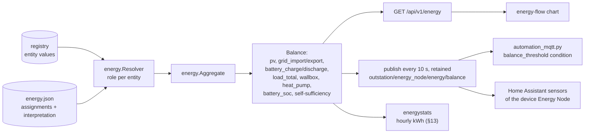
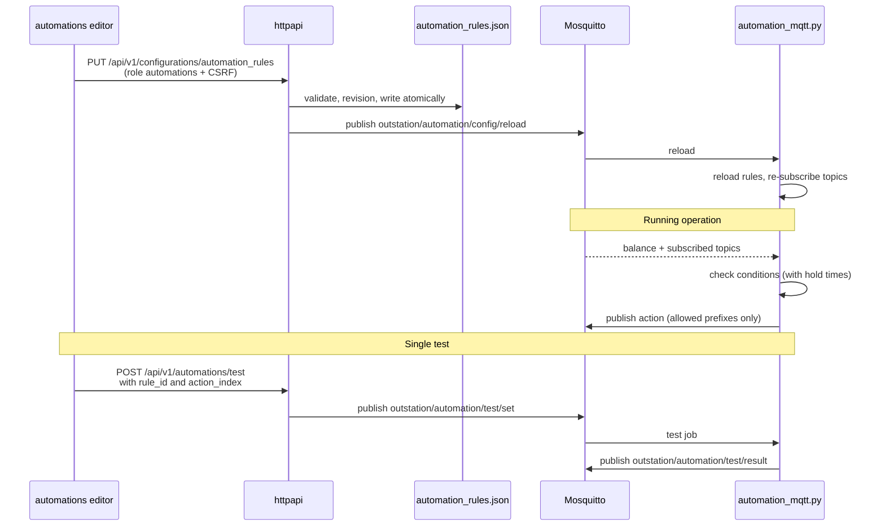
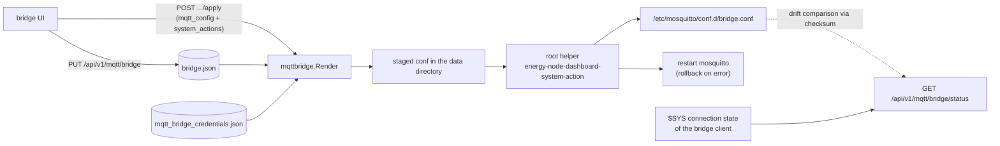

# Data flows: Energy and automations

Part of [Data flows in the Energy Node system](data-flow.md). The chapter
numbers follow the overview.

## 7. Energy balance

The balance is derived data. Entities get roles, and the roles produce a
balance object that is available over HTTP and over MQTT.





Measurement chains run first. `Aggregate` calls `evaluateChains` as a pre-pass
before it walks the entities. Reference points of a chain are skipped, because
their power is already in the counting point. When the counting point has no
fresh value, the pre-pass hands the value of the nearest fresh point of its
chain to the entity loop as a substitute. The entity gets the quality
`substitute`, and `substituteValue` clamps a negative value to zero except for
battery, grid and storage roles. The same pre-pass delivers the chain states
for the energy page.

The payload is `{"at": <unix s>, "balance": {…}, "interpretation": {…}}`.
`balance.categories` holds one value in watts per custom category, keyed by the
category ID. Consumers are never negative, while producers and storage keep
their raw sign. The seven energy sensors from §3 each pick one
field of `balance`, and Home Assistant records them. These recorded values are what the companion later
supplies back (§14).

The automation service takes the balance as finished numbers and computes
nothing itself. If the balance is older than `balance_max_age_s` (default
30 s), rules based on it stop firing.

## 8. Automations





The condition types are `balance_threshold`, `battery_soc`, `topic_value`,
`time_window`, `sun_window` and `entity_value`. The action types are `publish`
and `notification`.

## 9. Path to the main site

The Mosquitto bridge mirrors both namespaces in both directions to the main
site (`topic outstation/# both 0`, `topic homeassistant/# both 0`), so the main
site sees the same Discovery and measurement topics as the dashboard. These are
the defaults, the topic list is editable per connection in `bridge.json`.

Home Assistant on the main site creates its MQTT entities from the mirrored
Discovery, the bridges' devices as well as the dashboard's own "Energy Node"
device. The companion depends on this path (§14): it finds the dashboard's
series in Home Assistant only through these MQTT entities.

The dashboard manages the bridge but is not part of its data path:





The dashboard never writes to `/etc` itself. It puts a file into its own data
directory and lets a root helper do the rest. The trust boundary is the helper,
not the dashboard process: it reads exactly one compiled-in staging path, requires
a regular file owned by the dashboard user of at most 8 KB and 200 lines, and
accepts only lines that match a fixed directive allowlist (`connection`,
`address`, `topic` and the like). A compromised dashboard process therefore
cannot slip in `log_dest`, a new listener or any other directive. The helper keeps
the previous file as a backup and restores it if Mosquitto does not restart. The status combines three
sources: the systemd service state, the `$SYS` connection state and a checksum
comparison between the stored and the installed configuration.
