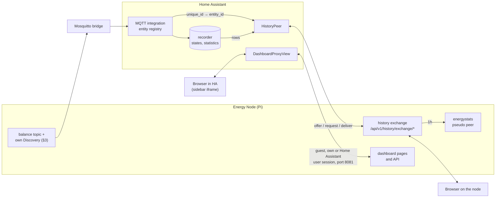
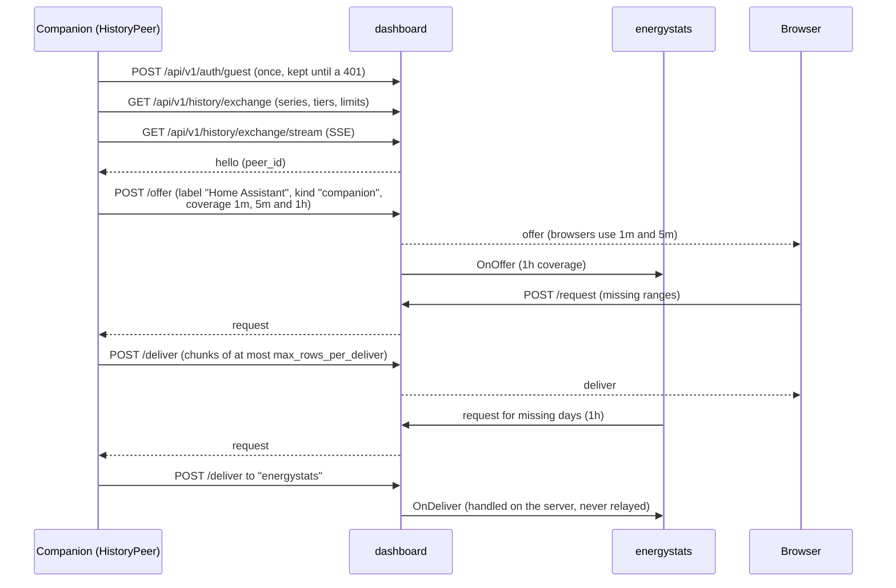
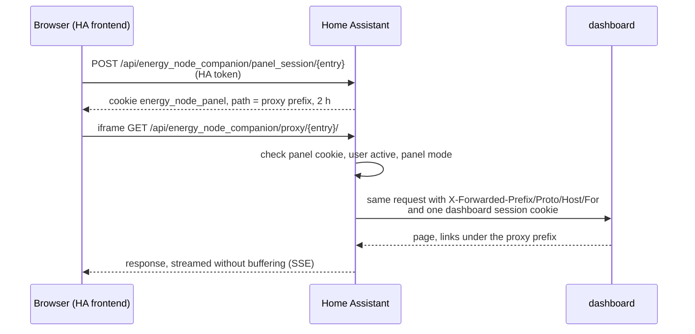

# Data flows: Home Assistant

Part of [Data flows in the Energy Node system](data-flow.md). The chapter
numbers follow the overview.

## 14. Home Assistant and the Energy Node Companion

The integration `energy_node_companion` runs inside Home Assistant and connects
it with one dashboard per config entry. It has three data paths, and each can be
switched on its own in the options: history (`history`), energy statistics
(`stats`) and the sidebar page (`panel`: all users, administrators only or off).





### Where the companion's values come from

The companion creates no entities and stores no values of its own. Everything
it supplies comes from the Home Assistant recorder, about MQTT entities that
exist only because the dashboard and the bridges announced them through
Discovery and the bridge mirrored them (§3, §9).

It maps the dashboard's series to Home Assistant entities through the entity
registry, platform `mqtt`, by `unique_id`:

| Dashboard series | Home Assistant source |
|---|---|
| `role:pv` | `energy_node_pv_power` |
| `role:grid` | `energy_node_grid_import` minus `energy_node_grid_export` |
| `role:battery` | `energy_node_battery_charge` minus `energy_node_battery_discharge` |
| `role:battery_soc` | `energy_node_battery_soc` |
| any extra history entity | the `sensor` or `number` with the same `unique_id` |

`role:load`, `role:wallbox` and `role:heat_pump` are never supplied in the
`1m` and `5m` tiers. `house_load` carries `load_total` and not the measured
`load` role, and the dashboard publishes no sensor for wallbox and heat pump.

| Tier | Source in the recorder | Fallback |
|---|---|---|
| `1m` | state changes, weighted by how long each value held | none |
| `5m` | 5-minute statistics (`mean`, `min`, `max`) | state changes, for entities without statistics and for difference series |
| `1h` | hourly long term statistics, per role | none |

For `1h` each role takes either an energy meter picked in the options (the
hourly `change` in Wh, a negative change from a meter reset drops the hour) or
the power sensor from §3 (the hourly `mean` in W). Wallbox and heat pump are
only available with a meter. Values are converted to the dashboard's unit, and
a series whose unit cannot be converted is left out instead of supplying wrong
numbers. Unavailable states stay gaps.

### Exchange with the dashboard





The companion is a pure source. It never asks for rows, keeps no store of its
own and does not feed the server's ring buffer. It sends `1h` only when the
announcement lists that tier, so an older dashboard is not sent an offer it
would reject. `kind: "companion"` is passed on only for this peer, and only then
does the server hand the `1h` coverage to `energystats`. Browsers ignore `1h`.

The companion recomputes its coverage every ten minutes and sends a new offer
only when it changed. When another peer joins it sends the current offer again.
On a lost connection it reconnects with a pause growing from 2 to 60 seconds.
The guest session is kept across reconnects, because every guest login writes
`users.json` on the node's SD card.

The companion needs no change for the scenario outputs. `series_map.resolve()`
resolves every announced series that is not a role through the MQTT `unique_id`
in the entity registry, and the scenario series `automation_scenario_<id>_output`
is exactly that `unique_id`.

### Pairing and the companion port

Besides the main port (8080), the dashboard listens on port 8081 for the
companion. Port 8081 serves HTTPS with a certificate the dashboard creates once
(ECDSA P-256, 20 years, `companion-tls.pem` and `companion-tls.key` in the data
directory). Its routes live under `/api/v1/companion/*` and exist only there.
Every request needs the pairing token as a bearer token, except the pairing
itself. The gate treats a request as insecure unless `X-Forwarded-Proto` is
exactly `https`.

The pairing code is 12 characters, created in the Users section of the
dashboard and valid for 10 minutes. It never travels. The companion and the
dashboard each send an HMAC-SHA256 over the certificate fingerprint of port
8081 and a fresh nonce, keyed with the code. The dashboard answers with the
token and a second proof that also covers the token. So the code only works
with this certificate, and a pairing cannot be replayed against another node.
A new pairing or an unpairing ends all Home Assistant sessions and closes the
open stream at once.

Over the stream (`GET /api/v1/companion/stream`, server-sent events) the
dashboard asks Home Assistant to check a password. A `verify` event carries
the user name and password of a sign-in attempt, the companion answers on
`POST /api/v1/companion/verify/{id}`, and the dashboard waits for at most five
seconds. Home Assistant accounts only sign in over HTTPS, and a name that is
also a local account never reaches this check. The companion sends a
`user-changed` report when a Home Assistant user is changed or removed, so the
dashboard drops that user's sessions. The stream also carries a `ping` every
25 seconds.

The companion holds one dashboard session per Home Assistant user. It asks
for it with `POST /api/v1/companion/session`, which creates the account on first
use, and keeps the token in memory until it expires. The next request after
that asks for a new one. Sessions from that route are marked `via: companion` and work only on
port 8081, so a cookie of one of them is refused on the main port.

### The sidebar page

The page in the Home Assistant sidebar is the real dashboard, passed through by
Home Assistant. The browser only talks to Home Assistant, the Home Assistant
host is the only one that has to reach the node.





The proxy sets the forwarding headers itself and drops whatever the browser
sent in them, because the dashboard trusts `X-Forwarded-Proto` for its HTTPS
check. The dashboard resolves its base path per request from
`X-Forwarded-Prefix` (`internal/basepath`).

Home Assistant's cookies, the panel cookie and the HA token from
`Authorization` stay in Home Assistant. Upstream the request carries exactly
one dashboard session and at most the language cookie `lang`. The proxy picks
that session in this order:

1. The browser's own dashboard session, if the browser has signed in to the
   dashboard itself.
2. With a pairing: the session of the Home Assistant user on port 8081. The
   proxy sends the pairing token as the bearer and the session as a cookie. A
   disabled account gets no session here.
3. The guest session the proxy shares with the history peer.

Without a pairing the proxy uses the guest session on the main port, as
before. A logout through the panel does not end the shared guest session, and
a `GET` or `HEAD` on a session that hits a 401 is repeated once after a new
login. A 401 with the code `companion_unauthorized` means the dashboard no
longer accepts the pairing. The proxy then answers 502, and the integration
drops the token and fingerprint from its entry, logs a warning and reloads
itself as a guest.

The panel cookie lives only in Home Assistant's memory, so after a restart of
Home Assistant the page fetches a new one. The page renews it every 30 minutes
while it is open.
