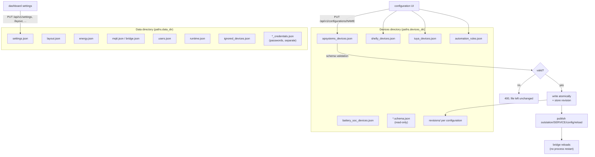
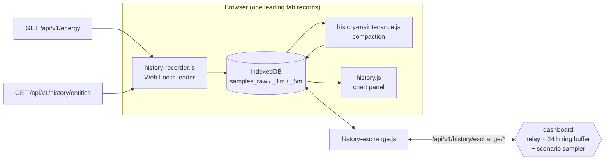

# Data flows: Storage

Part of [Data flows in the Energy Node system](data-flow.md). The chapter
numbers follow the overview.

## 6. Configuration: files, not a database

There are two directories with different owners.





Writes are atomic (temp file and `rename`) and store a revision first. Every
configuration can be viewed under `.../revisions` and restored with
`.../restore`.

The reload goes over MQTT and not through systemd. The target service swaps its
configuration inside the running process. `automation_rules` maps to the
service ID `automation`, otherwise `{name}_devices` maps to `{name}`.

Passwords always live in their own files (`*_credentials.json`), so they stay
out of the revision copies. The API never returns them in clear text and only
reports `password_configured: true/false`.

## 10. Browser history (IndexedDB, not on the Pi)

The dashboard keeps a rolling measurement history in each browser's IndexedDB
(`energy-node-dashboard`, store version 2). The Pi stores nothing.
`internal/history` on the server only defines the data contract and the
retention window and holds no samples.





The browser records the energy roles (`role:pv`, `role:grid_import`, …) from
the balance. It also records the entities listed in `settings.json` under
`history_extra_entities` and polls their values from
`GET /api/v1/history/entities`. That endpoint is an allowlist on the server, so
the browser cannot ask for arbitrary IDs. The sampling interval comes from the
dashboard settings.

Each browser has one recorder. The writing tab holds a Web Locks lease
(`energy-node-historizer`). The other tabs only read and are notified over a
`BroadcastChannel`. Two tabs writing slightly different timestamps would break
the composite key and bloat the store.

There are three tiers with limited retention: `samples_raw` (~6 h), `samples_1m`
(~7 days) and `samples_5m` (~30 days). `history-maintenance.js` compacts raw to
1 m and 1 m to 5 m in the leading tab. It moves a watermark forward in the
`meta` store, so each run only touches the newest span.

The hourly resolution is not kept in the browser. The history page reads it from
the node's energy statistics (§13).

For the exchange between devices (`/api/v1/history/exchange/*`) the server only
relays and stores nothing. Offers go to all peers. Requests and deliveries go to
exactly one peer over an SSE stream, and nothing is written to disk. A 24 h ring
buffer in memory joins as the pseudo-peer `server`, so a single browser can
still fill gaps after a reload. Peers announce their coverage as coarse rasters
(counts per time bucket), compare them and request only the missing ranges.
Only the `1m` and `5m` tiers are exchanged. Raw samples are not, because their
offset timestamps would not deduplicate. Protocol version 1 allows 500 rows per
delivery, 20 000 per request and 1 MiB per body.

The ring buffer has a second source besides the browsers: the dashboard itself.
Every 10 s the energy tick hands its snapshot to a sampler. The sampler keeps the
open minute in memory and writes one row per series when the minute closes. Each
row is stamped with the start of its minute. The series are `role:grid` (import minus export) and the
output sensors of every automation scenario with `while.mode` set to `regulate`.
Without such a scenario the sampler writes nothing, so the exception stays as
narrow as possible. A row a browser has already delivered for the same minute
stays as it is. The rows are never written to disk and the automation service
never reads them back.

Each browser runs the exchange in one of two modes, stored per device in
`localStorage` (`history-exchange-mode`). `always` offers its own coverage and
requests every gap of the full raster window, as described above. `on-demand`
is the default. The device keeps its SSE stream open, feeds the ring buffer
and answers requests, but it sends no offer of its own. It only plans requests
for the ranges the history page or a history tile currently shows
(`HistoryExchange.watchRange()`), and only in the resolution shown. The raw
resolution watches the minute tier. The 1h resolution watches nothing, because
the hourly means come from the server. Tabs that do not lead forward these ranges to
the leading tab over the recorder's BroadcastChannel and get a message back
when rows arrive. In `always` mode a device always offers its own coverage. In `on-demand` mode
it offers it only if the per-device choice `history-exchange-serve` is `on`,
and is otherwise a source only through the ring buffer.

Minute values are only exchanged up to 30 minutes before now (`SETTLE_MS` in
`history-coverage.js`). Until then devices can hold different numbers of samples
for the same minute, so the newest half hour would not match. Each watched range
also asks for the last 30 minutes of the minute tier once, and again at most
every five minutes while the range stays on screen. That request only goes out in
`on-demand` mode and while the exchange stream is connected.

Home Assistant can join as a permanent peer that only supplies data, through
the Energy Node Companion (labelled "Home Assistant"). Which series it maps and
from which recorder tables it answers is described in §14.

## 13. Energy statistics

The dashboard records energy per hour and role on its own, whether or not a browser is open. Every 10 seconds `internal/energystats` takes the energy snapshot with its derived balance and integrates the balance fields (`pv`, `grid_import`, `grid_export`, `battery_charge`, `battery_discharge`, `load_total`, `base`, `wallbox`, `heat_pump` and consumer or producer categories as `custom:<id>`) into kWh. A value counts until the next snapshot, for at most 5 minutes. A snapshot with a stale power role is skipped. Recording waits until the system clock is synchronised, and a clock jump discards the running hour.

Hours are stored per UTC month in `<data dir>/energystats/<yyyy-mm>.json`. Each hour carries its source: own recording or Home Assistant. Home Assistant always wins over own recording.

`GET /api/v1/energy/stats?period=day|week|month|year&at=<date>` sums the hours into hours, days or months in the local time zone and adds autarky and self consumption for each bucket and for the whole period. Weeks run Monday to Sunday and are summed into days.

`GET /api/v1/energy/stats/hours?from=<ms>&to=<ms>` returns the hourly means that the history page shows for spans of a week or longer (see [Devices and data](api-data.md#energy)). Own hours with less than 50 minutes of recording are left out, Home Assistant hours always count.

### Hours from Home Assistant

Where the companion takes these hours from is described in §14. The Energy Node Companion offers a third exchange tier `1h` next to `1m` and `5m`. Its rows carry the mean power of one hour in W, which equals the energy of that hour in Wh. Its coverage counts complete hours per UTC day, starting at the oldest day Home Assistant has, at most ten years back. The protocol version stays 1. A companion only offers `1h` when the announcement lists it, and it marks its offer with `kind: "companion"`.

Inside the dashboard `internal/energystats` acts as the pseudo peer `energystats`, like the ring buffer acts as `server`. It reads every companion offer, compares it with the hours it already holds from Home Assistant and requests what is missing, newest days first, at most 31 days per request and one request at a time. Deliveries addressed to `energystats` are handled by the server and never relayed. A day that Home Assistant offers but cannot fill is requested again only when the offered hour count changes.

The statistics API reports `companion.connected`, `companion.current` (the last or second to last complete hour came from Home Assistant for every offered role) and `companion.missing_days`.

The setting `energy_stats_recording` (`always`, `pause_with_companion`, `off`) controls the own recording. In pause mode the recorder keeps integrating but holds completed hours in memory (at most three) while the companion reports `current`. When that ends it writes them, `AddOwn` never touches hours from Home Assistant. Switching to `off` stores the started hour first.

The response also carries `at`, `prev` and `next` for navigation, `local` per bucket (start in the node's local time, used for labels so a browser in another time zone shows the node's hours), `categories` for custom role labels, `status.state` (`recording`, `paused`, `off`, `waiting_for_clock`), `status.corrupt_months` and `companion.backfill_from`.

`revision` is the statistics revision at the time of the query. Compare it with `energy_stats.rev` from the event stream to decide whether to reload.

## 16. Backups and restores

The backup feature writes the files below. Its user side is described in
[Settings: Backup](../dashboard/settings-backup.md). Only `backup.json` belongs
to an archive. The other paths are never archived.

| Path | Written by | Lifetime |
|---|---|---|
| `backup.json` | `PUT /api/v1/backup/settings`, atomically with mode 0600 | Until the settings change. It is part of the Settings area of an archive |
| `backups/<id>.tar.gz` or `.tar.gz.enc`, with `backups/<id>.json` as sidecar | Manual backups (`store`), the scheduler (`auto`), the updater through `backup create` (`update`) and the restore (`pre_import`) | Until deleted by hand or by the keep count of its trigger. Manual archives are never pruned. A temporary file left by an interrupted write is removed after an hour |
| `backup-staging/download-<id>.tar.gz` or `.enc` | A manual backup with target `download` | Removed when it is fetched, and after one hour at the next backup request |
| `backup-staging/import-upload` | An uploaded archive, or a copy of a stored archive | Replaced by the next import. Removed once the preview is taken, unless the archive waits for its password, and after one hour |
| `backup-staging/import/` | The archive extracted for the preview | The import session. Kept for one hour, or until the next import. A restore moves it to `backup-pending/` |
| `backup-pending/staging/` and `pending.json` | The restore request. The extracted archive is moved here, `pending.json` is written last | Read at the next start of the dashboard. Removed when the restore ends, and when it fails before the restart |
| `backup-pending/journal.json` and `backup-pending/old/` | The restore at start, before it writes any target. `journal.json` comes first, `old/` holds copies of the files it replaces | Used to roll back an interrupted restore at the next start. Removed with the folder when the restore ends |
| `backup-result.json` | The dashboard at start, after a restore | Kept until the next restore replaces it. Read by `GET /api/v1/backup/import/result` |

The folder `backup-pending/` is written by the restore only. Between two
restores it normally does not exist, and it stays only when a rollback after an
interrupted restore failed.
