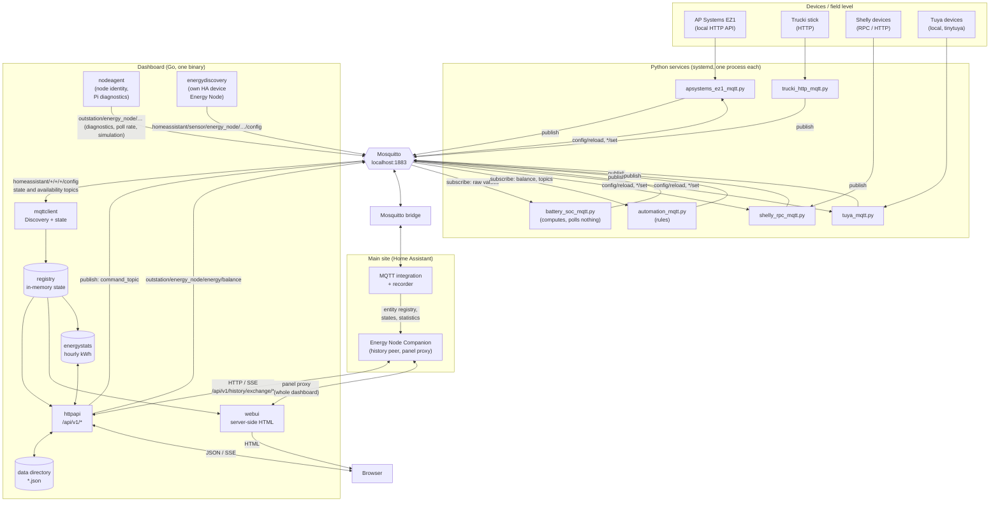

# Data flows in the Energy Node system

This page describes which data is produced where, which channels it travels
through and who reads it. It covers the whole system, so the Python bridges,
the MQTT broker, the Go dashboard and the browser all appear together.

Details of the individual parts are documented elsewhere: the dashboard's HTTP
interface in [api.md](api.md), the Python infrastructure package in
`libs/energy_node_common/`, and the Mosquitto bridge to the main site in
section 5 of INSTALLATION.md.

## 1. The whole picture

Device traffic goes through one local MQTT broker (Mosquitto on the Raspberry
Pi). The device bridges and the dashboard have no direct HTTP path between
them.

Home Assistant reaches the node in two ways. It gets the MQTT topics through
the Mosquitto bridge, and with the Energy Node Companion it also talks HTTP to
the dashboard, for the history exchange and for the sidebar page (§14).





Device state flows up (device → bridge → broker → dashboard → browser).
Commands and configuration flow down (browser → dashboard → broker → bridge →
device). Home Assistant closes a loop: it records what the bridge mirrors and
the companion hands parts of that back to the dashboard.

## 2. Topic conventions

There are two namespaces with separate jobs:

| Namespace | Purpose | Retained | Who writes |
|---|---|---|---|
| `homeassistant/{component}/{device_id}/{object_id}/config` | Discovery: which entity exists and where its value is | yes | Python bridges, and the dashboard for its own device `energy_node` |
| `outstation/{device_id}/...` | Payload data: measurements, status, commands | partly | bridges and dashboard |

The main topics below `outstation/`:

| Topic | Direction | Content |
|---|---|---|
| `outstation/{device_id}/{group}/{field}` | bridge → broker | Measurement (for example `outstation/t2mg81a4e9/field/acpower`) |
| `outstation/{device_id}/status/online` | bridge → broker | Availability, also set as the MQTT last will |
| `outstation/{device_id}/.../set` | broker → bridge | Switch command (`command_topic` from Discovery) |
| `outstation/{service_id}/config/reload` | dashboard → bridge | The bridge reloads its JSON configuration |
| `outstation/energy_node/energy/balance` | dashboard → broker | Energy balance, every 10 s, retained |
| `outstation/energy_node/status/online` | dashboard → broker | Availability of the dashboard (`1`/`0`), retained, also the last will |
| `homeassistant/sensor/energy_node/{object_id}/config` | dashboard → broker | Discovery of the dashboard's own energy sensors (§3) |
| `outstation/automation/test/set` | dashboard → automation | Run one rule action as a test |
| `outstation/automation/test/result` | automation → broker | Result of the test |
| `$SYS/broker/connection/{remote_client_id}/state` | broker → dashboard | Whether the bridge to the main site is up (`1`/`0`) |

The automation service refuses to publish to wildcards, to `homeassistant/...`
(no forged Discovery), to `$SYS/...` and to the dashboard's own topics
`outstation/energy_node/energy/balance` and
`outstation/energy_node/status/online`.

## Chapters

The chapters after the overview are on four pages:

- [Devices](data-flow-devices.md): 3. Discovery, 4. Live values, 5. Commands
  and 12. Data flow on the device map.
- [Storage](data-flow-storage.md): 6. Configuration files, 10. Browser history
  and 13. Energy statistics.
- [Energy and automations](data-flow-energy.md): 7. Energy balance,
  8. Automations and 9. Path to the main site.
- [Home Assistant](data-flow-ha.md): 14. Home Assistant and the Energy Node
  Companion.

## 11. What the system does not do on purpose

Several design decisions above follow from these limits.

There is no time series database on the server. The Pi's registry only holds
the current state, and the only thing the Pi keeps over time is the hourly
energy per role (§13). The rolling measurement history lives in the browser
(§10), and a long term archive is the main site's job. With the companion the
main site feeds parts of that archive back (§14).

There is no event history on the server either. Command history, the last
bridge apply and the last Tailscale action live in memory and are lost on a
restart, like the ring buffer of the history exchange (§10).

There is no wildcard subscription. The dashboard does not see what was not
announced through Discovery.

The dashboard does not access devices directly. The only exception is the
TinyTuya helper, which calls a Python script for the initial setup.
