# Data flows in the Energy Node system

This page describes which data is produced where, which channels it travels
through and who reads it. It covers the whole system, so the Python bridges,
the MQTT broker, the Go dashboard and the browser all appear together.

Details of the individual parts are documented elsewhere: the dashboard's HTTP
interface in [api.md](api.md), the Python infrastructure package in
`libs/energy_node_common/`, and the Mosquitto bridge to the main site in
section 5 of INSTALLATION.md.

## 1. The whole picture

Device traffic goes through one local MQTT broker (Mosquitto on the Raspberry
Pi). The device bridges and the dashboard have no direct HTTP path between
them.

Home Assistant reaches the node in two ways. It gets the MQTT topics through
the Mosquitto bridge, and with the Energy Node Companion it also talks HTTP to
the dashboard, for the history exchange and for the sidebar page (§14).


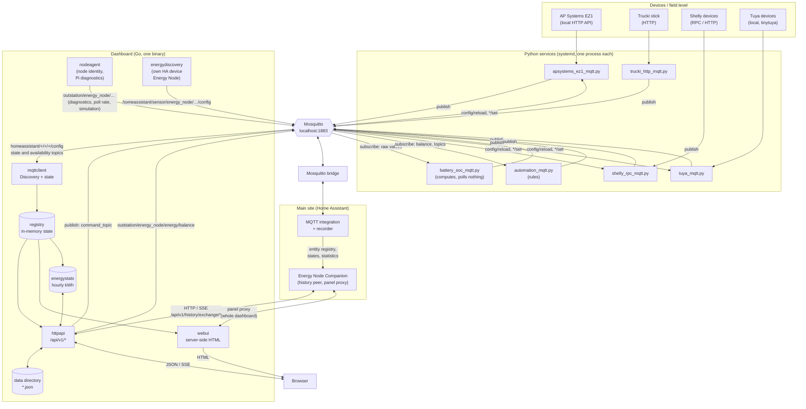


Device state flows up (device → bridge → broker → dashboard → browser).
Commands and configuration flow down (browser → dashboard → broker → bridge →
device). Home Assistant closes a loop: it records what the bridge mirrors and
the companion hands parts of that back to the dashboard.

## 2. Topic conventions

There are two namespaces with separate jobs:

| Namespace | Purpose | Retained | Who writes |
|---|---|---|---|
| `homeassistant/{component}/{device_id}/{object_id}/config` | Discovery: which entity exists and where its value is | yes | Python bridges, and the dashboard for its own device `energy_node` |
| `outstation/{device_id}/...` | Payload data: measurements, status, commands | partly | bridges and dashboard |

The main topics below `outstation/`:

| Topic | Direction | Content |
|---|---|---|
| `outstation/{device_id}/{group}/{field}` | bridge → broker | Measurement (for example `outstation/t2mg81a4e9/field/acpower`) |
| `outstation/{device_id}/status/online` | bridge → broker | Availability, also set as the MQTT last will |
| `outstation/{device_id}/.../set` | broker → bridge | Switch command (`command_topic` from Discovery) |
| `outstation/{service_id}/config/reload` | dashboard → bridge | The bridge reloads its JSON configuration |
| `outstation/energy_node/energy/balance` | dashboard → broker | Energy balance, every 10 s, retained |
| `outstation/energy_node/status/online` | dashboard → broker | Availability of the dashboard (`1`/`0`), retained, also the last will |
| `homeassistant/sensor/energy_node/{object_id}/config` | dashboard → broker | Discovery of the dashboard's own energy sensors (§3) |
| `outstation/automation/test/set` | dashboard → automation | Run one rule action as a test |
| `outstation/automation/test/result` | automation → broker | Result of the test |
| `$SYS/broker/connection/{remote_client_id}/state` | broker → dashboard | Whether the bridge to the main site is up (`1`/`0`) |

The automation service refuses to publish to wildcards, to `homeassistant/...`
(no forged Discovery), to `$SYS/...` and to the dashboard's own topics
`outstation/energy_node/energy/balance` and
`outstation/energy_node/status/online`.

## 3. Discovery: how the dashboard learns what exists

The dashboard has no device list in a configuration file. It learns everything
at runtime from retained Discovery messages. After a restart of the dashboard
the broker delivers the retained messages again.


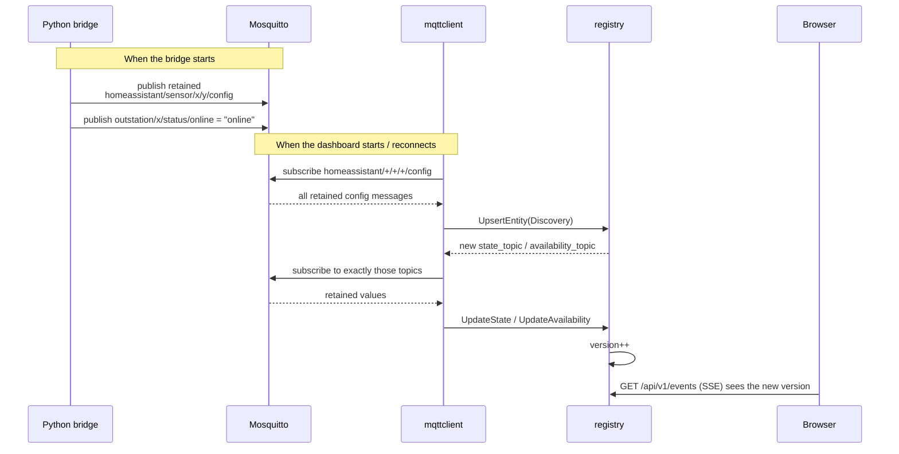


The dashboard only subscribes to topics it has discovered, never to
`outstation/#`. If a Discovery field is empty, the dashboard does not see that
value.

An empty payload on a `config` topic deletes the entity, and topics nobody
needs any more are unsubscribed.

Parse errors are collected in `reg.DiscoveryErrors()` and shown by
`GET /api/v1/discovery`, so they do not get lost.

The `discovery_prefix` is configurable (default `homeassistant`).

### The dashboard as a Discovery publisher

The dashboard also announces itself. On every connect and reconnect it
publishes retained Discovery for the Home Assistant device "Energy Node". Two
parts share that device through `device.identifiers = ["energy_node"]`:

| Part | Entities | Values from |
|---|---|---|
| `internal/energydiscovery` | seven read only sensors: `pv_power`, `grid_import`, `grid_export`, `battery_charge`, `battery_discharge`, `house_load` (the `load_total` field), `battery_soc` | the balance topic `outstation/energy_node/energy/balance`, one field each through `value_template` |
| `internal/nodeagent` | Pi diagnostics, poll rate, simulation switch | `outstation/energy_node/…` |

The unique IDs are `energy_node_<object_id>`, for example
`energy_node_pv_power`. The Energy Node Companion finds these sensors in Home
Assistant by exactly these IDs (§14), so they must not change.

Three more sensors are optional: `energy_node_wallbox`, `energy_node_heat_pump`
and `energy_node_custom_<id>` for each custom category. They are announced only
once something is assigned to the wallbox, the heat pump or the category. The
setting `energy_sensors` decides which of them are announced, and a missing
setting counts as on. A category that is deleted or unassigned is retracted
with an empty retained config. The announced sensors are remembered in
`energydiscovery/announced.json`, so the retraction also works after a restart.

All energy sensors point to `outstation/energy_node/status/online` as their
availability. When Tailscale reports a MagicDNS name, the device block carries
it as `configuration_url`, and the configs are published again when the name
changes.

The switch `publish_energy_device` in `mqtt.json` (default on) turns the
energy sensors off. The dashboard then publishes empty retained payloads on the
same topics, which removes the entities in Home Assistant. Without these
sensors the companion has no source for the energy roles.

The dashboard subscribes to its own Discovery like to any other, so the
"Energy Node" device also shows up in its own registry.

## 4. Live values all the way to the browser

The browser never talks MQTT. The registry counts every change in a version
number, and one SSE stream carries the version together with the topics the
page subscribed to.


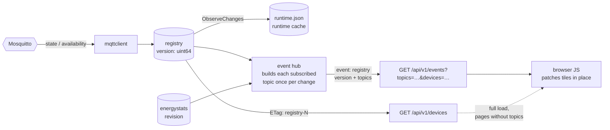


Each event carries `version` and one branch per subscribed topic:

| Topic | Content | Version source |
|---|---|---|
| `energy` | energy snapshot with balance | registry |
| `entities` | entity values, complete on connect, then only changes (`entities_delta`) | registry |
| `diagnostics` | summary of the diagnostics | registry |
| `devices` | structure, availability, status and with `:auto` the compact rows of the devices chosen with `?devices=`, as a delta after the first event | registry and device preferences |
| `energy_stats` | only `{"rev": N}` of the energy statistics | statistics store, so a backfilled hour from Home Assistant triggers an event while the registry is idle |

Without `?topics=` a client gets all topics except `devices`. With an empty
`?topics=` it gets only the version and fetches `GET /api/v1/devices` itself
when the version changes. The exact contract is in [api.md](api.md).

The hub builds a topic only while someone subscribes to it, and only once per
change for all connections. A connection that falls four events behind is
dropped and starts again with a complete event after the browser reconnects.

The send interval of the hub comes from `settings.json`
(`live_update_interval_seconds`, default 3 s) and takes effect without a
reconnect.

`GET /api/v1/devices` returns `ETag: "registry-N"`. With a matching
`If-None-Match` the server answers `304`.

The runtime cache (`runtime.json`) survives restarts. It remembers the last
values and restores them when an entity comes back, so tiles are not empty
after a restart.

## 5. Commands: from the click to the device


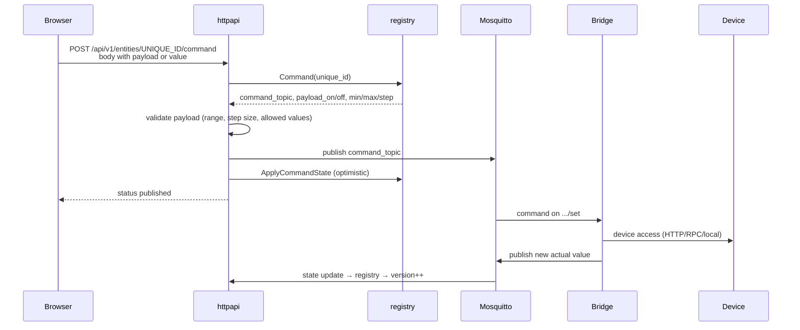


The dashboard only publishes to `command_topic`s from Discovery. No API path
writes to an arbitrary topic, except the fixed automation test on
`outstation/automation/test/set`.

Each command is recorded per device in an in-memory history (at most 12
entries) and appears in `GET /api/v1/devices/{id}` as `command_actions`.

## 6. Configuration: files, not a database

There are two directories with different owners.


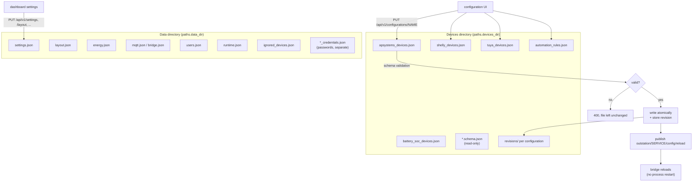


Writes are atomic (temp file and `rename`) and store a revision first. Every
configuration can be viewed under `.../revisions` and restored with
`.../restore`.

The reload goes over MQTT and not through systemd. The target service swaps its
configuration inside the running process. `automation_rules` maps to the
service ID `automation`, otherwise `{name}_devices` maps to `{name}`.

Passwords always live in their own files (`*_credentials.json`), so they stay
out of the revision copies. The API never returns them in clear text and only
reports `password_configured: true/false`.

## 7. Energy balance

The balance is derived data. Entities get roles, and the roles produce a
balance object that is available over HTTP and over MQTT.


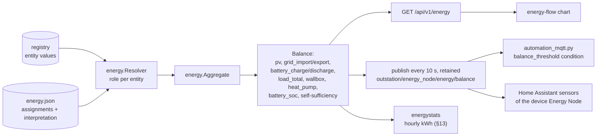


The payload is `{"at": <unix s>, "balance": {…}, "interpretation": {…}}`.
`balance.categories` holds one value in watts per custom category, keyed by the
category ID. Consumers are never negative, while producers and storage keep
their raw sign. The seven energy sensors from §3 each pick one
field of `balance`, and Home Assistant records them. These recorded values are what the companion later
supplies back (§14).

The automation service takes the balance as finished numbers and computes
nothing itself. If the balance is older than `balance_max_age_s` (default
30 s), rules based on it stop firing.

## 8. Automations


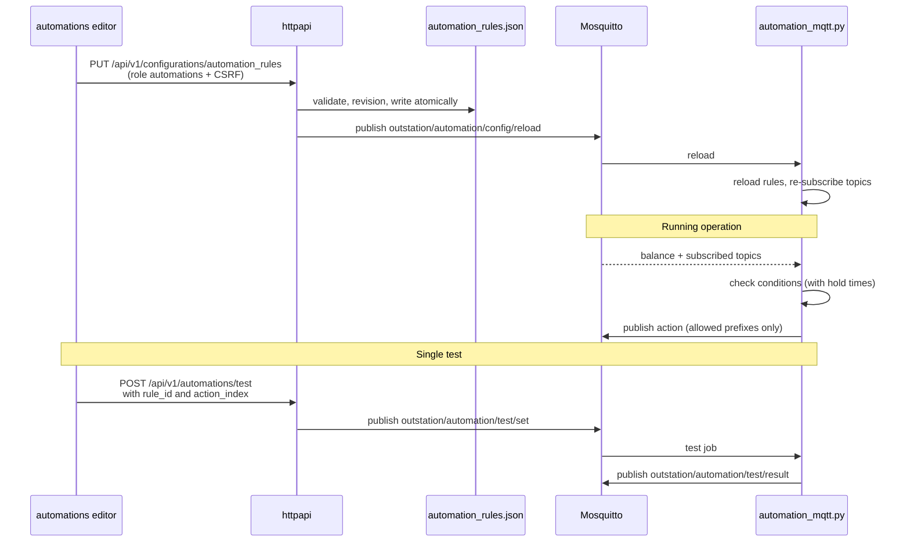


The condition types are `balance_threshold`, `battery_soc`, `topic_value`,
`time_window`, `sun_window` and `entity_value`. The action types are `publish`
and `notification`.

## 9. Path to the main site

The Mosquitto bridge mirrors both namespaces in both directions to the main
site (`topic outstation/# both 0`, `topic homeassistant/# both 0`), so the main
site sees the same Discovery and measurement topics as the dashboard. These are
the defaults, the topic list is editable per connection in `bridge.json`.

Home Assistant on the main site creates its MQTT entities from the mirrored
Discovery, the bridges' devices as well as the dashboard's own "Energy Node"
device. The companion depends on this path (§14): it finds the dashboard's
series in Home Assistant only through these MQTT entities.

The dashboard manages the bridge but is not part of its data path:


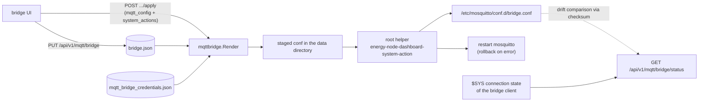


The dashboard never writes to `/etc` itself. It puts a file into its own data
directory and lets a root helper do the rest. The trust boundary is the helper,
not the dashboard process: it reads exactly one compiled-in staging path, requires
a regular file owned by the dashboard user of at most 8 KB and 200 lines, and
accepts only lines that match a fixed directive allowlist (`connection`,
`address`, `topic` and the like). A compromised dashboard process therefore
cannot slip in `log_dest`, a new listener or any other directive. The helper keeps
the previous file as a backup and restores it if Mosquitto does not restart. The status combines three
sources: the systemd service state, the `$SYS` connection state and a checksum
comparison between the stored and the installed configuration.

## 10. Browser history (IndexedDB, not on the Pi)

The dashboard keeps a rolling measurement history in each browser's IndexedDB
(`energy-node-dashboard`, store version 2). The Pi stores nothing.
`internal/history` on the server only defines the data contract and the
retention window and holds no samples.


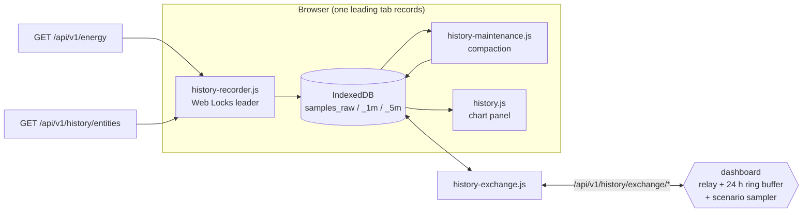


The browser records the energy roles (`role:pv`, `role:grid_import`, …) from
the balance. It also records the entities listed in `settings.json` under
`history_extra_entities` and polls their values from
`GET /api/v1/history/entities`. That endpoint is an allowlist on the server, so
the browser cannot ask for arbitrary IDs. The sampling interval comes from the
dashboard settings.

Each browser has one recorder. The writing tab holds a Web Locks lease
(`energy-node-historizer`). The other tabs only read and are notified over a
`BroadcastChannel`. Two tabs writing slightly different timestamps would break
the composite key and bloat the store.

There are three tiers with limited retention: `samples_raw` (~6 h), `samples_1m`
(~7 days) and `samples_5m` (~30 days). `history-maintenance.js` compacts raw to
1 m and 1 m to 5 m in the leading tab. It moves a watermark forward in the
`meta` store, so each run only touches the newest span.

The hourly resolution is not kept in the browser. The history page reads it from
the node's energy statistics (§13).

For the exchange between devices (`/api/v1/history/exchange/*`) the server only
relays and stores nothing. Offers go to all peers. Requests and deliveries go to
exactly one peer over an SSE stream, and nothing is written to disk. A 24 h ring
buffer in memory joins as the pseudo-peer `server`, so a single browser can
still fill gaps after a reload. Peers announce their coverage as coarse rasters
(counts per time bucket), compare them and request only the missing ranges.
Only the `1m` and `5m` tiers are exchanged. Raw samples are not, because their
offset timestamps would not deduplicate. Protocol version 1 allows 500 rows per
delivery, 20 000 per request and 1 MiB per body.

The ring buffer has a second source besides the browsers: the dashboard itself.
Every 10 s the energy tick hands its snapshot to a sampler. The sampler keeps the
open minute in memory and writes one row per series when the minute closes. Each
row is stamped with the start of its minute. The series are `role:grid` (import minus export) and the
output sensors of every automation scenario with `while.mode` set to `regulate`.
Without such a scenario the sampler writes nothing, so the exception stays as
narrow as possible. A row a browser has already delivered for the same minute
stays as it is. The rows are never written to disk and the automation service
never reads them back.

Each browser runs the exchange in one of two modes, stored per device in
`localStorage` (`history-exchange-mode`). `always` offers its own coverage and
requests every gap of the full raster window, as described above. `on-demand`
is the default. The device keeps its SSE stream open, feeds the ring buffer
and answers requests, but it sends no offer of its own. It only plans requests
for the ranges the history page or a history tile currently shows
(`HistoryExchange.watchRange()`). Tabs that do not lead forward these ranges to
the leading tab over the recorder's BroadcastChannel and get a message back
when rows arrive. In `always` mode a device always offers its own coverage. In `on-demand` mode
it offers it only if the per-device choice `history-exchange-serve` is `on`,
and is otherwise a source only through the ring buffer.

Minute values are only exchanged up to 30 minutes before now (`SETTLE_MS` in
`history-coverage.js`). Until then devices can hold different numbers of samples
for the same minute, so the newest half hour would not match. Each watched range
also asks for the last 30 minutes of the minute tier once, and again at most
every five minutes while the range stays on screen. That request only goes out in
`on-demand` mode and while the exchange stream is connected.

Home Assistant can join as a permanent peer that only supplies data, through
the Energy Node Companion (labelled "Home Assistant"). Which series it maps and
from which recorder tables it answers is described in §14.

## 11. What the system does not do on purpose

Several design decisions above follow from these limits.

There is no time series database on the server. The Pi's registry only holds
the current state, and the only thing the Pi keeps over time is the hourly
energy per role (§13). The rolling measurement history lives in the browser
(§10), and a long term archive is the main site's job. With the companion the
main site feeds parts of that archive back (§14).

There is no event history on the server either. Command history, the last
bridge apply and the last Tailscale action live in memory and are lost on a
restart, like the ring buffer of the history exchange (§10).

There is no wildcard subscription. The dashboard does not see what was not
announced through Discovery.

The dashboard does not access devices directly. The only exception is the
TinyTuya helper, which calls a Python script for the initial setup.

## 12. Data flow on the device map

The [data flow layer](../dashboard/device-map.md#data-flow-layer) of the device map
is drawn from what the services declare in their JSON schemas. Every field with
`"format": "mqtt-topic"` needs an `x-dataflow` annotation:

| Annotation | Meaning |
|---|---|
| `direction` | `input` or `output` |
| `label` | text on the edge |
| `json_key_field` | field that holds the JSON key, when the payload is JSON |
| `unit_field` | field that holds the unit |
| `x-dataflow-label-key` | translation key for the label, on the field |
| `x-dataflow: false` | leave the field out of the data flow (`true` is not allowed) |

A service that lists entries, such as several banks, puts `x-dataflow-node` on
the schema of one item with `id_field`, `label_field` and `device_id_template`.
Each entry becomes its own node. It is linked to a device when the template
gives the ID of a known device, otherwise it stays a service node.

The contract test `TestEveryServiceTopicFieldDeclaresDataflow` in
`dashboard/internal/dataflow/contract_test.go` walks the schema of every
service and fails for a topic field without an annotation, so a new service has
to decide for each topic whether it appears in the data flow.

## 13. Energy statistics

The dashboard records energy per hour and role on its own, whether or not a browser is open. Every 10 seconds `internal/energystats` takes the energy snapshot with its derived balance and integrates the balance fields (`pv`, `grid_import`, `grid_export`, `battery_charge`, `battery_discharge`, `load_total`, `base`, `wallbox`, `heat_pump` and consumer or producer categories as `custom:<id>`) into kWh. A value counts until the next snapshot, for at most 5 minutes. A snapshot with a stale power role is skipped. Recording waits until the system clock is synchronised, and a clock jump discards the running hour.

Hours are stored per UTC month in `<data dir>/energystats/<yyyy-mm>.json`. Each hour carries its source: own recording or Home Assistant. Home Assistant always wins over own recording.

`GET /api/v1/energy/stats?period=day|week|month|year&at=<date>` sums the hours into hours, days or months in the local time zone and adds autarky and self consumption for each bucket and for the whole period. Weeks run Monday to Sunday and are summed into days.

`GET /api/v1/energy/stats/hours?from=<ms>&to=<ms>` returns the hourly means that the history page shows for spans of a week or longer (see [api.md](api.md)). Own hours with less than 50 minutes of recording are left out, Home Assistant hours always count.

### Hours from Home Assistant

Where the companion takes these hours from is described in §14. The Energy Node Companion offers a third exchange tier `1h` next to `1m` and `5m`. Its rows carry the mean power of one hour in W, which equals the energy of that hour in Wh. Its coverage counts complete hours per UTC day, starting at the oldest day Home Assistant has, at most ten years back. The protocol version stays 1. A companion only offers `1h` when the announcement lists it, and it marks its offer with `kind: "companion"`.

Inside the dashboard `internal/energystats` acts as the pseudo peer `energystats`, like the ring buffer acts as `server`. It reads every companion offer, compares it with the hours it already holds from Home Assistant and requests what is missing, newest days first, at most 31 days per request and one request at a time. Deliveries addressed to `energystats` are handled by the server and never relayed. A day that Home Assistant offers but cannot fill is requested again only when the offered hour count changes.

The statistics API reports `companion.connected`, `companion.current` (the last or second to last complete hour came from Home Assistant for every offered role) and `companion.missing_days`.

The setting `energy_stats_recording` (`always`, `pause_with_companion`, `off`) controls the own recording. In pause mode the recorder keeps integrating but holds completed hours in memory (at most three) while the companion reports `current`. When that ends it writes them, `AddOwn` never touches hours from Home Assistant. Switching to `off` stores the started hour first.

The response also carries `at`, `prev` and `next` for navigation, `local` per bucket (start in the node's local time, used for labels so a browser in another time zone shows the node's hours), `categories` for custom role labels, `status.state` (`recording`, `paused`, `off`, `waiting_for_clock`), `status.corrupt_months` and `companion.backfill_from`.

`revision` is the statistics revision at the time of the query. Compare it with `energy_stats.rev` from the event stream to decide whether to reload.

## 14. Home Assistant and the Energy Node Companion

The integration `energy_node_companion` runs inside Home Assistant and connects
it with one dashboard per config entry. It has three data paths, and each can be
switched on its own in the options: history (`history`), energy statistics
(`stats`) and the sidebar page (`panel`: all users, administrators only or off).


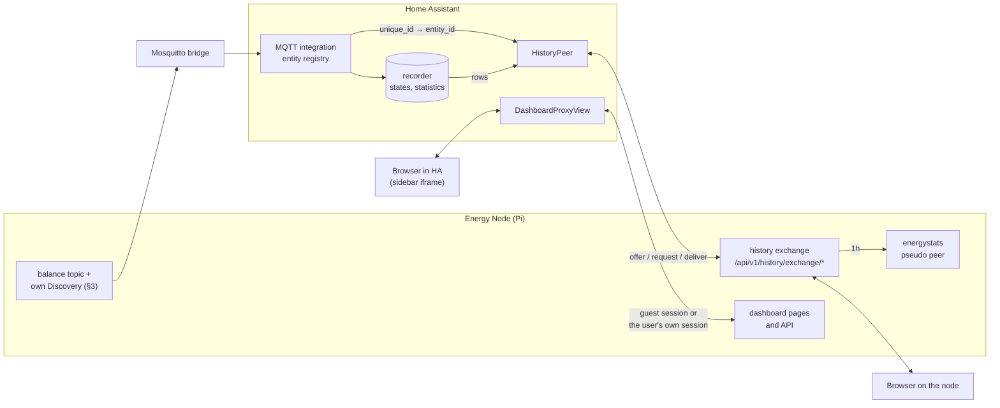


### Where the companion's values come from

The companion creates no entities and stores no values of its own. Everything
it supplies comes from the Home Assistant recorder, about MQTT entities that
exist only because the dashboard and the bridges announced them through
Discovery and the bridge mirrored them (§3, §9).

It maps the dashboard's series to Home Assistant entities through the entity
registry, platform `mqtt`, by `unique_id`:

| Dashboard series | Home Assistant source |
|---|---|
| `role:pv` | `energy_node_pv_power` |
| `role:grid` | `energy_node_grid_import` minus `energy_node_grid_export` |
| `role:battery` | `energy_node_battery_charge` minus `energy_node_battery_discharge` |
| `role:battery_soc` | `energy_node_battery_soc` |
| any extra history entity | the `sensor` or `number` with the same `unique_id` |

`role:load`, `role:wallbox` and `role:heat_pump` are never supplied in the
`1m` and `5m` tiers. `house_load` carries `load_total` and not the measured
`load` role, and the dashboard publishes no sensor for wallbox and heat pump.

| Tier | Source in the recorder | Fallback |
|---|---|---|
| `1m` | state changes, weighted by how long each value held | none |
| `5m` | 5-minute statistics (`mean`, `min`, `max`) | state changes, for entities without statistics and for difference series |
| `1h` | hourly long term statistics, per role | none |

For `1h` each role takes either an energy meter picked in the options (the
hourly `change` in Wh, a negative change from a meter reset drops the hour) or
the power sensor from §3 (the hourly `mean` in W). Wallbox and heat pump are
only available with a meter. Values are converted to the dashboard's unit, and
a series whose unit cannot be converted is left out instead of supplying wrong
numbers. Unavailable states stay gaps.

### Exchange with the dashboard


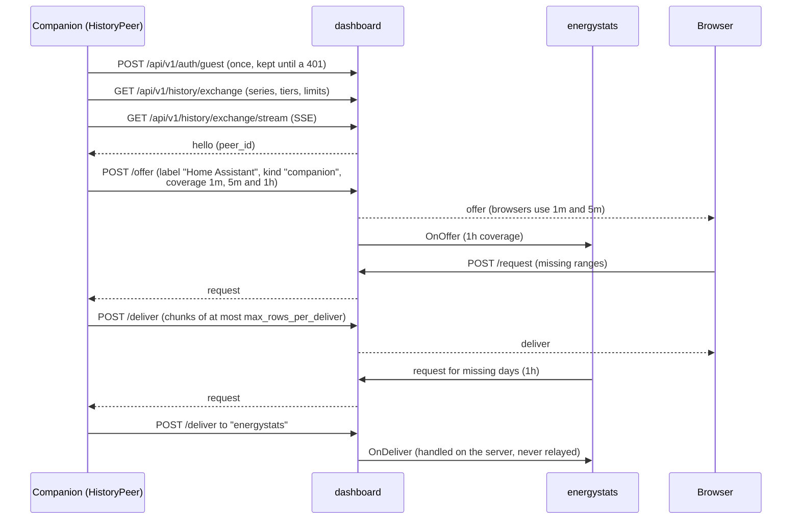


The companion is a pure source. It never asks for rows, keeps no store of its
own and does not feed the server's ring buffer. It sends `1h` only when the
announcement lists that tier, so an older dashboard is not sent an offer it
would reject. `kind: "companion"` is passed on only for this peer, and only then
does the server hand the `1h` coverage to `energystats`. Browsers ignore `1h`.

The companion recomputes its coverage every ten minutes and sends a new offer
only when it changed. When another peer joins it sends the current offer again.
On a lost connection it reconnects with a pause growing from 2 to 60 seconds.
The guest session is kept across reconnects, because every guest login writes
`users.json` on the node's SD card.

The companion needs no change for the scenario outputs. `series_map.resolve()`
resolves every announced series that is not a role through the MQTT `unique_id`
in the entity registry, and the scenario series `automation_scenario_<id>_output`
is exactly that `unique_id`.

### The sidebar page

The page in the Home Assistant sidebar is the real dashboard, passed through by
Home Assistant. The browser only talks to Home Assistant, the Home Assistant
host is the only one that has to reach the node.


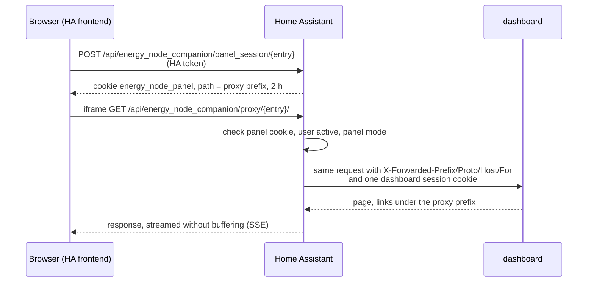


The proxy sets the forwarding headers itself and drops whatever the browser
sent in them, because the dashboard trusts `X-Forwarded-Proto` for its HTTPS
check. The dashboard resolves its base path per request from
`X-Forwarded-Prefix` (`internal/basepath`).

Home Assistant's cookies, the panel cookie and the HA token from
`Authorization` stay in Home Assistant. Upstream the request carries exactly
one dashboard session and at most the language cookie `lang`. If the browser
has signed in to the dashboard itself, its own session is used. Otherwise the
proxy uses the guest session it shares with the history peer. A logout through
the panel does not end that shared session, and a `GET` or `HEAD` on the guest
session that hits a 401 is repeated once after a new guest login.

The panel cookie lives only in Home Assistant's memory, so after a restart of
Home Assistant the page fetches a new one. The page renews it every 30 minutes
while it is open.
