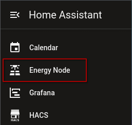

# Dashboard in the sidebar

With the **Sidebar** option on, the node's dashboard appears as its own entry
in the Home Assistant sidebar. It opens inside Home Assistant with the same
tabs you get in a browser on the tailnet.

## Who sees it

The **Sidebar** option decides who gets the entry:

- **All users** (default): every Home Assistant user.
- **Administrators only**: only users with the administrator flag. Other
  users neither see the entry nor can open the page by its address.
- **Off**: no sidebar entry.

Name and icon of the entry are set in the [options](companion-setup.md#options).

## How it reaches the dashboard

Home Assistant passes the dashboard through to the browser. The browser only
talks to Home Assistant, so the page also works on a phone that is not in your
tailnet, for example through the Home Assistant app on the go. Only the Home
Assistant host has to reach the node.

## Signing in

Once the companion is [paired](companion-setup.md#pair-with-the-dashboard),
the page opens as your Home Assistant user. You do not sign in a second time.
The first time you open the page, the dashboard creates an account for you.
It is listed under **Home Assistant** in the Users section, with the
permissions of its preset or with permissions set for it individually. On
first pairing the Home Assistant accounts get their own presets: the admin
preset gives every permission that Home Assistant accounts may hold, except
the elevated ones, and the user preset allows viewing, operating devices and
automations, and designing the layout and device appearance. The account has
no password of its own, so it can only be used through Home Assistant.

An account that is disabled in the dashboard gets no personal session. The
page then falls back to the guest session, which a guest can use as described
in [Dashboard](../dashboard/index.md).

Without pairing the page always opens as a guest, with the guest preset. A
guest can view the dashboard but cannot change anything. When an admin has
switched guest access off, the sidebar page shows only the sign-in. For the
protected actions, sign in with a dashboard user as usual.

The dashboard accepts Home Assistant accounts on its sign-in page too. Enter
the user name and password of your Home Assistant user there. Two rules apply:

- A name that also exists as a local dashboard account always signs in to the
  local account. The dashboard does not ask Home Assistant for it.
- Home Assistant accounts only sign in over HTTPS. When Home Assistant is
  served over plain HTTP, the sign-in page says that Home Assistant accounts
  need HTTPS.

Over HTTP the page works too, but the permissions that need HTTPS stay
unavailable, as they do for any other session without HTTPS.

The page renews its access on its own while it is open. After a Home
Assistant restart it fetches new access the next time you open it.

If the dashboard is offline, the page shows "The dashboard cannot be reached
right now." instead of the dashboard.
