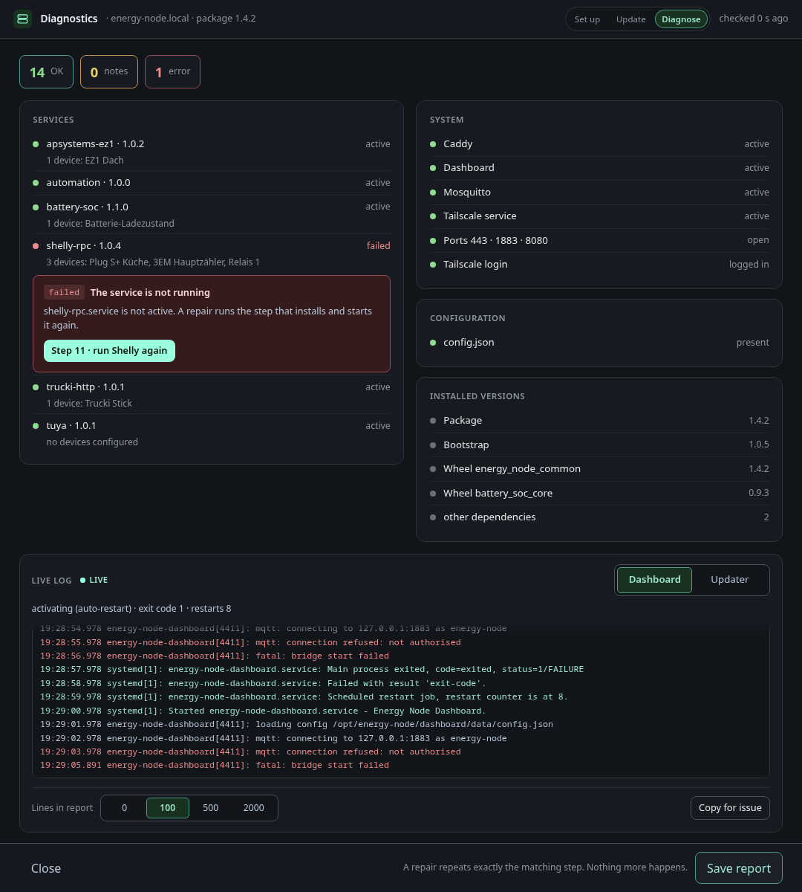

# Diagnosing a node

**Diagnose** reads the installed package version from the Pi and runs a
checklist: every systemd unit, the open ports, the Tailscale login and whether
`config.json` exists. A failing check has a button that repeats only the step
responsible for it. Next to the checks the screen shows what is installed:
each service with its version and its configured devices, services that were
never chosen marked as not installed, and a card with the package, bootstrap
and wheel versions. This part is for information and does not count as checks.
**Save report** writes the result to a file. Attach that file to a bug report.

A repair always runs its step again, even if the step is already marked as done. The checklist also tries the MQTT login from the node's `config.json` against the broker. If the broker refuses the password or the password file is missing, the repair button asks for a new password, or generates a random one, and then runs the broker step and the dashboard step together so that both use it. The user name stays as it is in `config.json`.

The live log card under the checks follows the journal of the dashboard and the updater service from the moment the screen opens, with their state, exit code and restart count above the lines. The report includes the number of buffered lines per service that you choose in the card footer. **Copy for issue** puts the report on the clipboard as Markdown and opens a new GitHub issue, with addresses, names and passwords masked, but read the text once more before you post it.
