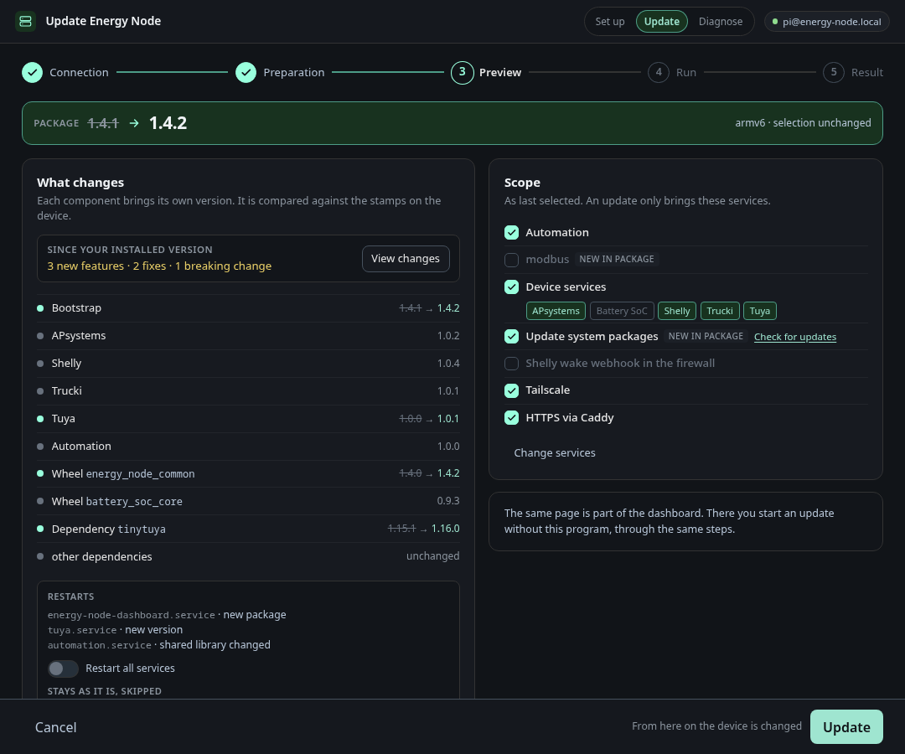
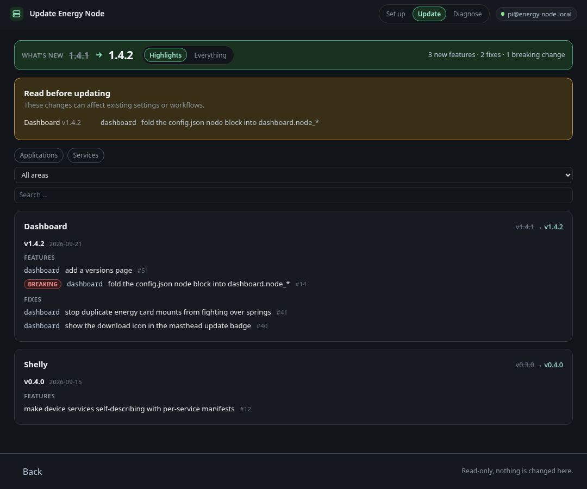

# Updating a node

Choose **Update** and connect. The preview compares each component's version
with the stamp on the Pi. It lists what changes, which services restart and
which steps are skipped because their work is already done. Every selected
service shows its own version, and every unit that restarts names the reason:
a new version, a changed shared library, a first install or an unknown
installed version.

A step counts as done while nothing it uses has changed since its last
successful run: its own script, the helpers it loads and the files it takes
from the package. An update with a new dashboard therefore skips Mosquitto,
the firewall, Tailscale and every unchanged service. Three steps still run
once per package version. System updates bring in new packages, the Shelly
webhook rule follows the port set in the dashboard, and the dashboard
configuration is written on every run. The first update after this rule was
introduced still runs every step once, because older stamps carry no record
of the inputs.

By default only a service whose own version changed restarts. A change to
`energy_node_common` restarts every service, and a change to
`battery_soc_core` restarts only `battery_soc`. **Restart all services**
restarts every service unit anyway. A unit that is not running always starts,
and a node whose last run predates per-service versions restarts every service
once. The scope card shows the services as last selected. A service that is new
in the package stays off until you tick it under **Change services**.
**Update** runs the pending steps through the same code as a fresh install, so
there is no separate partial update path that could break.

When the package carries a changelog, the first card adds a line such as
"3 new features · 2 fixes · 1 breaking change" and a **View changes** button.
The page behind it lists, per component, only what is newer than the version on
the Pi. Breaking changes come first, then one card per component. The page
opens on the **Highlights**, one line per merged change that matters to an
operator. The switch at the top shows **Everything**, down to each commit. The
counts in the first card are based on the highlights too. You can filter by
kind (applications, services, libraries and so on) or by area, and search the
text. The page works offline and changes nothing. A package without a
changelog shows no such line.

The dashboard serves the same page under `/redeploy/`, behind its login, and
runs the same steps on the node itself, without this program and without SSH.
It can download the newest signed release package from GitHub, and its header
shows a notice when a newer release is out.
