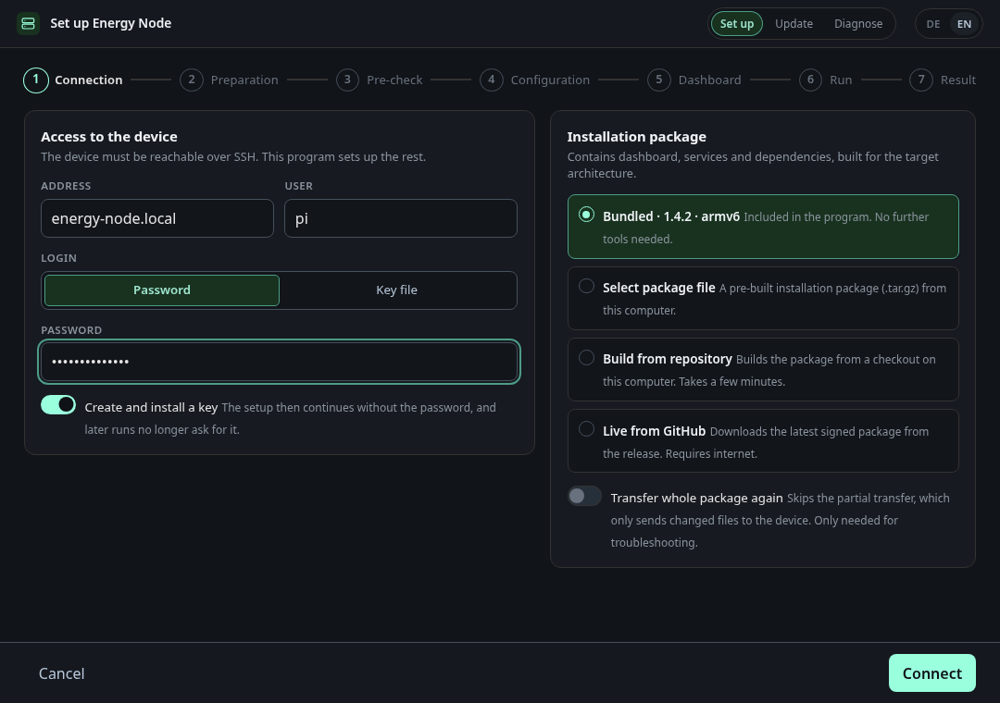
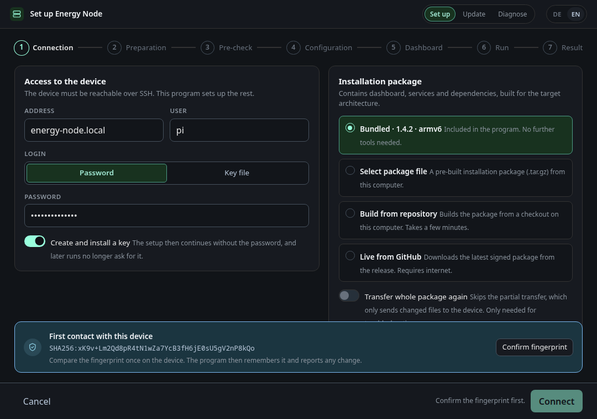
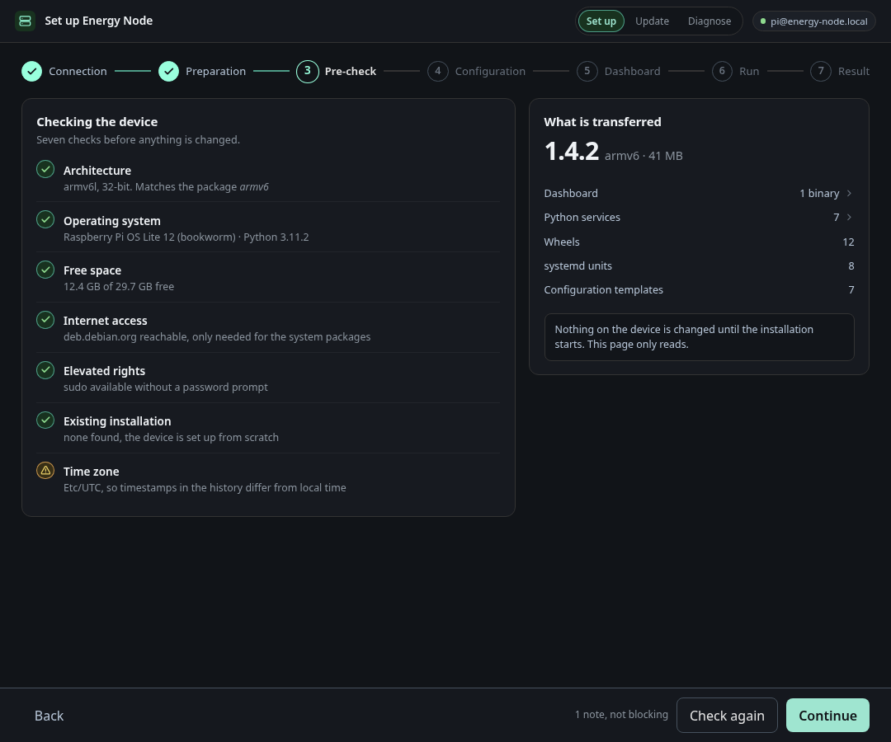
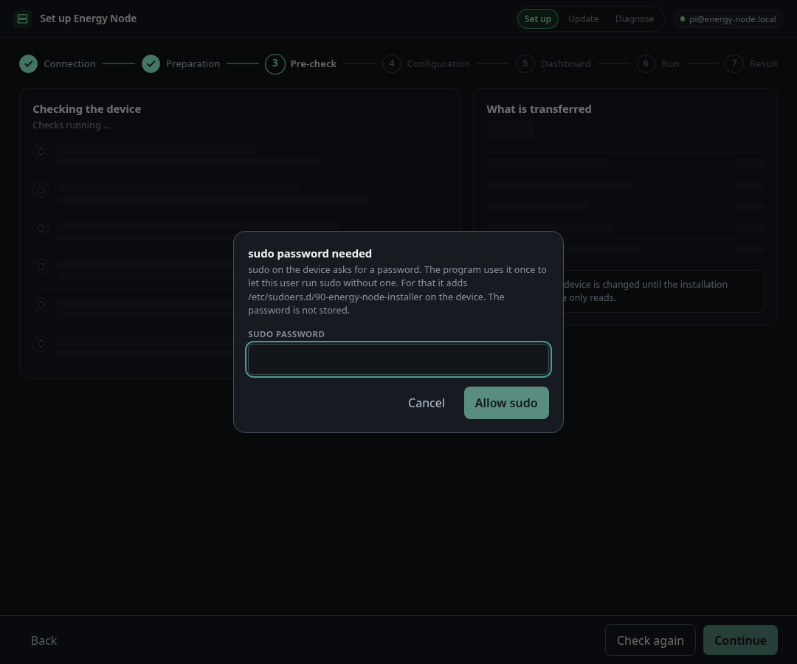
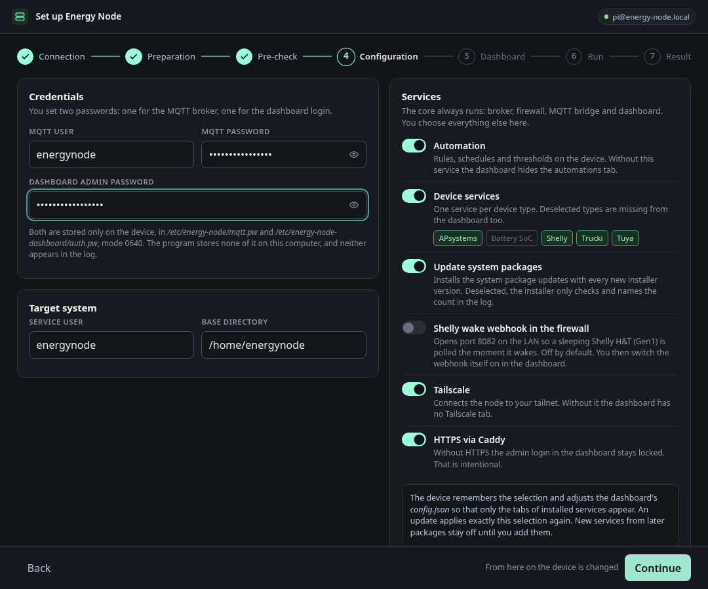
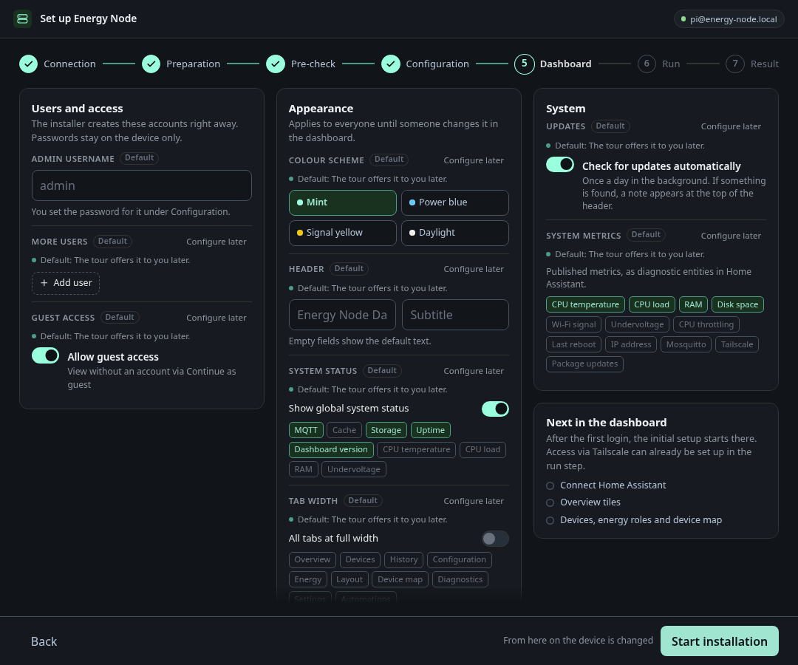
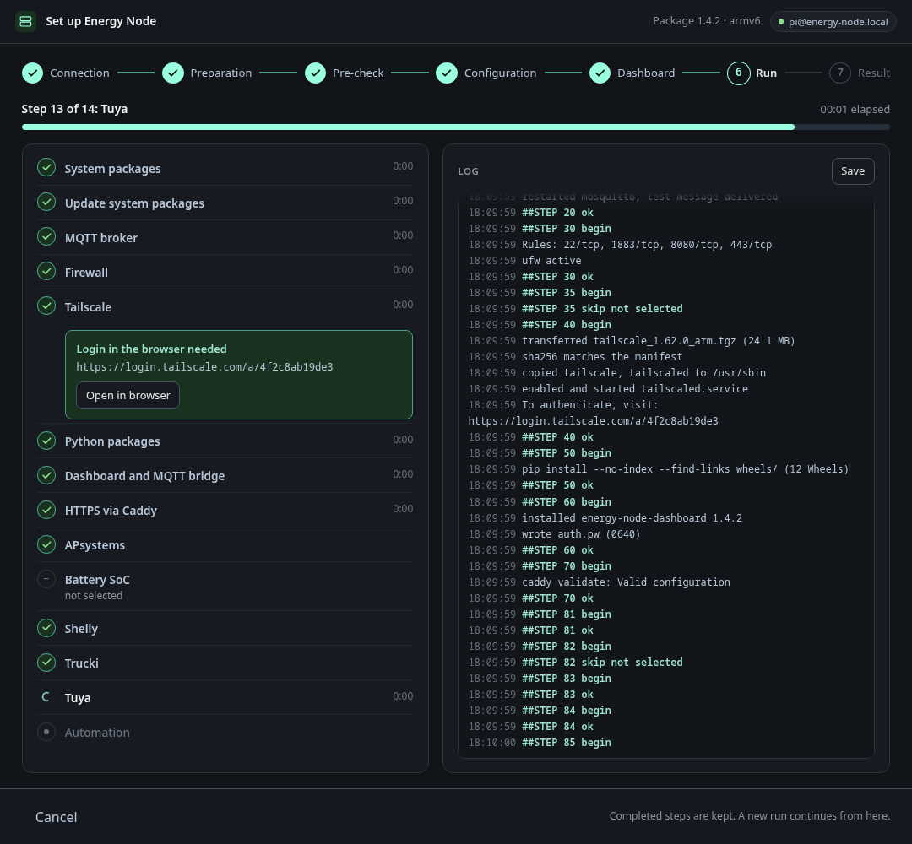
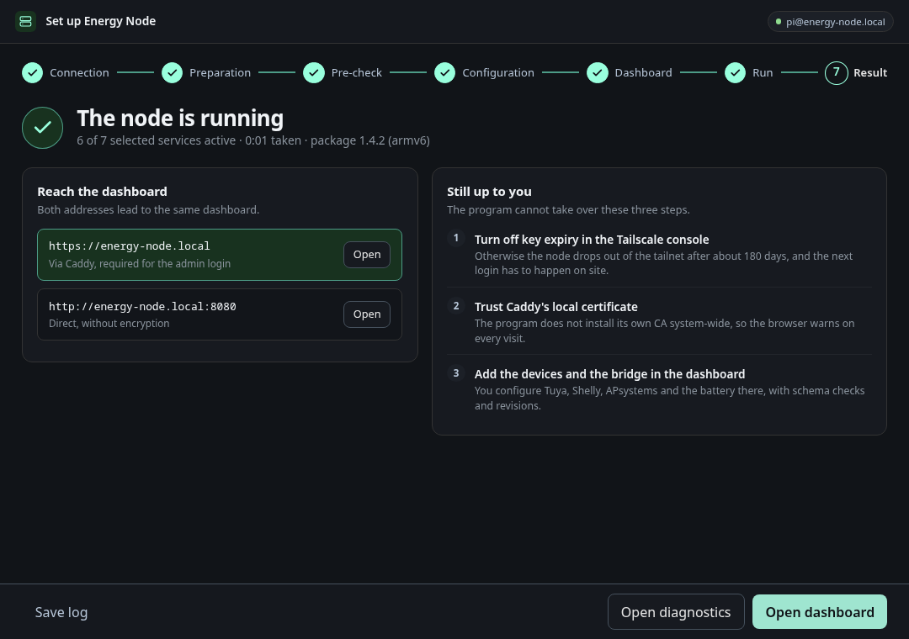

# Deploying a node

The installer is a desktop program that puts Energy Node on a Raspberry Pi from
your own computer. You point it at the Pi and choose the services you want.
It then runs the same idempotent setup steps as a manual install: packages,
MQTT broker, firewall, Tailscale, the dashboard, HTTPS and one systemd unit per
device service. Nothing is built on the Pi.

The top bar of the window switches between three modes. **Set up** installs a
fresh Pi. **Update** brings an installed node to the version in the
installer's package. **Diagnose** checks an installed node and repairs one
failing part.

> The installer is in beta. It already sets up, updates and diagnoses real
> nodes, but 1.0 is not released yet. Until then, screens and steps can change
> between versions. [Manual installation](developing/manual-installation.md) documents what the
> installer automates and why.

The screenshots on this page come from the installer's demo host and not from
a real Pi. Window and screens are real, but the data behind them is canned, so
version numbers, service states and log lines are made up. The screenshot
notes in the repository explain how to run the demo yourself.

## Before you start

The Pi needs Raspberry Pi OS (or Debian) with SSH enabled and a user that may
use `sudo`. The installer's first action is to create a working directory
under `/var/lib`, which needs root. If `sudo` asks that user for a password,
the installer sets up passwordless `sudo` once, see
[sudo password](#sudo-password). The Pi also needs
internet access for the system packages and for Tailscale, and your computer
must reach it by name or IP address.

Which image fits which Pi is listed under
[Operating system](installer-operating-system.md). The **Media** tab can write
the card for you, see [Preparing a storage medium](#preparing-a-storage-medium).

Your computer can run Windows, macOS or Linux. On Windows the window uses the
Edge WebView2 runtime, which current Windows 10 and 11 installations include.
On Linux it needs GTK with WebKitGTK. If no window can be opened, the installer
falls back to a browser, see [The window](#the-window).

## Getting the installer

Every release on the repository's GitHub releases page includes the installer:

| Your computer | File |
|---|---|
| Windows | `energy-node-installer_windows_amd64.exe`, start it with a double click |
| macOS (Intel and Apple Silicon) | `energy-node-installer_macos_universal.zip`, unzip it and start `energy-node-installer` |
| Linux (x86-64) | `energy-node-installer_linux_amd64.tar.gz` |
| Linux (ARM64) | `energy-node-installer_linux_arm64.tar.gz` |

`SHA256SUMS.installer` lists their checksums. The builds are unsigned, so
Windows SmartScreen and macOS Gatekeeper warn before the first start. The
installer downloads the signed installation package for your Pi from the same
releases, so the program is all you need.

To run the installer from a checkout with a locally built package instead:

```sh
bash scripts/build/make_bundle.sh --arch armv6
mkdir -p installer/bundle
tar -xzf dist/energy-node-*-armv6.tar.gz -C installer/bundle
scripts/dev/run-installer.sh
```

`--arch` is the Pi's architecture: `armv6` for a Pi 1 or Pi Zero (the default
target), otherwise `arm64` or `amd64`. `run-installer.sh` builds the program
and starts it (`--no-build` skips the build). The
[Installer developer CLI](developing/installer-cli.md) page has the details,
such as a quicker package build for a first try.

## Preparing a storage medium

The **Media** tab writes an SD card for a Raspberry Pi so that you do not need a
second tool for the image. It needs the Raspberry Pi Imager 2.0 or newer, as the
Flatpak or as a package. If it is missing, the tab links to Discover and to the
download page. For now the tab works on Linux only. Windows and macOS follow.

1. **Device.** Pick the Pi model. The box below the list shows the image, the
   installation package and the download size. Models that have not been tested
   yet carry an experimental label.
2. **Settings.** Choose a device name, which the installer checks on the
   network, and a user. The installer fills in the rest: user `node`, login with
   a key only, passwordless `sudo`, and the time zone and keyboard layout of this
   computer. An emergency password for a screen and keyboard on the Pi is off by
   default. You can add Wi-Fi here. Its password only goes onto the medium and
   the installer does not store it.
3. **Drive.** Plug in the card. Removable drives appear in the list as soon as
   they are connected. Internal drives only show up with the **Also show internal
   drives** switch, and the drive this computer runs from never does. For a card
   you tick a box, for an internal drive you type the drive's name.
4. **Write.** The installer downloads the image, checks its checksum, writes the
   card with the Imager and ejects it. The Imager asks for administrator rights
   through the system's own dialog.
5. **Done.** Put the card into the Pi, connect it and switch it on. The installer
   waits for the Pi and then offers **Continue to setup**.

The installer creates the Pi's SSH host key itself and remembers it, so
[Setting up a node](#setting-up-a-node) connects without the fingerprint
question.

## Setting up a node

### 1. Connect



Enter the Pi's address and the SSH user, then either the password or a key
file. With a password, leave **Create and install a key** on. The installer
then generates a key pair and installs the public half on the Pi, so later
runs for updates or diagnostics connect without asking for the password.

**Remember access details** keeps the address, the user and the password or key
file in your computer's keychain: Windows Credential Manager, macOS Keychain or
the Secret Service on Linux. On the next start the form is filled in and the
password field shows **Saved password**, so you only press **Connect**. The
saved password is only used for the same address and user. To delete the entry,
switch the option off and connect once. Without a keychain, for example on a
Linux desktop without a Secret Service, the switch is hidden.

The card on the right shows which installation package is used and for which
architecture. It has to match the Pi, and the next step checks that.

The first time you connect to a Pi, the installer shows its host key
fingerprint.



Compare it once on the Pi itself, then confirm. The installer remembers the
key in `~/.energy-node/known_hosts` and warns if it ever changes.

When the package still has to be fetched or checked, a short **Prepare
package** screen follows. It downloads the newest signed package from GitHub,
transfers it to the Pi and verifies it there.

#### Python version of the Pi

If the Pi runs a different Python version than the package was built for,
preparing stops with **Process paused, confirmation required**. **Load
dependencies online** continues: the Pi then loads its Python dependencies from
the internet (piwheels or PyPI). This needs internet access on the Pi, and the
package signature does not cover those files. The pre-check then notes that
the dependencies come from the internet.

### 2. Pre-check



Before it changes anything, the installer checks the Pi: operating system,
architecture and Python version against the package, free disk space, `sudo`
without a password, internet access and the time zone. A finding either blocks
the installation or is a note you can ignore. A package built for a different
architecture or Python version than the Pi's blocks. A Pi still on UTC only
gets a note. The card on the right lists what will be transferred. Nothing on
the Pi has changed yet.

#### sudo password



If you connected with a key file and `sudo` on the Pi asks for a password, the
pre-check opens the dialog **sudo password needed**. Enter the password of the
SSH user and choose **Allow sudo**. The installer uses it once to add
`/etc/sudoers.d/90-energy-node-installer`, which lets this user run `sudo`
without a password. The password is not stored and appears in no log. A wrong
password is rejected, and you can try again.

### 3. Configuration



This screen asks for two passwords and the services you want.

The credentials are a password for the MQTT broker and one for the dashboard's
admin login. They are only written to the Pi (`/etc/energy-node/mqtt.pw` and
`/etc/energy-node-dashboard/auth.pw`, mode `0640`). The installer does not
store them on your computer and keeps them out of its log.

The core always runs: broker, firewall, MQTT bridge and dashboard. On top of
that you choose Automation, the individual device services (APsystems,
Battery SoC, Shelly, Trucki, Tuya), Tailscale and HTTPS via Caddy. A service
you deselect is hidden in the dashboard as well. The Pi remembers the
selection in `config.json` (`installed_services`, see
[Configuration file](operating/configuration.md)), and an update applies the
same selection again.

**Update system packages** is on by default. It installs pending Debian
updates once per installer version and tells you when the node needs a reboot.
In the update preview, **Check for updates** counts the pending updates, and
the diagnose lists them. Both use the package lists from the node's last
refresh (apt-daily runs daily) and say when that was. **Fetch again now** in
the diagnose refreshes the lists first.

Under **Target system** you set the service user and its base directory on the
Pi.

**Continue** opens the Dashboard step.

### 4. Dashboard



This step presets the dashboard for its first start. Every setting is
optional. **Configure later** skips the whole step, and the dashboard's
first-time setup asks for the same things after the first sign-in.

- **Users and access:** the admin user name, more users with the template
  Admin, Operate or View only and a password of at least 10 characters, and
  the switch **Allow guest access**. The installer creates these accounts
  right away, and the passwords stay on the Pi.
- **Appearance:** colour scheme, title and subtitle of the header, and the
  tab width. It applies to everyone until someone changes it in the dashboard.
- **System:** the system status in the header and its items, the published
  system metrics for Home Assistant, and **Check for updates automatically**.

The dashboard takes the presets over at its first start. Its
[first-time setup](dashboard/onboarding.md) then shows these steps as *Set in
the installer*.

**Start installation** starts changing the Pi. There is no way back after
this point.

### 5. Run



The left column follows the steps and the right one shows the live log. When a
step needs you, for example because Tailscale wants a login in a browser, it
shows the address and an **Open in browser** button and waits.

If a step fails or you cancel, the steps that finished are kept. Starting again
continues where the run stopped, because every step checks whether its work is
already done.

### 6. Result



The result page lists the dashboard's addresses: HTTPS through Caddy, which
the admin login requires, and plain HTTP on port 8080. It also lists what the
installer cannot do for you, such as turning off Tailscale key expiry and
trusting Caddy's local certificate. **Save log** writes the full log to a file.

## Updating and diagnosing

Once a node runs, the installer also updates it and checks it. Both have a
page of their own: [Updating a node](installer-update.md) and
[Diagnosing a node](installer-diagnose.md).

## The window

The installer runs a small web server on `127.0.0.1` and opens its page with a
one-time token in the address, so no other program on your computer can talk
to it. It shows the page in the first of these that works:

1. An embedded system window (WebView), the normal case.
2. A Chrome, Chromium or Edge app window without tabs or address bar.
3. A normal tab in your default browser.
4. No window at all. The address is printed in the terminal and you open it
   yourself.

`--no-window` goes straight to the fourth option, for example when you run the
installer over SSH on a headless machine. Closing the embedded window ends the
program. In the other modes, press `Ctrl+C`.

| Flag | Purpose |
| --- | --- |
| `--bundle <dir>` | Use the installation package in this directory instead of `bundle/` next to the program |
| `--lang <code>` | Interface language, `de` or `en`. Default: your operating system's locale |
| `--port <n>` | Port on `127.0.0.1`. Default: any free port |
| `--no-window` | Do not open a window, only print the address |

You can also switch the interface language in the top bar.

## For developers

The installer also has a command line mode that builds a bundle from your
checkout and deploys it to a Pi over SSH. See
[Installer developer CLI](developing/installer-cli.md).

To set up a node without the installer, follow the
[Manual installation](developing/manual-installation.md). It documents what
the installer does step by step.
